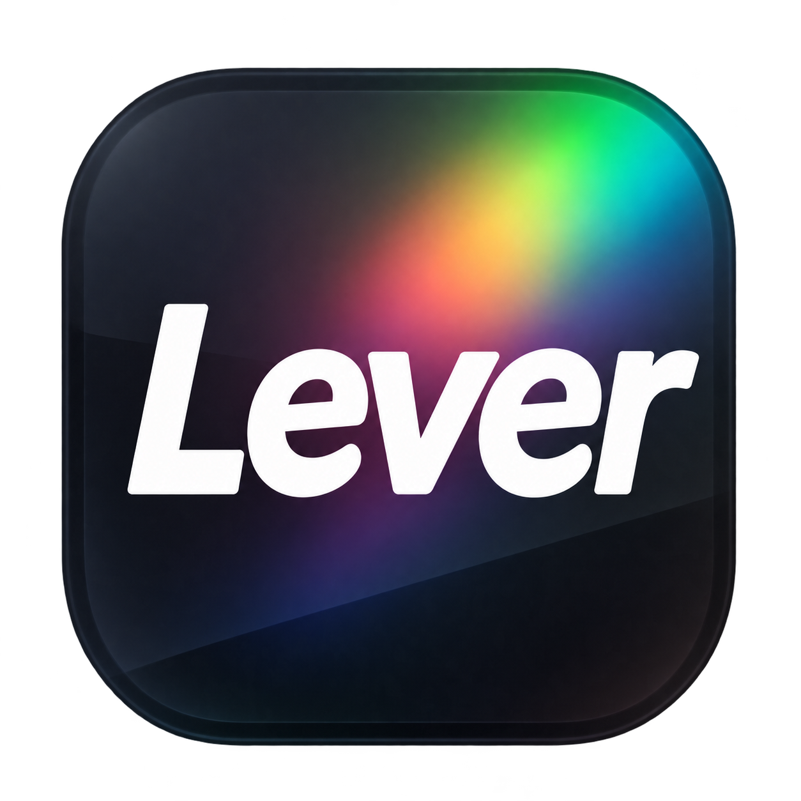

<p align="center">
  
</p>

<h1 align="center">Lever</h1>

<p align="center">
  <strong>A local AI workbench for Agents</strong>
</p>

<p align="center">
  Connect Codex, Claude Code, Pi, DeepSeek Harness, Antigravity, and ACP runtimes. Work with conversations, files, diffs, and terminals in one workspace.
</p>

<p align="center">
  <strong>English</strong> · <a href="README.zh.md">简体中文</a>
</p>

<p align="center">
  <a href="#features">Features</a> ·
  <a href="#quick-start">Quick start</a> ·
  <a href="#runtimes-and-plugins">Runtimes and plugins</a> ·
  <a href="#development">Development</a>
</p>

## Why Lever

Set each Agent's working directories, instructions, Skills, and Delegations. Use the same workspace to chat with that Agent, run Topics in parallel, and review the results.

The native runtime calls models and runs tools using your CLI configuration and credentials. The web UI and desktop app share the same workflow for conversations, files, diffs, and terminals.

## Features

- **Workspace browser.** In the desktop app, open websites or local development servers from the globe icon or the pane's `+` menu. Choose **Select an element**, pick an element on the page, and confirm to add a reference to a Chat or Topic draft. Use the camera button to attach a screenshot of the visible area. The toolbar also offers a floating browser, a separate preview window, device viewports, zoom, hard reload, and DevTools. Browser tabs and separate windows share a sign-in state per Agent. Clearing cookies or cache applies to the current Agent's browser profile. On macOS, you can select a light or dark appearance for each page. On macOS 14 or later, each Agent's browser profile persists across app restarts. In the web UI, the same entry opens the address in a new browser tab.
- **Agent configuration and collaboration.** Set multiple Scope directories, a default runtime and model, permissions, instructions, and Skills for each Agent. Use Delegations to choose which Agents can receive tasks.
- **Native runtimes.** Built-in plugins connect Codex, Claude Code, Pi, DeepSeek Harness, Antigravity, and ACP. Choose a runtime and model, then set the reasoning effort and Fast mode where the runtime supports them.
- **Chats and Topics.** Keep an ongoing conversation in a Chat and run separate Topics in parallel. Each Topic keeps its own context, draft, queue, and unread state.
- **Execution controls.** Follow streamed replies, tool activity, plans, approvals, and questions. Send input during a run, queue messages for the next turn, or stop a Session.
- **Files and terminals.** Browse and search Scope files, edit text with autosave, and preview images, audio, video, PDFs, Markdown, and documents. Reference files and upload images in conversations. Open multiple local terminals and reconnect to them after a page refresh or brief connection loss.
- **Change review.** Inspect snapshots from individual turns, uncommitted changes, commits, and branch diffs. Reference selected changes in the original conversation.
- **Adjustable workspace.** Drag tabs to reorder them or move them between panes. Resize panes and collapse the navigation or sidebar. Lever saves the layout per Agent.
- **Web and desktop.** Both use the same backend and data format. Choose English or Simplified Chinese and a system, light, or dark theme.

## Chats and Topics

A Chat is the conversation you see. A Session holds the runtime execution and context. Regular messages share the Chat's main Session, and each Topic has a separate Session. Stop requests, approvals, and model changes apply to the selected Session.

The main Chat and several Topics can run at the same time. They share the Agent's Scope directories by default, so each Session can see file changes made by another. The main Chat shows a summary for each Topic. Select a summary to view, reply, or reference messages in the sidebar. Topics keep separate drafts and unread states.

Selecting a Chat or Topic uses the pane's preview tab, which has an italic title. Lever keeps the tab open after you start a reply, attach a file, or answer a question. To keep a tab open while you follow a run, double-click the tab or select **Keep tab open** from its context menu.

In the Agent's **Profile**, open **Scope** and manage the directory groups and worktrees. Add worktrees by repository, then save the directories you want to use together as a group. For a repository without a selected worktree, the group uses the default Scope directory. Choose a group when you create a Topic or delegate a task. Lever saves the Topic's working directories when you send its first message. Subsequent messages, Files, Diff, and Terminal use those directories.

Changes to an Agent's instructions, Skills, and Delegations take effect on its next turn. Existing Sessions keep their runtime, model, permissions, and working directories. Changes to Agent defaults apply to new Sessions. When you switch runtimes, Lever creates a native session in the target runtime and passes along the conversation history.

Enter `/compare` in a Chat to have several Agents answer the same message. By default, each Agent uses its own Scope. Turn on **Share scope** to use the current Chat's working directories for every participant. If the Chat has yet to start a main Session, the comparison uses the initiating Agent's default Scope. Agents with write access can edit the same files when they share a Scope.

<details>
<summary>Input, attachments, and queues</summary>

- Use **Chat** and **Topic** in the composer to switch modes. You can also use `/chat`, `/topic`, and `/model`.
- Type `@` to reference files in the current Session's working directories. Type `/` to select a command or a Skill for the current runtime. References stay with the draft and the sent message. Click a file reference to open it in a Files tab in the opposite pane.
- The composer formats Markdown as you type. Select, drag, or paste files into it and preview attached images. Each message can have up to 8 attachments totaling 20 MiB, with a limit of 5 MiB per image.
- Press **Enter** to send and **Shift+Enter** to insert a line break. While a run is active, **Enter** sends input to the current turn (**Steer**), and **⌘/Ctrl+Enter** queues input for the next turn (**Queue**). Swap these actions in **Settings → General → Send while running**. If you set **⌘/Ctrl+Enter** as the send shortcut, press **⌘/Ctrl+Shift+Enter** for the other action.
- After you select another model within the same runtime, **Steer** sends input to the current turn. The selected model becomes the Session's default for the next turn. Use **Queue** when the runtime awaits approval or an answer, or while you switch runtimes or permissions. Runtimes that support Steer can move a queued message into the current turn. You can edit or remove queued messages, or turn a queued message in the main Chat into a Topic.
- Stopping a run or encountering an error pauses that Session's queue. If you restart the backend during a run, the Session keeps its queue and continues processing it after the current turn finishes. To resume another paused queue, select **Resume queue**.

</details>

## Quick start

You need Go 1.27.3, Node.js 24, and pnpm 11. The repository pins pnpm to 11.15.1. Install and sign in to the runtime CLI you plan to use. Lever uses that CLI's configuration and credentials.

Run the following commands from the repository root.

### Run the web UI

```sh
make build
./bin/lever
```

Open the complete local URL printed in the terminal. Lever uses the URL to pair with the browser, then removes the token from the address bar. The default address is `127.0.0.1:4778`. Open it on the machine that runs Lever.

### Run the desktop app

```sh
make desktop
./bin/desktop/Lever
```

### Set up your first Agent

1. Open the runtime page in **Settings**. Under **Discovered on this device**, select the CLI you want to use. For another account or command, select **Add connection**.
2. Use the initial **Lever** Agent or create your own. In **Profile**, select a connection, model, and permissions, then set the Scope directories. By default, Codex and Claude Code load Skills from the user directory and all Scope directories.
3. Open a Chat and send a message. Switch to a Topic when you need separate context. Use **Files**, **Diff**, and **Terminal** to work with the project.

In the desktop app, use the system folder picker to add multiple Scope directories. In the web UI, enter the paths. If you leave the model blank in **Profile**, select a model in the composer.

The web UI and desktop app share a data format. One backend process uses a data directory at a time. By default, Lever stores data in the `Lever` directory under your system's user configuration directory. Set another directory with `--data-dir /path/to/data` or `LEVER_DATA_DIR`.

Active Agents continue running in the background when you close the window or quit the desktop app. Reopen Lever and return to the original Chat or Topic to follow progress, respond to approvals, or view results. To end a run, select **Stop run** in the conversation. After the desktop app closes, the backend exits when all active runs finish.

A separate process hosts the provider for each turn. The runtime continues during a Go backend restart and keeps its output and pending approvals with the same turn. Reopen the same data directory to view output, respond to approvals, or stop the run. If the machine restarts or the execution process is lost, Lever marks unresolved runs as **Outcome unconfirmed**.

## Runtimes and plugins

In **Plugins**, browse, search, enable, or disable installed plugins. Each runtime plugin can have several named connections. Select **Manage connections** in the plugin details to open the runtime settings filtered to that plugin.

### Configure Codex and Claude Code

Lever uses the local CLI's sign-in and configuration by default. It looks for executables in `~/.local/bin` first, then in Homebrew, `/usr/local/bin`, NVM, and the inherited `PATH`. Set an absolute executable path with `LEVER_CODEX_PATH` or `LEVER_CLAUDE_PATH`.

Local connections use `CODEX_HOME` and `CLAUDE_CONFIG_DIR`, which default to `~/.codex` and `~/.claude`, respectively. To use separate accounts, select **Add connection** in the runtime settings. Choose the same runtime and name the connection. **Sign in to another account** creates a separate profile directory and opens the native CLI sign-in terminal. If you already have a separate configuration, select **Use existing profile**. Choose the connection by name in the Agent's **Profile** or in the chat model picker.

The model picker displays the CLI version and path and lets you refresh the model catalog. The runtime reports the available models, reasoning effort levels, and Fast mode.

### Connect Antigravity

Lever detects the local `agy` and uses its sign-in, settings, and native session directory. If you still need to sign in, run `agy --login` in a terminal, then refresh the model list.

To use a separate installation and account, select **Add connection** in the runtime settings. Choose Antigravity and **Use managed ACP runtime**, name the connection, and save it. Select **Install Antigravity**, then **Sign in with Google**. The connection keeps its profile in a separate directory under Lever's data directory.

You can also point the connection to an existing Antigravity ACP executable or set `LEVER_ANTIGRAVITY_PATH` to override the default. Antigravity uses the ACP adapter and queues follow-up input. Fast and Steer are unavailable. Images, multiple directories, and Delegations depend on the capabilities the runtime reports.

### Connect Pi and DeepSeek Harness

Install the CLI on the machine that runs Lever. Sign in or configure a model API key in the terminal. In the runtime settings, find the CLI under **Discovered on this device** and select **Use**. Then select that connection in the Agent's **Profile**.

- Pi uses the configuration in `PI_CODING_AGENT_DIR`, which defaults to `~/.pi/agent`. To set another executable or configuration directory, select **Add connection**.
- Lever launches DeepSeek Harness with `dsh --profile acp`. On macOS it also detects the desktop app in `/Applications`. For a custom installation, enter the absolute executable path in **Add connection**.

You can override the default executable with `LEVER_PI_PATH` or `LEVER_DSH_PATH`.

### Find conversations from the command line

While Lever runs, terminals, scripts, and other Agents under the same system account can query conversations with the local CLI. The CLI returns JSON.

```bash
lever chat list --limit 20
lever context find --chat '<chat-id>' --query 'architecture decision'
lever context read --target '<session-id>'
```

Omit `--query` to list the Chat's recent Topics. To read the main conversation, use `--chat '<chat-id>' --target main`. To read another page, keep the same `--target` and pass the previous page's `nextCursor` JSON to `--cursor` as returned. To connect to another Lever instance, use `--data-dir` or `LEVER_DATA_DIR` to select its data directory.

When Lever starts Pi, it supplies a CLI command scoped to the current Chat and sets up executable lookup. Cross-Chat references and Delegations still require MCP.

### Connect ACP runtimes and install local plugins

To connect an installed ACP command, choose ACP in **Add connection**. Enter the executable and add each argument separately. Sign in through the runtime CLI, then select the connection from the Agent's **Profile** or the model picker.

In **Plugins**, select **Install plugin**. Paste a Git repository URL or select a local directory with a `lever-plugin.json` file. Git plugins support installation from a subdirectory, update previews, and rollback to the previous version. During local development, reload the manifest from the plugin details. For manifest formats and session identity rules, see the [plugin documentation in Chinese](docs/plugins.md).

<details>
<summary>Continue a conversation in its native app</summary>

Open **Agents → Recent** and select a Codex App or Claude Code session. Lever reads the native history and sends new text through the original app in the same session. The open Chat updates when new messages reach the native history.

Codex App opens the corresponding session as needed. On macOS, Lever can also open a Code session in the Claude desktop app. For Claude Code in a terminal, open the original session first and enable it to receive messages from other sessions.

Lever saves the native session ID so a conversation can continue in the same runtime. The main Chat and each Topic keep their own ID. Whether a native app can find or resume a session depends on the runtime and local configuration.

For Chats and Topics created in Lever, wait for the current run to finish before continuing in the native app. New messages you send in the native app stay in its history. Switching runtimes creates a new session in the target runtime.

</details>

## Files, terminals, and change review

<details>
<summary>Edit and search files</summary>

In Files, you can edit UTF-8 text in Scope up to 2 MiB per file. Lever autosaves 500 ms after you stop typing. You can also select **Save** or press **⌘/Ctrl+S**. Saving continues when you switch files or tabs. If saving fails, the draft stays available while the app is open. If the file changed on disk, download the draft or reload the disk version. Lever discards the draft after it successfully loads the disk version.

Select the path or filename at the top to open the directory tree. Markdown opens in preview by default. Lever remembers whether you last chose source or preview. Filter the directory tree by path. **Search in files** ignores case, follows Git ignore rules, and skips binary files and files larger than 2 MiB. Select a result to jump to its line.

Files previews images with zoom and pan. The supported formats are PNG, JPEG, GIF, WebP, SVG, AVIF, BMP, ICO, HEIC, HEIF, and TIFF. Files also previews audio, video, PDF, static HTML, Markdown, MDX, Mermaid, CSV, TSV, and TTF, OTF, WOFF, and WOFF2 fonts. For documents, it supports DOCX, XLSX, PPTX, ODT, ODS, ODP, RTF, EPUB, and Jupyter Notebook. It can list the contents of ZIP, JAR, TAR, GZ, and TGZ archives and show SQLite tables.

Document previews focus on content. Complex layout, charts, formulas, and animations may render differently. HTML previews render static content without scripts or external resources. Audio and video codecs depend on the browser. Binary previews are read-only. You can download unsupported files from the file actions menu.

Files loads document, archive, and database parsers in a separate worker on demand. The limit is 50 MiB per file, with a 30-second timeout. Fonts have a 10 MiB limit, and notebooks and RTF have an 8 MiB limit. Archive contents have additional limits. Tables and databases use paginated views, and a notice appears when Files truncates a document preview. Files streams the original image, audio, or video directly, beyond the 2 MiB text editing limit. Audio and video support HTTP Range requests.

</details>

<details>
<summary>Use interactive terminals</summary>

Open multiple system shells in Terminal. Each shell starts in the Agent's primary Scope directory by default. Terminal supports zoom, Chinese input and output, scrollback, and **Ctrl+C**. Terminal sessions stay open when you switch tabs or Agents. After a page refresh or brief disconnect, Lever can reconnect to the same running shell. Closing a terminal tab ends its shell. Stopping the backend ends its terminals.

Commands run with your local user's permissions. Scope sets the shell's starting directory. The model's approval and read-only settings apply to runtime tools.

</details>

<details>
<summary>Review diffs and turn changes</summary>

Diff can show the latest turn, uncommitted changes, unstaged or staged changes, a single commit, or a branch comparison. Choose unified or side-by-side view, word-level diffs, line wrapping, or full context.

When a turn has changes to preview, a file summary appears below the reply. Open the summary, select line numbers by clicking or dragging, and select **Discuss selection**. Lever adds the code, path, and line numbers to the original Chat or Topic draft. Each reference keeps the code you selected at the time.

For Codex, turn changes show the cumulative patch that the runtime reports. The patch may omit writes made by shell commands. If multiple tasks edit the same file at the same time, it may include edits from those other tasks. Open the latest-turn diff from a Chat or Topic to see that Session's changes. Refresh to see newer completed turns.

For turns that use Git snapshots, the same view shows the difference between the snapshots from before and after the turn. This includes turns from other runtimes or older runs with snapshots. The diff includes new files that Git does not ignore and can include edits from concurrent tasks. Snapshot capture is read-only with respect to your Git index, HEAD, and working files. Lever can show native Codex patches in directories outside Git repositories.

</details>

## Development

### Reload the desktop app during development

On macOS, run the restart script.

```sh
./scripts/restart-desktop.sh
```

The script installs the frontend dependencies, builds the Go binaries, and replaces the desktop window and backend for the selected data directory. Active providers continue running. The new window reconnects to the same turn and any pending approvals. When upgrading from an older version for the first time, the script waits for active runs from that version to finish. You can still respond to approvals in the original window while it waits. A local Vite server provides hot reload.

The script supports `--data-dir`, `--listen`, and `LEVER_DATA_DIR`. In development, the backend proxies frontend assets and hot module replacement. The API, pairing, and page settings share the same origin.

### Reload the web UI during development

Install the frontend dependencies.

```sh
pnpm --dir web install --frozen-lockfile
```

Run these commands in separate terminals.

```sh
make dev
```

```sh
pnpm --dir web dev
```

Open the URL labeled **Lever:** in the backend output on port 4778, or the one labeled **Development:** on port 5179. Both use the local backend. Vite serves the frontend directly in development.

### Build desktop packages

```sh
make package
# Also build the Windows executable.
make package TARGETS=darwin/arm64,windows/amd64
```

Find the output in `desktop/dist/`. The default target is macOS on Apple Silicon, with local ad hoc signing. Both commands skip the macOS DMG and Windows installer. For a release, configure signing and notarization, and verify the package on the target platforms.

### Verify changes

```sh
make privacy
pnpm --dir web install --frozen-lockfile
pnpm --dir web exec playwright install chromium
make test
go vet ./...
```

`make test` runs the privacy check, Go race tests, a production frontend build, and Playwright end-to-end tests. Integration tests use HTTP, SQLite, and CLI protocol fixtures to cover sessions, approvals, cancellation, Delegations, and file boundaries. The fixtures stand in for the real models.

To run the Chat switching benchmark on its own, build the web UI and run its spec.

```sh
pnpm --dir web build
pnpm --dir web test:e2e chat-switch.spec.ts
```

The benchmark uses six Chats with 52 turns each and fixed history responses. It measures the time between a click on a Chat tab and its latest message becoming visible. Chromium's 90th-percentile limits are 180 ms for the first open and 100 ms when returning to a loaded Chat. With Playwright WebKit installed, add `--browser=webkit` for limits of 200 ms and 140 ms, respectively. The terminal prints the P90, and the Playwright report includes the timing of each switch.

The privacy check requires Python 3. By default it scans the paths and text of tracked files and new files that Git does not ignore. It checks for local user paths, private IPv4 addresses, non-example email addresses, internal URLs, and common secret formats. To scan the staged contents, run `python3 scripts/privacy_check.py --staged`. The check reports only the file location and issue type for each finding.

Add company names, internal domains, internal project names, and other private terms to `.private-words.txt`, one per line. Start a line with `#` to add a comment. Git ignores this file. To share the list across workspaces, put it in `${XDG_CONFIG_HOME:-~/.config}/lever/private-words.txt`. The check uses these local lists to detect organization-specific terms.

After you change Go DTOs or desktop bindings, regenerate the types.

```sh
make generate
```

<details>
<summary>Test against real runtimes</summary>

Live runtime tests require an opt-in and use the model quota of your signed-in account. Replace `<available-model>` with a model your account can use.

```sh
LEVER_LIVE_TEST=1 LEVER_LIVE_CODEX_MODEL='<available-model>' \
	go test ./internal/provider -run TestLiveRuntimes/codex -v -count=1

LEVER_LIVE_TEST=1 LEVER_LIVE_CLAUDE_MODEL='<available-model>' \
	go test ./internal/provider -run TestLiveRuntimes/claude -v -count=1

# Test the model catalog, images, and Fast mode together.
LEVER_LIVE_TEST=1 go test ./internal/provider -run TestLiveComposer -v -count=1
```

</details>

## More documentation

- Agents, Chats, Sessions, the execution lifecycle, and the application architecture. [Design documentation in Chinese](docs/design.md)
- Plugin manifests, provider configuration, and ACP support. [Plugin documentation in Chinese](docs/plugins.md)

## License

Lever is licensed under the [Apache License 2.0](LICENCE).
