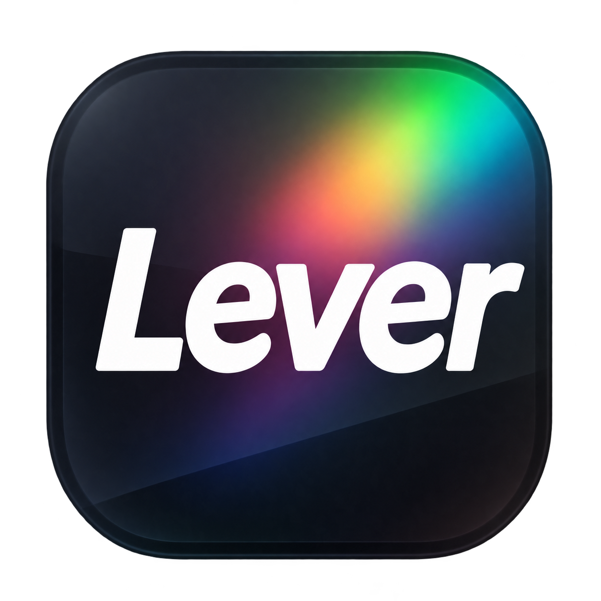
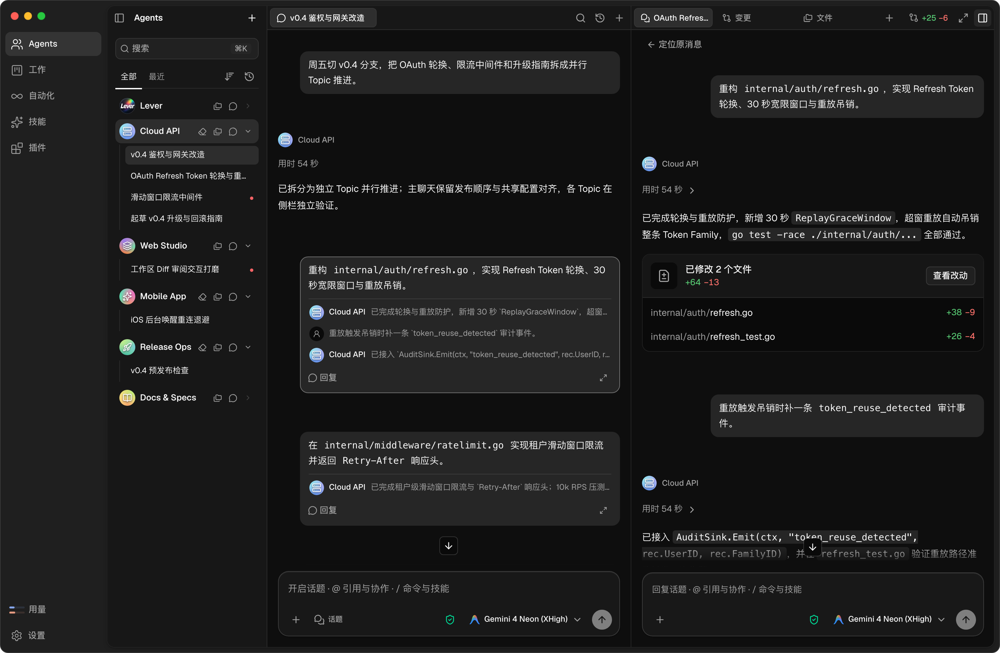
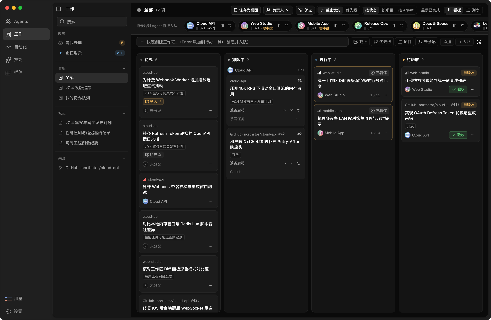
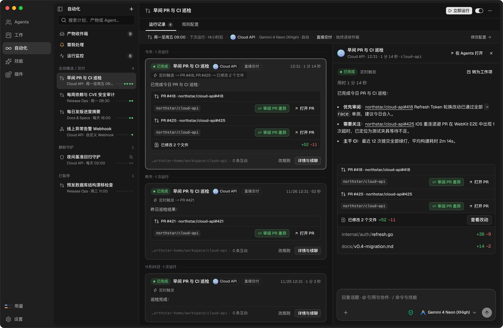

<div align="center">

<p>
  
</p>

<p><strong>为高并发协作而生的本机 AI 工作台</strong></p>

<p>
  统一编排 <strong>Codex</strong>、<strong>Claude Code</strong>、<strong>Pi</strong>、<strong>DeepSeek Harness</strong>、<strong>Antigravity</strong> 与 <strong>ACP</strong> 原生运行时——<br />
  在一个轻量本机应用中融合并行 Topic、持久化 Agent、内建工程工具、Works 看板与自动化。
</p>

<p>
  <a href="LICENCE"></a>
  
  
  
  
  
</p>

<p>
  <a href="README.md">English</a> · <strong>简体中文</strong>
</p>

<p>
  <a href="#设计理念">设计理念</a> ·
  <a href="#快速开始">快速开始</a> ·
  <a href="#lever-的不同之处">不同之处</a> ·
  <a href="#核心能力">核心能力</a> ·
  <a href="#支持的运行时">运行时</a> ·
  <a href="#开发指南">开发指南</a>
</p>

</div>



<details>
<summary>查看更多界面截图</summary>

### 工作



### 自动化



</details>

## 设计理念

早期的 AI 工具把我们训练成了「长对话」工作流：先铺垫背景，等一段不完整的回复，再追问纠偏三四轮，所有新任务不断往同一条时间线上堆——或者干脆不停新开临时窗口，最后散落一地、再也找不到上下文。

**但今天人与 Agent 的协作节奏正在发生变化。** 随着 Agent 对人类意图的理解越来越准确，单个任务已经越来越不需要反复多轮对齐；大多数事情本身就是彼此独立的话题——说清目标即可交付执行，只在必要时深入追问或验收结果。

因此，人与 Agent 的交互形态应该从**「连续对话为主」**转向**「独立话题为主、连续对话为辅」**。Lever 正是围绕这一判断构建的：

> **Topic 间弱联系 + Topic 内强连续 = 高并发度**

```text
同一个 Agent · 同一条 Chat 时间线
├── 主聊天            ──► 持续对齐背景与日常沟通
├── Topic A (运行中)  ──► [Worktree A · Codex]       重构鉴权流程     ──► 侧栏深入追问 + Diff 划行反馈
├── Topic B (运行中)  ──► [Worktree B · Claude Code] 修复移动端布局   ──► 从工作区浏览器直接拾取 DOM 元素
└── Topic C (待确认)  ──► [默认 Scope · Pi]          整理发布说明     ──► 队列已就绪，完成后自动续跑
```

- **Topic 间弱联系**：每个 Topic 共享同一个 Agent 的持久化设定与同一条 Chat 时间线视图（以实时摘要呈现），一眼看清全局进展，却不会互相污染上下文窗口，也不会彼此阻塞执行。
- **Topic 内强连续**：当某个任务确实需要反复打磨时，点开摘要即可在侧栏进入专属会话——它拥有独立的运行时、模型、Worktree 目录组、草稿、消息队列与未读状态，可以持续深挖直到交付。
- **天生高并发**：同一个 Agent 下可以同时跑着主聊天与多条并行 Topic，你在同一工作区里顺滑切换、审阅文件与代码变更，不再被单线程聊天或零散窗口拖慢节奏。

## 快速开始

### 让你的 Agent 帮你安装

如果你已经在用 Codex、Claude Code、Pi、Antigravity 等本机 Agent，可以直接复制下面的提示词，让它帮你完成安装：

```text
帮我在这台电脑上安装 Lever（https://github.com/alfredxw/lever）。
先查看仓库 README 和 GitHub Releases：如果已有适配当前系统的桌面安装包就直接安装；否则克隆仓库，检查 Go 1.27.3、Node.js 24 和 pnpm 11 后编译桌面应用（`make desktop`，或用 `make build` 构建 Web 版）。
安装完成后启动 Lever，并确认本机已登录的运行时 CLI（如 Codex、Claude Code、Pi、Antigravity）可以正常识别。
```

如果之前在其他 Agent 应用（如 Codex App、Claude 等）里配置了 **Projects** 或**定时任务**，也可以在 Lever 启动后让你的 Agent 顺手迁移过来。项目会映射为带目录 **Scope** 的 Lever **Agent**，定时任务会映射为 **Automations**：

```text
帮我检查这台电脑上其他 Agent 应用（如 Codex App、Claude 或其他本机 Agent 工具）里现有的项目（Projects）和定时任务，并迁移到 Lever。
通过 Lever 本机 CLI（桌面端或 `lever` 可执行文件）把项目创建为带对应目录 Scope 的 Agent（`agent create`），把定时任务迁移为 Automations（Codex App 可先用 `automations import-codex --dry-run` 预览，其他工具用 `automations create`）。
在正式创建或停用原应用的定时任务前，先给我看一份迁移清单，等我确认后再执行。
```

### 手动安装

**环境准备：** Go `1.27.3`、Node.js `24`、pnpm `11`（固定版本 `11.15.1`），并至少登录一个本机运行时 CLI。

<table>
<tr>
<td width="50%" valign="top">

**运行 Web UI**

```sh
make build
./bin/lever
```

打开终端打印的完整本机链接（默认 `127.0.0.1:4778`，仅本机访问，一次性 token 配对后自动清除）。

</td>
<td width="50%" valign="top">

**运行桌面应用**

```sh
make desktop
./bin/desktop/Lever
```

使用同一 Go 后端与 SQLite 存储启动原生桌面窗口，并额外提供内置工作区浏览器与系统文件夹选择器。

</td>
</tr>
</table>

启动 Lever 后：

1. **连接 CLI**：打开 **设置 → 运行时**，启用本机发现的 CLI，或点击 **添加连接** 配置多账号。
2. **配置 Agent**：直接使用初始 **Lever** 或新建专属 Agent，在 **Profile** 中设置连接、权限与 **Scope** 目录。
3. **高并发协作**：日常在 **Chat** 沟通，遇到独立任务随时发成 **Topic** 并行推进，旁边随时打开 **Files**、**Diff**、**Terminal** 与**工作区浏览器**验收。

> [!NOTE]
> Web 与桌面共用同一数据目录（默认 `<系统用户配置目录>/Lever`，可用 `--data-dir` 或 `LEVER_DATA_DIR` 指定）。关闭桌面窗口后活跃任务会在后台继续执行，重启 Go 后端也不会中断当前轮次。

## Lever 的不同之处

在同样支持聚合多种本机编码 CLI 的前提下，Lever 在**对话形态、顶层抽象与验收闭环**上走了不同的路：

| 维度 | 常见的多 Agent 聚合形态 | Lever 的方式 |
| :--- | :--- | :--- |
| **对话组织方式** | 单条越来越长的线性聊天，或彼此孤立的零散分支线程 | **独立 Topic 为主、连续 Chat 为辅** —— Topic 间弱联系共享全局视野，Topic 内强连续支持深入迭代 |
| **顶层组织单位** | 按单个仓库开窗口、一次性临时线程，或异步团队工单 | **持久化 Agent** —— 一次配好跨仓库 **Scope**、Git **worktree 目录组**、原生指令、**Skills**、**委派**与布局，新 Topic 开箱即用 |
| **执行控制力** | 干等执行完成，或直接中断丢掉上下文 | **Steer、Queue、暂停与继续** —— 运行中实时纠偏、排队或一键转 Topic；每轮独立进程承载，关窗或重启后端任务不中断 |
| **多账号与原生互通** | 每个 CLI 单账号运行，或单线程绑定死一个运行时 | **多命名账号并行**（如个人 + 工作账号）、会话内热切运行时并自动交接历史、`/compare` 多 Agent 对比，以及 **Codex App / Claude Code 续聊** |
| **审阅与验收闭环** | 在聊天工具、IDE、终端与外部浏览器之间来回切换 | **一体化本机工程工作台** —— Monaco **文件**与 25+ 格式预览、可划行反馈的 **Diff**、持久 **PTY 终端**、支持 DOM 元素拾取的**工作区浏览器** |
| **对话之外的工作流** | 纯被动提问回复，或需要额外部署的服务端看板 | **轻量本机工作中枢** —— 块**笔记**、同步 **GitHub / Lark Todos** 的看板、定时与事件**自动化**、**Lark Bot**，全部收进**单 Go 二进制 + 原生 WebView + SQLite** |

## 核心能力

### 并行 Topic 与实时执行控制
- **主聊天 + 并行 Topic 混合时间线**：需要连续探索时在主聊天对话，任务一拆开就随手发成独立 **Topic** 并行推进。主聊天中展示 Topic 的实时摘要，点击在侧栏展开完整会话，各话题独立保存草稿、队列与未读状态。
- **Steer、Queue、暂停与继续**：运行中可用 **Steer**（<kbd>Enter</kbd>）实时追加纠偏，或用 **Queue**（<kbd>⌘/Ctrl</kbd>+<kbd>Enter</kbd>）排队后续指令；排队消息可编辑、移除、插入当前轮，或把主聊天的排队消息一键转为独立 Topic。受支持的运行时还可随时**暂停 / 继续回复**，保留已生成内容。
- **进程隔离不中断**：每轮执行由独立 provider 进程承载。关闭桌面窗口或重启 Go 后端都不会中断运行中的 Agent，重新打开即可接回实时输出与待审批请求。
- **现代输入框**：Markdown 即时排版、`@` 引用（文件、对话/话题、Agent、笔记/工作项）、`/` 选择命令与 Skills，支持拖入/粘贴图片与文件附件。

### 持久化 Agent、多账号与原生互通
- **一次配置，每个 Topic 即刻开跑**：为每个 Agent 配置多目录 **Scope**、可复用的 Git **worktree 目录组**（Topic 首发时自动锁定）、默认运行时与模型、权限策略、原生系统指令、**Skills** 与一层 MCP **委派（Delegations）**。
- **多账号并行与跨运行时热切**：同一个 CLI 可同时维护个人与工作等多个命名账号。会话中途切换运行时时，Lever 会自动在目标运行时创建原生会话并携带当前会话历史平滑交接。
- **`/compare` 多 Agent 对比与原生续聊**：输入 `/compare` 让多位 Agent 同时回答同一条消息（默认隔离各自 Scope，也可开启共用当前 Scope）；在 **Agents → 最近** 可直接打开并续聊本机 **Codex App** 与 **Claude Code** 会话；导航栏实时展示受支持运行时的订阅额度窗口。

### 一体化本机工程工作台
- **工作区浏览器**（桌面端）：在对话旁直接打开本机开发服务或网页。点击**选择元素**即可把网页 DOM 选择器与可见文本直接引用进 Chat 或 Topic 草稿，点击相机一键附带可视区截图；内置设备视口、缩放、悬浮窗/独立预览窗、DevTools、macOS 单页深浅外观切换，以及按 Agent 隔离且跨重启保留的登录态（macOS 14+）。
- **聊天中的 HTML 文件**：独占一段的本地 HTML 链接和已发送的单个 HTML 附件会在消息内展开。正文或章节链接可点击展开、收起。预览标题栏直接提供**快速预览**、**在网页标签中打开**和复制路径等图标。桌面版的**在系统浏览器中打开**会直接打开磁盘上的原文件，无需经过 Lever 地址或配对浏览器；网页版可**下载原始 HTML 文件**。作为单个附件分享报告时，请把引用的图片嵌入 HTML。
- **文件编辑与 25+ 格式预览**：跨多 Scope 根目录浏览与搜索（遵循 `.gitignore`），内置 **Monaco** 编辑器（500 ms 自动保存与磁盘冲突保护），直接只读预览图片、音视频、PDF、Mermaid、Office 文档、Jupyter Notebook、压缩包与 SQLite 数据表。
- **轮次与 Git Diff 划行反馈**：查看最近一轮 Codex 补丁或只读 Git 快照、未提交/暂存、单次提交与分支差异（统一或并排视图）。点击或拖选行号再点**反馈这段变更**，将带路径和行号的代码快照直接引用回原 Topic 草稿。
- **持久 PTY 终端与记忆布局**：在 Agent 主 Scope 目录打开多个本机 Shell，切换标签或刷新页面自动重连；标签支持整项拖拽排序与跨栏移动，每个 Agent 独立记忆分栏布局，提供简体中文 / English 与跟随系统 / 浅色 / 深色主题。

### Works、自动化、Skills 与插件生态
- **Works（笔记 + 看板 + 外部来源）**：用块编辑器记录工作笔记并内嵌待办与 `@Agent` 交接，在支持自定义分组与视图的 **Board** 看板统一管理，自动同步 **GitHub Issue/PR** 与 **Lark Todos** 并一键派发给 Agent。
- **自动化**：让 Agent 主动干活——支持定时触发（单次、每天、工作日、指定星期、每月、固定间隔）与事件触发（**IMAP 邮件**、带 Bearer Token 与 `Idempotency-Key` 的自定义 **Webhook**），执行结果自动进入新 Topic、原 Chat 或看板工作项。
- **Skills 与插件生态**：统一浏览、筛选并按 Agent 启停 Lever 托管目录、用户目录与 Scope 目录下的 Skills（托管的 `SKILL.md` 可直接在 Files 编辑）。内置 **Lark Bot** 和 **Larkx** 消息渠道，也可通过 Git 仓库（子目录、版本锁定、更新预览与一键回退）或本地目录安装运行时、任务源、事件源与个人消息渠道插件。

## 支持的运行时

Lever 直接编排本机已安装的 CLI 与 ACP 服务，沿用原有登录态与订阅额度，不修改你的全局 CLI 配置。

| 运行时 | 接入方式 | 核心特性 | 路径环境变量 |
| :--- | :--- | :--- | :--- |
| **Codex** | 原生协议（`app-server`） | 多账号、Steer、暂停/继续、Skills、Fast、Codex App 续聊 | `LEVER_CODEX_PATH` |
| **Claude Code** | 原生协议（`stream-json`） | 多账号、Steer、暂停/继续、Skills、Fast、桌面/CLI 续聊 | `LEVER_CLAUDE_PATH` |
| **Pi** | 原生 RPC | 多账号、Steer、Skills、每轮授权的 Lever 工具、当前 Chat 查询 CLI | `LEVER_PI_PATH` |
| **Antigravity** | 本机 `agy` / 托管 ACP | 本机 `agy acp` 1.5.0+ 可 Steer；独立托管连接按握手启用能力 | `LEVER_ANTIGRAVITY_PATH` |
| **DeepSeek Harness** | 内置 ACP（`dsh`） | 自动检测 CLI 与 macOS 桌面版（`/Applications`） | `LEVER_DSH_PATH` |
| **自定义 ACP** | 通用 ACP v1 | 任意 ACP 可执行命令与参数，或 `lever-plugin.json` 插件包 | 自定义命令 |

各连接的追加、暂停、会话恢复、附件和权限差异见[运行时基础能力表](docs/provider-capabilities.md)。

> [!TIP]
> 除上述 6 个运行时插件外，Lever 还内置 **GitHub**、**Lark Todos**、**IMAP Mail**、**Lark Bot** 和 **Larkx 个人渠道**。Larkx 支持 macOS 和 Linux 后端。各插件均可在侧栏 **插件** 页面管理。

<details>
<summary><strong>运行时配置提示、原生应用续聊与本机 CLI</strong></summary>

- **多账号连接**：在 **设置 → 运行时 → 添加连接** 可为 Codex / Claude Code 创建独立配置目录并打开原生登录终端（查找顺序：`~/.local/bin` → Homebrew → `/usr/local/bin` → NVM → `PATH`；遵循 `CODEX_HOME`、`CLAUDE_CONFIG_DIR`、`PI_CODING_AGENT_DIR`）。
- **原生应用续聊**：在 **Agents → 最近** 可直接读取并续聊本机 **Codex App** 与 **Claude Code** 会话；在 Lever 新建的对话需等当前轮结束后再在原生应用续聊。
- **通过本机 CLI 操作各模块与通信（JSON）**：
  ```sh
  lever agent list --full
  lever providers models --provider codex
  lever chat send --agent '<agent-id>' --operation topic --text '汇总今日进展' --wait
  lever run answer --request '<request-id>' --allow=true
  lever context find --chat '<chat-id>' --query '架构决策'
  lever context read --target '<session-id>' # 或 --target main
  lever automations create --name '每日巡检' --agent '<agent-id>' --time 09:00 --model '<model>' --permission auto_review --prompt '...'
  lever automations import-codex --dry-run
  lever work-items list && lever notes list && lever events tail --type runs
  ```

</details>

## 开发指南

| 任务 | 命令 | 说明 |
| :--- | :--- | :--- |
| **应用 Go 改动**（macOS） | `./scripts/restart-backend.sh` | 编译 Go、重启后端，并重新打开桌面窗口，继续使用热更新 |
| **恢复桌面前端**（macOS） | `./scripts/restart-frontend.sh` | 重启 Vite 并刷新当前窗口，后端与运行中的任务继续执行。先用 `./scripts/restart-backend.sh` 启动桌面。 |
| **应用 Go 改动**（Windows） | `pwsh -File .\scripts\restart-desktop.ps1` | 编译 Go，等待依赖旧后端的任务结束，再重启后端并打开支持热更新的桌面窗口。可用 `-Port` 或 `-DataDir` 覆盖默认的 `4779` 或 `.lever/`。 |
| **浏览器热更新** | `make dev` + `pnpm --dir web dev` | 先执行 `pnpm --dir web install --frozen-lockfile`，访问 `4778` / `5179` 端口 |
| **打包桌面应用** | `make package` | 输出到 `desktop/dist/`；加 `TARGETS=darwin/arm64,windows/amd64` 同步构建 Windows |
| **重新生成类型** | `make generate` | 修改 Go DTO 或桌面绑定后同步 TypeScript 类型 |
| **完整测试验证** | `make test && go vet ./...` | 运行隐私检查、Go `-race` 测试、前端构建与 Playwright E2E |

<details>
<summary><strong>性能基准、隐私检查与真实运行时测试</strong></summary>

- **Chat 切换基准**：`pnpm --dir web build && pnpm --dir web test:e2e chat-switch.spec.ts`（6 个 Chat × 52 轮；P90 上限：Chromium 首次打开 180 ms / 切回 100 ms；WebKit 200 ms / 140 ms）。
- **隐私检查**：`make privacy`（暂存区用 `python3 scripts/privacy_check.py --staged`）。自定义敏感词可写入 `.private-words.txt`（已 Git 忽略）或 `${XDG_CONFIG_HOME:-~/.config}/lever/private-words.txt`。
- **真实运行时测试**（需显式开启，消耗账号额度）：
  ```sh
  LEVER_LIVE_TEST=1 LEVER_LIVE_CODEX_MODEL='<model>' go test ./internal/provider -run TestLiveRuntimes/codex -v -count=1
  LEVER_LIVE_TEST=1 LEVER_LIVE_CLAUDE_MODEL='<model>' go test ./internal/provider -run TestLiveRuntimes/claude -v -count=1
  LEVER_LIVE_TEST=1 go test ./internal/provider -run TestLiveComposer -v -count=1
  ```

</details>

## 更多文档与许可证

- [设计文档](docs/design.md) — Agent、Chat、Session、执行生命周期与模块边界
- [插件说明](docs/plugins.md) — 插件清单（`lever-plugin.json`）、Provider、任务/事件源与消息渠道
- [多设备与自托管 Hub 设计草案](docs/remote-devices.md) — 远程 Host、Hub 同步与移动端控制端的拟议架构

本项目采用 [Apache License 2.0](LICENCE) 开源。
