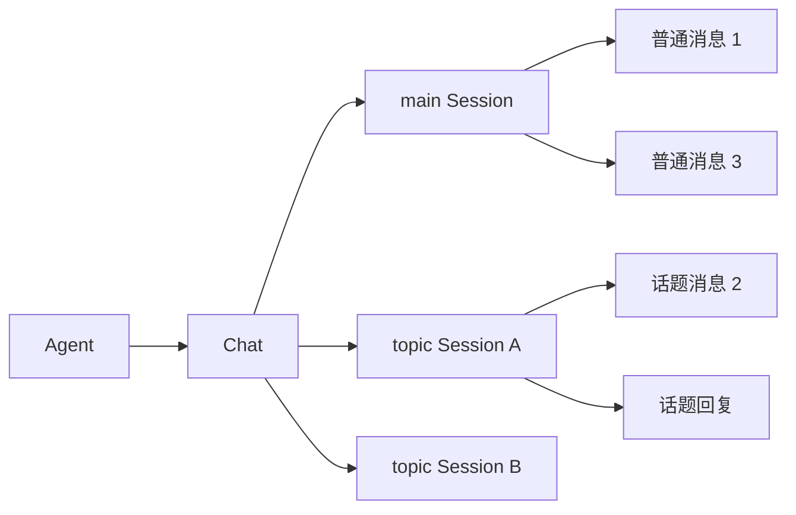

# Lever：以 Agent 为中心的运行时管理工作台

更新：2026-11-07。本文记录当前实现的模型、边界与后续范围。

## 1. 产品定位

Lever 管理已经存在的 Agent runtime。用户先定义 Agent，再与它对话、查看其工作目录和审阅变更。目录是 Agent 的 Scope，不是应用的顶层组织单位。

Go 后端管理 Codex、Claude Code、Pi、Antigravity 和 ACP 进程的会话引用、审批与输出，DeepSeek Harness 使用同一 ACP 适配层。模型调用、工具执行、上下文压缩和推理循环仍由 runtime 完成。Lever 不实现另一套 agent loop，也不直接调用模型 API。

第一版只交付 Agents 工作区及必要设置。Tasks、Plugins、Integrations 保留在产品规划中，不展示可点击但不可用的空页面。

## 2. 界面与操作

工作台使用 React、TypeScript、shadcn/ui、Tailwind CSS，分为三级：

```text
一级导航（可拖拽收起）       同一个圆角工作区
                         ╭──────────────────┬────────────────────────────────╮
Lever                    │ Agents        ＋ │ Chat | 文件 | 变更 | 配置   ＋ │
                         │ 搜索             ├────────────────────────────────┤
Agents                   │ 全部 / 未读      │ 普通消息                       │
                         │                  │ ┌ 话题：讨论 API ──────────┐ │
                         │ 代码搭档         │ │ Agent 回答 / 用户继续回复 │ │
                         │ 审阅搭档         │ └──────────────────────────┘ │
                         │ 文档搭档         │ 后续普通消息                   │
外观                     │                  │                                │
设置                     │ 本机             │ 输入…   连续聊天 ▾       发送 │
                         ╰──────────────────┴────────────────────────────────╯
```

二级列表展示 Agent、最近 Chat 标题与执行/待确认状态；可以搜索、按最近活动查看和归档。主区域支持多个 Chat，以及 Files、Diff、Terminal、Profile 等可关闭的 Tab。打开的 Tab、选中 Agent、主题、语言、导航宽度、消息草稿和待确认发送的 commandId 保存在客户端。

- **Chat**：流式 Markdown、工具活动、审批、问题回答、停止和未确认结果处理。
- **Files**：浏览多个 Scope 根目录，使用 Monaco 编辑文本并自动保存。语言资源和 worker 均随应用打包，不依赖 CDN。
- **Diff**：使用 Pierre Diff 展示本地工作区、暂存区、未暂存区和两个 Git revision 的差异，支持统一/并排视图。未跟踪文件可跳转到 Files。
- **Terminal**：xterm + 本机 PTY，通过已有认证与同源检查保护的 WebSocket 连接。每个终端窗格由后端持有独立 PTY，使用对应 Agent 或 Topic 的工作目录。刷新恢复分屏布局并重连原 Shell。连接断开后保留 30 秒，重连时先回放有界的内存输出，再恢复实时输入和输出。主动关闭窗格或标签、断线超时或后端退出时清理终端作业。输出使用有界确认窗口，避免高速输出积压。
- **Profile**：编辑 Agent 名称、职责、运行时、目录、Skills、权限与 Delegations。

一级导航位于浅灰/深灰画布上，二、三级共用一个 12px 圆角容器，外侧留白 8px。二级列表顶部与三级 36px 标签栏对齐；当前 Tab 使用中性底色和圆角，不另叠一层标题栏。

二级侧栏和右侧分栏收展时，正文随可用宽度自然换行；开启系统「减少动态效果」时直接切换。分栏控制固定在工作区右上角，使用 `PanelRight`；历史入口只保留在主栏。右栏为空时打开新标签菜单；收起已有分栏时保留标签、草稿和终端连接。最大化只占满工作区，还原保留原分栏比例；收起后再次展开回到普通分栏。Files 内的目录显隐使用 `Folders`，与工作区分栏区分。

一级导航默认展开至 160px。macOS 支持在 52–288px 之间连续拖动，松手时保存实际宽度。全屏态下，导航缩到 80px 以下时，Lever 字标淡出，App 图标淡入。窗口态下，红绿灯下方沿一级导航底色向工作区渐变，导航覆盖红绿灯后恢复完整的圆角边框。默认字号下，一级导航达到 96px 时显示图标和标签，较窄时居中显示图标。

Web 和 Windows 的展开范围为 112–288px。收起宽度为 52px，收起时保留上次展开的宽度。Escape、失焦或取消指针操作会撤销拖拽，分隔条也支持方向键、Home、End 和 Enter。

Tabs 在 96–160px 之间缩放，超出时水平滚动。切换时会露出当前标签，也支持用方向键导航。窗口宽度不超过 760px 时使用图标栏，Agents 列表覆盖工作区，可单独收起。

工作台排序拖拽统一保留普通箭头，移动元素本体并限制在所在行或列，不生成浮动副本。标签排序和主、副分区之间移动共用同一实现，始终留在标签行内；邻项让位，边缘自动滚动，松手提交，Escape 撤销。同区排序保留当前选中页。

使用 i18next / react-i18next 提供简体中文和英语；首次按浏览器或桌面语言选择，可在设置中切换并记住。语言包由 TypeScript 检查键集合一致，涵盖标签、表单、状态、空态和无障碍名称。用户消息、Agent 名称、文件名、Provider 输出与原生错误保留原文。桌面通过一个 mygo 外观绑定同步语言，原生菜单和退出提示使用相同语言。

界面保持紧凑、低干扰；以细边界区分区域，绿色用于执行状态与话题线索。聊天 Markdown 使用 Streamdown，外部链接在独立窗口打开，图片不自动从模型提供的地址加载。

## 3. Chat、Topic 与 Session

**同一个 Chat 内，发送方式由每条消息决定。Chat 没有全局 mode。**

| 用户操作 | Session 路由 | 时间线表现 |
| --- | --- | --- |
| 连续聊天 | 复用该 Chat 的 main Session；首次发送时创建 | 普通用户消息和回复 |
| 新话题 | 创建该 Chat 下新的 topic Session | 用户消息气泡内展示最近三条回复摘要，侧栏承载完整对话 |
| 话题内回复 | 复用明确指定的 topic Session | 追加到原话题内部 |
| 话题后发送普通消息 | 仍然回到原 main Session | 出现在混合时间线后续位置 |



核心不变量：

1. 每个 Chat 最多一个 main Session，由 SQLite 部分唯一索引保证。
2. 每次接受的用户输入由一个具有独立 commandId 的 Run 记录。Steer 的 Run 不启动第二个进程，其消息快照投影到目标 Run 的 Items 中，保留流式输出中的实际位置。Topic 根消息属于其自身 Session，不再发送给 main。
3. 混合时间线由 main 已出队执行的 Run 和每个 topic 的首个 Run 投影而成。主聊天的排队消息、已移除和已投递的 steer 记录不另占一轮。已接受但仍排队的 Topic 保留根消息，以便重启后恢复；移除未执行的根消息时，下一条未移除的消息成为根。数据库分配的 `sequence` 决定顺序，流式更新、话题回复和刷新不会改变根消息的位置。
4. Topic 与 main 共用执行、审批、停止、持久化和 Provider 适配逻辑。Topic 是 Session 的一种组织方式，不是另一套执行实体。
5. 同一个 Session 只能有一个进行中或未确认的 Run。不同 Session 并行执行，不共享原生会话 ID；Agent 和 Chat 只汇总状态，不占用执行槽。
6. Session 保存自己的工作目录和 Selection。Agent 的运行时、模型、权限和目录只作为新会话默认值；Instructions、Skills 和 Delegations 在每轮开始执行时读取最新配置。当前执行及其 Steer 保持同一份配置，排队消息开始执行时读取新配置。输入框中的选择不修改 Agent Profile。
7. `commandId` 在数据库唯一；相同 ID、相同输入返回原 Run，相同 ID、不同输入报冲突。客户端在请求前保存该 ID，网络失败或刷新后重试复用它。

Topic 的根消息与普通消息共用 `UserMessage`，摘要通过气泡内容插槽组合。侧栏共用 `RunContent`、`Composer` 和 `QueuedMessages`，每次只挂载当前 Topic 的输入框；引用消息直接进入该输入框。草稿沿用 Session ID 对应的浏览器存储，发送中的请求也按同一 ID 跟踪，关闭侧栏不取消请求。Topic 没有 Chat/Topic 模式切换和子话题入口。

Agents 侧栏的「未读」直接列出 main Session 和 Topic，而不是仅列出有未读的 Agent。Topic 条目标明所属 Agent 和原 Chat，点击后复用原 Session 的标签、草稿和队列；「定位原消息」打开父 Chat，必要时加载更早历史再定位根消息。Topic 的消息和上下文仍属于原 Chat 下的独立 Session。

「全部」视图在每个 Agent 下列出进行中、待处理和未读的 Chat 与 Topic，每个 Session 占一行。展开时在会话行显示状态，收起时在 Agent 摘要行显示状态汇总。阅读后，未读点消失，会话在刷新后仍留在列表里。已读且没有进行中任务或待处理请求的条目可以逐条或按 Agent 移除。当前设备会记住手动清理的条目，会话有新活动时会重新出现。来源和详细状态放在悬停提示中。子列表沿用 shadcn Sidebar 的缩进、28px 行高和选中背景，背景铺满子项整行，不加层级线。Agent 原有点击、头像、文件与 Chat 入口不变；有子项时在摘要行最右侧显示折叠按钮及方向指示，无子项时隐藏并保留占位，避免宽度跳动，点击只切换该 Agent 的子列表。拖动 Agent 时整组移动，子项不触发拖动。「设置 → 外观」控制活动会话默认展开或折叠，偏好保存在当前设备。

`sessions.activity` 保存轻量 `Conversation` 投影：会话身份、来源、标题、最近消息和未读事件游标。Overview 返回所有会话摘要，SSE 按 Session 更新，因此已完成、未打开的 Topic 不依赖活动 Run 或浏览器标签才能被发现。执行终态、新问题、审批请求和 unknown 状态推进所属 Session 的未读游标。主聊天与话题的历史响应在同一只读事务中返回内容和事件游标；对应会话已加载、可见且窗口聚焦时，前端自动确认这个边界之前的内容已读。父 Chat 中的话题预览不确认 Topic 已读。请求的待处理状态由现有 requests 记录决定，阅读不修改审批状态。

右键 Agent、Chat 或 Topic 时，菜单作用于点中的行。桌面调用系统菜单，网页与桌面共用操作项。未读会话可以显式标为已读，Agent 也可以一次标记当前的未读会话。清理活动只影响活动列表。置顶会话显示在「最近」的「已置顶」分组。在侧栏行或工作区标签上都可以重命名 Chat 和 Topic。两者的手动标题独立保存，编辑首条消息或收到延迟生成的标题后仍会保留。

首次升级为旧 Session 回填摘要，不重放消息或执行。旧 Chat 级活动游标和浏览器已读游标用作各 Session 的初始基线，随后按 `sessionId` 独立保存到 `lever:read-sessions`。旧数据无法还原每个 Topic 过去是否被单独阅读，因此保留原有粗粒度判定；消息、原生 Session ID 和队列归属不变。

主时间线和话题回复均按游标分页，每页 40 条。底层 native session ID 是适配信息，不用作产品 Chat/Session 身份。

## 4. 数据与 Profile

| 对象 | 职责 |
| --- | --- |
| Agent | 稳定身份、名称、当前 Profile、归档状态 |
| Profile | Instructions、Provider/Model、Permissions、Scope、Skills、Delegations |
| Chat | 属于一个 Agent 的混合时间线容器、标题、来源、最近活动时间 |
| Session | main/topic、工作目录 Scope、下一轮的默认 Selection、当前 native ID、可选父 Run 引用 |
| Run | 输入、Selection、附件、是否携带历史、顺序、状态、输出 Items、错误与时间 |
| Attachment | Chat 所属关系、原始文件名、内容类型、大小、后端持久化文件 |
| Item | 一段助手文本、工具活动或 steer 用户消息快照；通过 item ID 原位更新 |
| Request | 属于某次 Run 的审批或问题、答案及 pending/answered/expired 状态 |
| Delegation | 父 Run、幂等请求键、目标 Chat/Session/Run |

**Instructions** 通过 runtime 的原生指令入口传递：Codex 每轮使用 `additionalContext` 的 application 指令，Claude initialize 使用 appendSystemPrompt。Codex 的当前 Agent 指令明确替代旧指令，清空配置也会传递；长指令按原生单项上限拆分。保留 runtime 自身的系统说明和工具协议，不把 Profile 伪装成一条普通用户消息。

**Device** 当前固定为 Go 后端所在本机。浏览器连接本机后端时，输入的路径也属于后端设备。尚未建立远程执行抽象。

**Provider** 指 Codex、Claude Code 等运行时，而不是模型 API 厂商。复用本机 CLI 的安装、登录态和原生配置。CLI 路径解析与子进程 PATH 保持一致，支持 `LEVER_CODEX_PATH` / `LEVER_CLAUDE_PATH` 显式指定安装。Profile 的 Model 是初始选择；留空时，输入框从 runtime 的模型目录选择默认模型。

插件为一级实体，通过 `lever-plugin.json` 的 `contributes` 声明能力。当前扩展点为 Providers，管理入口为一级导航「插件」。一个插件可贡献多个 Provider，每个贡献可建立多个配置实例；会话保存实例 ID，实例再绑定插件安装与贡献 ID。内置 Codex、Claude Code、ACP 使用相同登记机制。安装元数据与配置实例分别保存在 `plugins`、`providers`，已有 Codex、Claude 实例 ID 和原生会话绑定保持不变。

本地插件引用其源目录，安装只登记，不执行脚本。停用或卸载前必须停止或处理活动及排队任务；卸载保留安装记录与历史，重装生成新安装身份。ACP v1 由通用适配器接入，按握手结果提供模型、原生模式、图片、内嵌文件、多目录；Lever 的每轮 MCP 优先使用 HTTP，否则通过 stdio 连接同一服务。Agent 自行执行工具；不提供客户端文件与终端执行回调。恢复历史不重复写入新 Run，不支持的能力明确拒绝。清单契约与边界见 [插件清单](plugins.md)。


Codex 使用分页 `model/list`，在启动后最多等待三秒确认共享模型缓存已刷新，再重新读取目录，避免缓存其他客户端的旧列表；发现与执行均使用 Lever 客户端标识。Claude 合并 initialize 返回的 models 与 `internal/provider/models.json` 中记录的官方型号、原生能力及最低 CLI 版本。保留原生默认项、自定义网关模型和别名的实际解析目标，按精确 ID 去重；原生能力优先，不将 `opus` 等别名擅自改写成官方型号。Codex 的可选模型仍完全由原生账户目录决定；目录缺失且当前 CLI 低于已知要求的型号只显示升级提示。

目录缓存五分钟，面板可显式刷新，并显示当前 CLI 版本与路径。切回运行时恢复本输入框内此前的选择；同运行时换模型保留目标仍支持的推理档位和 Fast，否则恢复目标默认值。目录与版本检测均不读取凭据文件、不发起模型生成请求；官方型号的账户权限与网关支持仍由运行时在执行时确认。

**Scope** 是一个或多个有稳定 root ID 的本地目录。保存时解析为规范路径并校验存在，`primaryRootId` 指定新 Session 的默认 cwd。Session 创建后保留自己的目录，不随 Agent 默认目录变化；不提供额外的单次发送 cwd 覆盖。

Scope 是工作目录和文件浏览边界，**不等于 runtime 的完整安全沙箱**。Codex 使用 workspace-write / read-only 原生策略，额外 Scope roots 进入其工作区配置；Claude 使用 default 审批和 add-dir，不提供名为“只读”却无法完整执行的虚假模式。runtime 自带的配置、MCP、Skills 和原生工具仍遵循其自己的规则。

**Skills** 由 Codex 和 Claude Code 从 Lever 托管目录、`~/.agents/skills`、两个运行时的用户配置目录和会话的每个 Scope 目录加载。运行时的用户 Skills 位于配置目录下的 `skills`。Lever 优先使用当前运行时实例配置的目录，其次使用 `CODEX_HOME` 或 `CLAUDE_CONFIG_DIR`，最后使用 `~/.codex` 或 `~/.claude`。每个 Scope 目录提供 `.agents/skills`、`.codex/skills`、`.claude/skills` 和 `skills`。Profile 的 Scope 展示新会话的目录来源，已有会话使用各自保存的 Scope。

输入框的 `/` 可在正文中引用 Skill，不要求运行时支持自动加载 Agent 的 Skill 目录。Codex 和 Claude Code 使用各自的原生引用；Antigravity、Pi 和其他 ACP 运行时按选中的 `SKILL.md` 路径引用。Antigravity 优先调用当前会话已确认的对应 Skill，未确认时保留文件路径。普通运行时命令仍只在消息开头提供。

**Skills** 一级菜单默认打开卡片总览，按用户目录和 Agent 已保存的 Scope 目录展示自动发现的 Skills。总览支持搜索、按来源和启用状态筛选。选中 Agent 后，卡片开关保存到该 Agent 的 Profile，并在下一轮执行生效。同名条目显示来源路径并共享启停设置。侧栏可展开各个目录。打开 Skill 后，Files 展示 `SKILL.md` 和配套文件。Lever 托管的 Skills 可以在 Files 中编辑，其他来源以只读方式打开。

在 Profile 的 **已禁用的 Skills** 中按名称配置禁用。同名目录 Skill 一起禁用。保存后，下一轮执行和 `/` 建议使用新的配置。正在执行的轮次与其 Steer 使用启动时的配置。**额外 Skills** 可以附加其他包含 `SKILL.md` 的目录。Lever 在每轮开始前更新额外 Skills 的工作副本，保留相对资源路径。副本使用常规文件，合计最多 32 MiB。

Antigravity、TRAE CLI 与 DeepSeek Harness 在普通消息中接收该 Agent 已启用的补充技能目录（名称、说明和 `SKILL.md` 路径），不要求用户手动输入 `/`。TRAE CLI 还按进程叠加原生禁用规则。支持多目录的本地 `agy` 加载会话专用的 `skills.json`，原生发现主动挂载的技能副本，并对项目技能应用禁用。不会改写仓库或用户配置，也不把原技能所在的外部目录授权为工作区；读取其他来源仍遵守运行时审批。

AGY 的 `~/.gemini/antigravity-cli/skills` 和 `~/.gemini/skills` 不受原生清单的排除规则约束；DeepSeek 自行加载的技能也不由 Lever 禁用。TRAE 的启动参数若覆盖整个 `skills` 表，或包含不能安全合并的规则，则保留连接原值，仅过滤 Lever 提供的技能。未识别的 ACP 连接仅支持显式文件引用，不显示配置开关。

**Delegations** 配置允许协作的其他 Agent，以及是否逐次确认。配置在下一轮执行时生效。子 Agent 使用自身 Profile；不继承父会话历史、凭据或权限。父任务必须提供明确的委派输入。

## 5. 执行与恢复

```text
queued → starting → running ⇄ waiting_user → completed / failed / interrupted
   ├─→ cancelled
   └─→ steering → steered（输入投递到现有执行）
                     ↓
              连接意外丢失 → unknown
```

每个出队执行的 Run 启动一个受管 CLI 进程。同 Provider 配置实例的后续 Run 使用 Session 保存的 native ID 恢复原生会话，并传入当前轮的模型、推理强度和速度；Standard 明确清除 Fast。Codex 映射到 `turn/start` 的 model / effort / serviceTier（Fast 为 priority），Claude 映射到 `--model` / `--effort` / `--settings.fastMode`。Claude 通过 initialize 传入附加系统指令，避免 SDK 初始化覆盖 CLI 参数。没有空闲进程池。完成状态必须来自当前根会话的终止事件，原生子任务完成不能结束父 Run。

原生会话由运行时自己持久化：Codex 使用非 ephemeral 的 `thread/start` 与 `thread/resume`；Claude 保留默认 session persistence 并通过 `--resume` 接续。子进程继承用户的 `CODEX_HOME` / `CLAUDE_CONFIG_DIR`，不创建 Lever 专用的运行时 home。与 Codex app 共享 home 时，主会话和 Topic 均能在 app 的原生列表中被发现，无需复制 transcript 或直接修改桌面应用数据库。协议依据见 [Codex app-server](https://developers.openai.com/codex/app-server)。

Claude Desktop 保持独立会话列表，官方接续方式是 Code 页的 `/resume` 或 `claude --desktop --resume`，详见 [官方说明](https://code.claude.com/docs/en/desktop#coming-from-the-cli)。目前未找到静默注册侧栏会话的公开接口，自动侧栏同步仍未实现。Lever 的时间线只记录自身执行的 Run，不导入其他客户端的消息；执行准入也只管理 Lever 自己启动的进程，因此跨应用续聊应在当前执行结束后进行。2026-11-06 已核对 Codex app 中两个实际 Lever 会话的 ID；Claude 真实请求取得 native ID 并落盘后超时，Desktop 的 `/resume` 选择器也未列出本机会话，完整回复与 Desktop 接续均未验收。

切换 Provider 配置实例时保留逻辑 Session，清除旧 native ID，再建立目标运行时的原生会话。切换回来也建立新原生会话，避免恢复到缺少中间对话的旧上下文。携带当前 Session 的用户消息、输出和附件路径：完整 JSONL 写到会话目录，最近完整记录最多 32 KiB 随当前输入传入，运行时可读取完整文件。历史作为用户级资料传入，不提升成 system instructions，不重新执行旧输入；不携带其他 Topic 或 main 的内容。UI 显示切换提示。这是管理层的历史交接，不实现模型推理、自动摘要或工具循环。原生隐藏推理、内部压缩状态无法跨运行时迁移。

输入框采用附件、逐条消息模式、模型选择和发送四个控件。模型弹层按运行时、模型、推理强度排列，底部切换 Standard / Fast。能力来源为运行时与经过版本限制的官方型号元数据；Claude Fast 还需通过初始化状态检查，不能静默降为 Standard。只读 Session 禁止切换到不能保证该权限的 Claude。

附件支持选择文件、拖入和粘贴，图片可预览，其他文件可下载。后端生成随机 ID、嗅探内容类型；每条最多 8 个文件、合计 20 MiB，单张原生图片最多 5 MiB。消息只提交本 Chat 的附件 ID，事务内建立 Run 关联。图片通过 Codex localImage / Claude base64 image 内容块发送，其他文件提供保存路径由原生工具读取。删除已发送附件会被拒绝；移除未发送附件会同时删除文件。草稿保存在浏览器，附件保存在后端，刷新恢复时不重新上传。文本、附件 ID、完整 Selection 和消息模式共同参与发送幂等校验。

Provider 层只依赖小接口：`Bind` 保存原生身份、`Item` 更新显示内容、`Ask` 请求用户交互。Provider 不直接访问数据库或 UI。控制请求与审批保留原生关联 ID，回答只回传到对应请求。

普通输出每 200 ms 合并持久化，审批与终态立即落盘。SSE 使用可重放游标，断线后补取通知；通知表只保存对象引用，恢复时读取当前投影，不反复储存整份增长中的回复。首次连接从 Overview 的一致快照游标开始，超出保留范围则重新获取快照。前端收到 Run 终态时，先取消对应 Overview、Chat、Session 的旧查询再更新和刷新缓存，防止较早发出的快照覆盖完成状态。SSE 不是另一份消息数据库。

取消先尝试 runtime 原生 interrupt，再终止仍未响应的所属进程树。Unix 使用独立进程组；Windows 使用 kill-on-close Job Object。只管理本应用启动的进程，不按进程名称扫描。终态落盘前必须完成进程清理；停止父 Run 会一并停止其仍在执行的委派。

桌面端和 Web 服务端把每个 Run 交给独立的 provider 进程。它独占原生协议连接，记录输出、审批、终态和完成时的工作区快照。新后端按原 Run ID 接回，补齐已记录的输出，沿用原请求 ID 收取答复。每个 Run 的进程锁和持久化领取状态确保原输入只启动一次。执行进程消失且缺少终态时显示 `unknown`。

对于升级前由旧后端直接持有的 Run，重启会让旧审批过期，并核对 Codex 保存的最新轮次。Lever 用原生轮次 ID 或原消息 ID 匹配原 Run，读取已记录的终态和输出。确认因重启中断且没有待处理审批或停止意图时，在原生会话发起空输入续跑，并将新输出接到原 Run。证据不足时显示 `unknown`。用户核实执行已停止后可以标记为 `interrupted`。

用户可以重试 `failed` 或 `interrupted` 的消息。重试使用原消息的正文、附件、引用与运行时设置，在同一 Session 新开一轮。之前的输出和文件改动记录保留，队列等待用户手动恢复。若 Session 尚无 native ID，重试会新建原生会话并携带该 Session 的历史。普通发送在这种中断后需要等重试建立绑定，或改用新的 Chat 或 Topic。

执行准入只按 Session 隔离，同一 Agent、Chat 或可写 Scope 下的不同 Session 可以同时执行。新 Topic 总是创建独立上下文；已有主聊天或其他 Topic 的执行、审批和未确认状态不会阻止它启动。共享目录的文件改动相互可见，Lever 不提供文件写入隔离，也不自动创建 worktree。

### 追加输入与队列

运行中主发送键默认执行 Steer，组合键对本条消息执行 Queue。用户可在通用设置中交换两种动作，偏好与发送键一起保存在当前设备。主发送键为 Enter 时用 ⌘/Ctrl+Enter 执行另一种动作，为 ⌘/Ctrl+Enter 时则用 ⌘/Ctrl+Shift+Enter。主按钮跟随默认动作，旁边的小按钮执行另一种。空输入显示停止。等待审批或回答、运行时或权限与当前轮不一致、运行时不支持 Steer 时，输入框只提供 Queue。Chat 与 Topic 共用这套交互。

主聊天与每个 Topic 的队列、暂停状态和运行时身份均属于各自 Session。输入框切换到新 Topic 时显示普通发送按钮。排队的主聊天消息可改为 Topic，保留原 ID、附件与时间线位置并立即独立执行。排队消息使用现有 runs 表和接受事务，保存文本、附件、引用、模型参数与 commandId。运行结束并关闭进程后，再按 sequence 以各消息保存的设置启动下一条。同一 Session 始终只有一个活动或未确认的执行。编辑与移除只能作用于 queued 状态，出队竞争时拒绝修改并保留浏览器草稿。

从输入框或队列发起 Steer 时，追加输入沿用当前 Run 的运行时、模型、推理强度、Fast 和权限。接受 Steer 时，把消息选择的模型、推理强度和 Fast 保存为 Session 的默认值，供接下来的新消息使用。已排队的消息各自保留所选设置。

Provider 通过 `NextSteer` / `Steered` 领取并确认追加输入。输入框和队列依据当前 Run 的 `steerPending` / `canSteer`。尚在启动的兼容连接允许先把输入绑定到指定 `steerRunId`，但收到就绪信号前不向进程投递；普通 Queue 不自动升级。Codex 绑定 `expectedTurnId`，Claude 在工具安全点追加并以消息 UUID 回显确认，Pi 等待原生消费或处理确认。AGY CLI 在后台命令或子代理仍在运行时保留同一会话与 Steer 入口；其他 ACP 按握手契约注入。没被领取或被明确拒绝的追加保留为后续 Queue；送达不确定时不自动重发。所有输入仍可通过原 commandId 查询。各连接的能力与降级方式见[运行时能力表](provider-capabilities.md)。

用户停止或执行失败／未确认只暂停所属 Session 的队列，其他 Session 继续执行。独立执行进程所属的 Session 在后端重启时保留队列状态，当前 Run 结束后按原顺序出队。其他遗留队列在重启后暂停，点击该 Session 的「继续队列」恢复。尚未确认的旧执行仍须先核对已停止。编辑排队消息时暂存原输入草稿，保存或取消后恢复。

## 6. 一层 Agent 协作

通过官方 MCP Go SDK 提供会话级 HTTP 服务，暴露：

- `delegate_start(agentId, requestKey, task)`：校验 Profile 白名单，必要时请求确认，创建目标 Agent 的 Chat 和执行。
- `delegate_wait(id)`：最多等待 20 秒，返回当前状态、输出和子会话引用，可再次查询。
- `delegate_cancel(id)`：只停止当前父 Run 拥有的子任务。

每个父 Run 使用临时 capability token，结束后失效；只写该 Run 的配置，不修改用户全局 MCP 设置。`parentRunId + requestKey` 保证重试不重复创建子执行。子 Session 不再获得 Lever 的委派 capability，因此不递归构建工作流。委派与父 Run 可以共享可写目录并行执行；只有显式委派受父 Run 的取消级联影响，用户创建的 Topic 互相独立。

## 7. Web 与桌面

两个入口使用同一个 Go 应用服务、HTTP API 和 Web 构建：

- `cmd/lever`：独立本机 Web 后端，嵌入前端静态资源。
- `cmd/lever-desktop`：mygo 窗口和菜单。WebView 通过 loopback URL 连接独立的本机后端。

桌面使用 `--serve-desktop` 启动同一可执行文件的后端模式，并通过数据目录对应的本机 socket 或命名管道重新连接。后端持有运行时和 SQLite。桌面通过现有 HTTP API 读取当前状态，再订阅事件流。默认地址 `127.0.0.1:4778` 为 Tab、草稿和主题提供稳定的 origin，可通过参数更换。

API 只监听 loopback，并检查 Host 和 Origin。WebView 通过 URL fragment 中的配对 token 换取 HttpOnly/SameSite cookie，随后清除 fragment。桌面通过本机 socket 或命名管道读取配对信息，WebView 只信任由此确认的后端 origin。外部链接交给系统浏览器。MCP 使用每个 Run 自己的 capability。

同一数据目录由 OS 文件锁保证只有一个后端。桌面退出后，活跃 Agent 在后台继续。后台在所有桌面窗口断开且任务结束后退出。独立 Web 模式的进程由命令行管理。

数据存储：

```text
<系统用户配置目录>/Lever/
├── lever.db             # SQLite，WAL 与外键
├── lever.lock           # 后端实例锁
├── desktop-start.lock   # 桌面连接与启动的互斥锁
├── desktop.log          # 桌面加载与本地错误日志
├── backend.log          # 桌面后端日志
└── sessions/<session>/  # 当前 Skills 工作副本与运行时切换历史
```

也可以用 `LEVER_DATA_DIR` 或 `--data-dir` 指定数据目录。原生登录凭据由 CLI 自己管理。

Files 使用 Go `os.Root` 约束文件读写，不仅做字符串前缀检查；路径穿越与指向 Scope 外的符号链接不能访问文件。仅编辑完整的 UTF-8 常规文件，最大 2 MiB，截断内容与符号链接不能保存。保存校验原 Scope 路径和内容版本，在原目录暂存完整内容后替换文件；同一进程的写入串行执行，并在替换前再次检查外部修改。用户手动编辑不受 Agent 运行时沙箱设置影响。前端每个文件保留独立的草稿和保存队列，卸载面板不中断保存；冲突或失败不清除草稿，也不循环重试。Git Diff 禁用外部 diff/textconv/fsmonitor 执行，比较 revision 先解析成 commit OID，变更范围限制在选中的 root，patch 上限 8 MiB。

## 8. 目录结构与职责

```text
lever/
├── cmd/
│   ├── lever/main.go             # Web CLI：参数、信号、启动退出
│   └── lever-desktop/            # mygo：窗口、导航与原生语言
├── desktop/
│   └── mygo.json                 # 桌面打包与原生绑定配置
├── internal/
│   ├── model/
│   │   ├── types.go             # Go JSON 数据契约，TS 的单一来源
│   │   └── tygo.yaml            # Go DTO → TypeScript
│   ├── app/
│   │   ├── app.go               # Agent/Chat 用例、消息路由、执行准入
│   │   ├── execution.go         # 输出持久化、审批等待、快照和生命周期
│   │   ├── delegation.go        # 一层委派规则与 MCP 工具入口
│   │   ├── attachments.go       # 上传、消息附件归属与删除
│   │   ├── catalog.go           # 运行时模型目录缓存
│   │   └── handoff.go           # 当前 Session 的跨运行时历史交接
│   ├── provider/
│   │   ├── provider.go          # 最小适配接口、安装版本探测
│   │   ├── catalog.go           # 原生模型、推理档位与 Fast 能力发现
│   │   ├── codex.go             # Codex app-server 协议
│   │   └── claude.go            # Claude stream-json 协议
│   ├── device/                  # PATH、CLI 启动、平台进程树管理
│   ├── workspace/files.go       # Scope 文件读取和本地 Git Diff
│   ├── store/store.go           # SQLite、事务、快照查询、事件游标
│   ├── httpapi/                 # 本机认证、HTTP 路由和 SSE
│   ├── host/host.go             # Web/desktop 共用启动装配
│   └── testutil/fakeruntime/    # 仅测试使用的真实子进程协议夹具
├── web/
│   ├── assets.go                # 嵌入 dist，后端必须先构建前端
│   ├── src/
│   │   ├── App.tsx              # 三栏壳层、Tab 和本地工作区状态
│   │   ├── api/                 # TS 生成类型、HTTP/SSE、原生外观绑定
│   │   ├── features/
│   │   │   ├── agents/         # Profile 表单和创建流程
│   │   │   ├── chat/           # 时间线、Composer、ModelPicker、Attachments
│   │   │   ├── files/          # 目录树与按需加载的 Monaco
│   │   │   └── diff/           # 本地比较与 Pierre Diff
│   │   ├── components/ui/      # shadcn 组件
│   │   ├── components/workbench/ # 导航拖拽、标签栏，不持有业务状态
│   │   ├── i18n/                # 中英语言包、语言选择及桌面语言同步
│   │   ├── components/common.tsx
│   │   ├── lib/utils.ts
│   │   ├── index.css           # 主题、工作台和响应式布局
│   │   ├── desktop.css         # 原生标题栏安全区域和窗口拖拽
│   │   └── main.tsx            # 配对、React、QueryClient
│   └── tests/                  # Playwright，真实后端 + 协议夹具
├── docs/design.md
└── Makefile                     # 构建、测试、类型生成
```

当前保持单 Go module。`app` 直接使用具体 SQLite store；没有为唯一存储实现预先建立 repository 接口。Agent、Session 尚未拆成相互调用的服务。MCP 工具与用户消息经过相同准入规则，HTTP 不复制业务状态机。

Go DTO 经固定版本 tygo 生成 TypeScript；暂不同时维护 OpenAPI 和另一套手写前端类型。前端 TanStack Query 管理服务端投影，客户端只维护 Tab、主题、语言、导航尺寸和草稿。后续遇到真实的第二种存储、远程设备或外部 API 消费者，再扩展对应边界。

## 9. 验证状态与后续范围

已通过真实 HTTP + SQLite + 子进程协议的集成测试：混合 Chat 的 Session 路由、幂等发送、Agent 配置更新与会话设置隔离、审批和问题、停止、unknown 状态、路径边界、本地 Git Diff、SSE 重放、一层委派与去重。Playwright 覆盖完整创建流程、混合聊天、刷新、Monaco、Diff、Profile、窄窗口与浅色/深色，以及导航拖拽吸附/撤销/宽度记忆、标签溢出和键盘切换、中英文即时切换与刷新后保留。

输入框新增端到端覆盖文件选择、拖入、粘贴、预览、移除、草稿刷新恢复、模型与推理/Fast 选择、长模型列表滚动、跨运行时续聊和 Topic 隔离。协议测试核对实际原生消息中的图片内容和选项、模型变化时复用 native ID，以及切换运行时后的历史交接。

运行时验证：终端环境中的 Codex CLI 0.144.6 使用 `gpt-5.6-sol` 完成真实请求与 native Session 续接；新增图片 + Low + Fast 联合验证，正确识别图片内容。桌面环境也已实测读取 GPT-6.1-Sol 等原生模型目录，没有修改用户全局模型配置。Claude Code 2.1.318 初始化和目录读取成功，但本次真实调用在 70 秒内没有模型输出，已取消；此前独立 CLI 同样未完成请求。Claude 协议夹具已通过，真实模型链路仍需在可用的本机配置下复验。

macOS/arm64 与 Windows/amd64 分发包可构建；macOS 已检查实际创建 Agent、Monaco 文件预览，以及新版圆角布局、导航收起、语言持久化和原生中文菜单。Windows 目前只有交叉编译，原生 WebView、审批和进程树行为仍需实机验收。分发包尚未做 Developer ID 公证或 Windows 安装器发布。

后续范围明确留在本版之外：Tasks 看板/定时/事件触发、Plugins 扩展系统、Cloud/Lark Integrations、远程 Device、托盘后台驻留、文件编辑、远程 MR 拉取、自动 worktree、运行时全量历史导入和自动恢复未知执行。当前可用的 Diff 是本地变更与本地 revision 比较。
