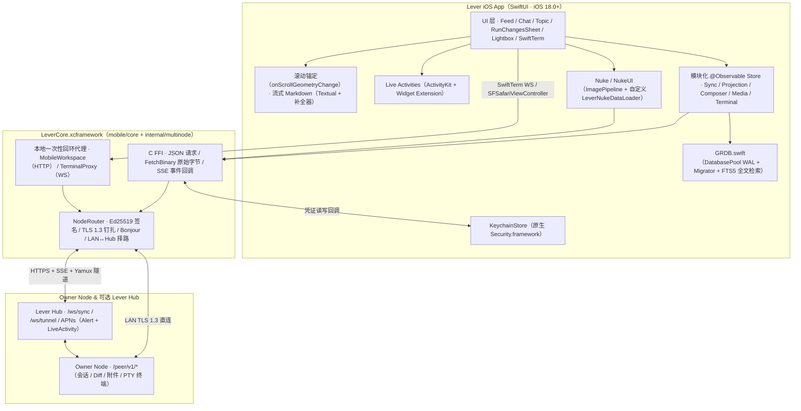
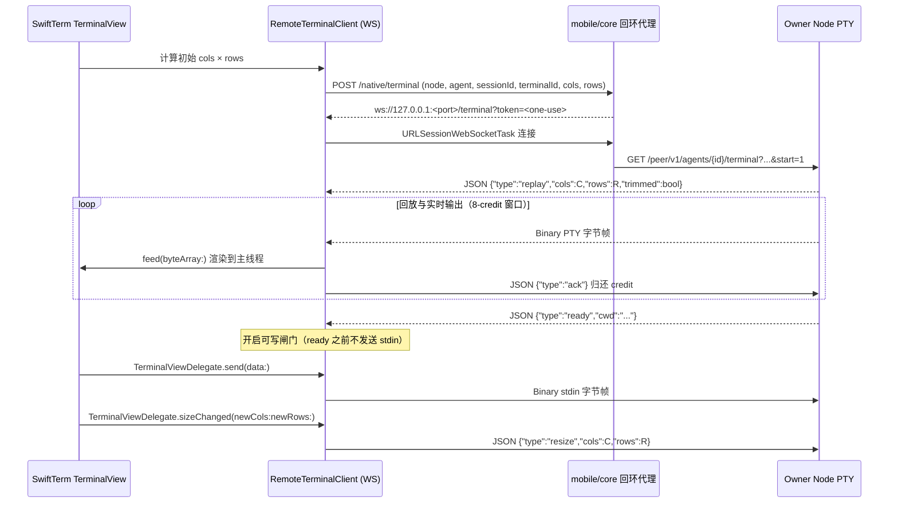

# Lever iOS 原生应用组件与架构升级方案

设计方案 · 2026-11-28

> **设计基线**：坚持 **纯原生 SwiftUI（iOS 18.0+）+ 共享 Go 核心 `LeverCore.xcframework`** 路线；严格遵循「简洁内聚、避免过度设计、最小依赖面」原则，仅在避免重造高复杂度轮子时引入成熟 SPM 包（`Textual`、`GRDB.swift`、`Nuke`、`SwiftTerm`），并充分挖掘 iOS 18 原生能力（`onScrollGeometryChange`、`ActivityKit`、`QuickLook`）。关联文档：[Lever 产品与会话设计](design.md)、[多设备协同架构设计](remote-devices.md)。

---

## 1. 总体架构与核心不变量

Lever iOS 客户端定位为多节点远程控制端（`AccessLevel = none`），不承担 Agent Runtime 执行，也不在 Swift 层重复实现传输安全与择路逻辑。全部加密、鉴权与隧道能力下沉至共享 Go 核心，SwiftUI 层专注高性能渲染、交互与系统原生体验。



### 1.1 不可破坏的六条约束

1. **传输与鉴权唯一收口在 Go Core**：Ed25519 请求签名、TLS 1.3 证书钉扎、Bonjour 发现、多节点择路与断线重试全部留在 [mobile/core](../mobile/core/main.go) 与 `internal/multinode`。Swift 层不另起远端连接状态机；需要原生 HTTP/WS（如 `SwiftTerm`、`SFSafariViewController`）时，统一连接 Go Core 暴露的 `127.0.0.1:0` 一次性令牌回环代理。
2. **禁止自动加载模型输出中的外部图片 URL**：与 [design.md](design.md) 保持一致，Markdown 正文中由模型生成的任意外链图片绝不自动发起网络请求（防止跟踪像素、SSRF 与信息泄露），仅自动加载受 Lever 鉴权保护的附件与 Agent 头像。
3. **黑白灰阶视觉规范**：Light 与 Dark 主题保持 [LeverTheme.swift](../mobile/ios/Lever/Theme/LeverTheme.swift) 的中性灰阶体系，代码块高亮、Diff 增删、终端主题、扩展键盘栏和灵动岛均遵循克制低干扰原则，彩色仅用于 Agent 头像与语义状态提示。
4. **权限驱动显隐，清晰区分「未授权」与「低版本」**：基于 `PeerNodeInfo` 的 `accessLevel`（`chat` / `workspace` / `admin`）和 `features` 渲染功能入口（变更摘要、完整 Diff、附件预览、工作区、原生终端），能力不可用时给出准确提示。
5. **不牺牲 120fps 滚动流畅度**：列表项坚持 `Equatable` 隔离，禁止在主线程执行 SQLite 同步 I/O、大图解码或全量 Markdown 解析。
6. **推送与锁屏零明文泄露**：APNs Alert 维持现有加密载荷；Live Activity `ContentState` 仅携带脱敏状态元信息，严禁放入对话正文、代码片段或具体待审批命令。

---

## 2. 依赖选型清单与排除边界

### 2.1 保留与新增依赖（共 4 个 SPM 包 + 系统原生框架）

| 依赖 | 仓库 / 来源 | 协议 | 职责 | 替代/增强对象 |
| --- | --- | --- | --- | --- |
| **Textual** | `https://github.com/gonzalezreal/textual`（`>= 0.5.0`） | MIT | 原生 Markdown、GFM 表格、`swiftui-math` 公式、内置异步 Prism 代码与 Diff 高亮 | **已引入**，补齐流式补全器、自定义主题与安全附件加载器 |
| **GRDB.swift** | `https://github.com/groue/GRDB.swift.git`（`>= 7.12.0`） | MIT | SQLite WAL 并发读写池（`DatabasePool`）、Schema 版本迁移、`FTS5` 本地全文搜索 | 替换手写 C API [SQLiteCache.swift](../mobile/ios/Lever/Core/SQLiteCache.swift) 与遗留 [LocalCache.swift](../mobile/ios/Lever/Core/LocalCache.swift) |
| **Nuke / NukeUI** | `https://github.com/kean/Nuke.git`（`>= 14.0.0`） | MIT | 异步图片下载调度、后台解码降采样、内存+磁盘 LRU 缓存、并发去重 | 替换手工头像缓存，支撑消息图片缩略图、大图预览与鉴权附件图 |
| **SwiftTerm** | `https://github.com/migueldeicaza/SwiftTerm.git`（`>= 1.99.4`） | MIT | 原生 UIKit `TerminalView`（VT100/xterm 仿真、原生触控与滚屏、扩展键接入） | 支撑 `admin` 档原生远程 PTY 终端 |
| **系统原生框架** | `SwiftUI (iOS 18+)` / `ActivityKit` / `WidgetKit` / `QuickLook` / `Security` / `AVFoundation` | Apple SDK | `onScrollGeometryChange` 滚动锚定、灵动岛/锁屏实时活动、非图附件预览、Keychain、扫码 | 零第三方依赖解决高频原生体验 |

### 2.2 明确不引入的组件与原因

| 组件 | 排除原因 |
| --- | --- |
| **React Native / Expo 生态**（Legend List、Keyboard Controller、Expo UI 等） | Lever iOS 已是成熟纯 SwiftUI + Go Core 应用，不反向混编 RN；只吸收其交互语义（如 Legend List 滚动锚定、Remend 流式补全）。 |
| **Enriched Markdown iOS** | 尚处 `0.x` 早期且无完整流式 API；开启 Tree-sitter 代码高亮硬性增加约 8 MB 包体积（不可裁剪），LaTeX 再增 3–5 MB，且受限于非标准字体修饰符。`Textual` 已全面覆盖需求。 |
| **STMarkdown** | 原上游模块已从 `i-stack` 仓库移除，存在停维风险。 |
| **Exyte Chat** | 面向传统人际 IM 气泡模型，与 Lever 的主对话/话题卡片混合流、懒加载工具步骤、审批/提问卡片和 `Equatable` 细粒度流式更新冲突。 |
| **Highlightr** | 已停止维护（unmaintained）；`Textual 0.5.0` 已内置 actor 化 `Prism.js` 代码高亮。若未来做原生代码编辑器再直接评估 `SwiftTreeSitter` + `Runestone`。 |
| **KeychainAccess** | [KeychainStore.swift](../mobile/ios/Lever/Core/KeychainStore.swift) 仅 126 行且包含 Simulator 无 Entitlement 降级和 C 回调适配，足够稳固。 |
| **TCA** | iOS 18 原生 `@Observable` 已够轻量高效；解决 [LeverStore.swift](../mobile/ios/Lever/Store/LeverStore.swift) 过长应靠领域拆分，而非引入重度宏框架。 |
| **Citadel / SwiftNIO SSH** | Lever 远程终端经 `/peer/v1/agents/{id}/terminal` 走 LAN TLS 1.3 或 Hub `yamux` 隧道，不走 SSH 协议栈。 |
| **GhosttyKit / libghostty** | 需维护自定义分支的 `GhosttyKit.xcframework` 与 Zig/C 构建链，维护成本远高于 `SwiftTerm`。 |
| **swift-markdown / jsdiff / MLX Swift LM** | `Textual` 底层解析已满足当前需要；Diff 由 Owner Node 服务端直接计算返回，移动端无需算 diff；移动端纯控制端不跑本地 LLM 推理。 |

---

## 3. 工程化基础：构建脚本、Store 拆分与 Go Core 扩展

### 3.1 声明式 SPM 管理与 Widget Extension 支持（`generate-xcodeproj.py`）

当前 [generate-xcodeproj.py](../mobile/ios/generate-xcodeproj.py) 将 `Textual` 硬编码为多处散落变量，且只生成单一主 App Target。改造为统一配置表驱动：

1. **声明式 `SPM_PACKAGES` 数组**：
   ```python
   SPM_PACKAGES = [
       {
           "key": "textual",
           "url": "https://github.com/gonzalezreal/textual",
           "rule": {"kind": "upToNextMinorVersion", "minimumVersion": "0.5.0"},
           "products": ["Textual"],
       },
       {
           "key": "grdb",
           "url": "https://github.com/groue/GRDB.swift.git",
           "rule": {"kind": "upToNextMajorVersion", "minimumVersion": "7.12.0"},
           "products": ["GRDB"],
       },
       {
           "key": "nuke",
           "url": "https://github.com/kean/Nuke.git",
           "rule": {"kind": "upToNextMajorVersion", "minimumVersion": "14.0.0"},
           "products": ["Nuke", "NukeUI"],
       },
       {
           "key": "swiftterm",
           "url": "https://github.com/migueldeicaza/SwiftTerm.git",
           "rule": {"kind": "upToNextMajorVersion", "minimumVersion": "1.99.4"},
           "products": ["SwiftTerm"],
       },
   ]
   ```
   循环自动生成 `XCRemoteSwiftPackageReference`、`XCSwiftPackageProductDependency` 与 `PBXBuildFile`，并移除不再需要的 `libsqlite3.tbd` 直接链接（由 `GRDB` 统一链接系统 SQLite）。
2. **新增 `LeverLiveActivityExtension` Target**：
   - 源码目录：`mobile/ios/LeverLiveActivity/`（共享 `mobile/ios/Shared/LeverActivityAttributes.swift` 同时编入主 App 与 Extension 两个 Target）。
   - Bundle ID：`app.lever.mobile.live-activity`，产品类型 `com.apple.product-type.app-extension`，主 App `PBXCopyFilesBuildPhase` 自动嵌入 `PlugIns/`。
   - [Info.plist](../mobile/ios/Lever/Resources/Info.plist) 增加 `NSSupportsLiveActivities = true` 与 `NSSupportsLiveActivitiesFrequentUpdates = true`。

### 3.2 `LeverStore` 领域模块化拆分

[LeverStore.swift](../mobile/ios/Lever/Store/LeverStore.swift) 当前达 2575 行，职责过度集中。保持对外唯一入口与 `@Observable @MainActor` 语义，但按职责拆为独立文件，降低改动冲突与状态误触发：

```text
mobile/ios/Lever/
├── Core/
│   ├── LeverBridge.swift             # Go C-FFI（含 FetchBinary 与 TerminalProxy）
│   ├── KeychainStore.swift           # 保留现有实现
│   ├── Database/
│   │   ├── AppDatabase.swift         # GRDB DatabasePool + DatabaseMigrator
│   │   ├── DatabaseModels.swift      # Record / KV / RunStep / FTS5 表结构
│   │   └── LegacyCacheMigrator.swift # 一次性迁移旧 lever_mobile.sqlite / LeverCache JSON
│   └── Media/
│       └── LeverImagePipeline.swift  # Nuke ImagePipeline + LeverNukeDataLoader
├── Store/
│   ├── LeverStore.swift              # 根状态容器与生命周期（bootstrap / pair / unpair）
│   ├── LeverStore+Sync.swift         # 多节点索引、分页尾读、增量拉取、热话题预取
│   ├── LeverStore+Projections.swift  # Feed / Drawer / Timeline 记忆化投影
│   ├── LeverStore+ReadClear.swift    # 跨端已读游标、清理/恢复同步
│   ├── LeverStore+Composer.swift     # Provider / Model / Star / Skills / 附件上传
│   └── LiveActivityCoordinator.swift # ActivityKit 生命周期与 Token 上报
├── Views/
│   ├── Chat/
│   │   ├── TimelineScrollAnchor.swift      # iOS 18 onScrollGeometryChange 滚动锚定
│   │   ├── StreamingMarkdownNormalizer.swift # 流式未闭合语法补全
│   │   ├── MarkdownContentView.swift       # Textual 主题 + 流式/终态分离 + 安全图片加载
│   │   ├── RunChangesSheetView.swift       # 原生本轮变更列表 + 单文件 Unified Diff
│   │   ├── AttachmentPreviewViews.swift    # 图片网格缩略图 + Lightbox + QuickLook
│   │   └── ...（现有 ChatDetailView / TopicDetailView / MessageComponents）
│   └── Terminal/
│       ├── RemoteTerminalClient.swift      # 对齐 socket.go 的 WS 客户端（含 8-credit ack）
│       ├── SwiftTermView.swift             # TerminalView UIViewRepresentable + 扩展键栏
│       └── TerminalSheetView.swift         # 终端容器（权限/离线/重连态）
└── Shared/
    └── LeverActivityAttributes.swift       # 主 App 与 LiveActivity Extension 共享属性
```

### 3.3 `mobile/core` 薄能力扩展（2 处）

在 [mobile/core/main.go](../mobile/core/main.go) 与 [internal/multinode](../internal/multinode/) 增加两项通用底层能力，供 Nuke、Diff 与 SwiftTerm 复用：

1. **原始二进制请求 `LeverCore_FetchBinary`**
   - 现有 `LeverCore_Request` 强制将响应包装进 JSON `Envelope`，拉取 `GET /peer/v1/attachments/{id}`（PNG/JPEG/WebP/PDF 原始字节流）会产生 33% Base64 膨胀与额外 JSON 拷贝。
   - 新增 C 导出函数：
     ```c
     typedef struct {
         int32_t status;
         char*   content_type;
         char*   error;
         uint8_t* data;
         int64_t  length;
     } lever_binary_result;

     lever_binary_result* LeverCore_FetchBinary(const char* path);
     void LeverCore_FreeBinary(lever_binary_result* res);
     ```
   - 内部走同一个 `c.directory.Request` / `NodeRouter` 管道，支持 `/api/spaces/{space}/nodes/{node}/attachments/{id}`（及兼容旧节点的 `/avatars/{device}/{imageId}`），限制单次最大体积（与 `app.MaxAttachmentBytes` 对齐）并带 20s 超时。
2. **原生终端一次性回环 WS 代理 `/native/terminal`**
   - 复用 [mobile_workspace.go](../internal/multinode/mobile_workspace.go) 的安全模式：监听 `127.0.0.1:0`，签发一次性 `token`，校验 `r.Host == host` 且 `Origin == ""`。
   - 请求 `POST /native/terminal` 传 `{"node", "agent", "sessionId", "root", "terminalId", "cols", "rows"}`，返回 `{"wsUrl": "ws://127.0.0.1:<port>/terminal?token=<one-use>", "host": "127.0.0.1:<port>"}`。
   - 回环代理收到升级请求后，先消费一次性 token（`subtle.ConstantTimeCompare`），再调用 `n.Open(ctx, "GET", "/peer/v1/agents/{agent}/terminal?...", nil, headers)` 经 LAN TLS 1.3 或 Hub `yamux` 隧道建立上游 WebSocket，双向零拷贝透传 Binary 与 Text 帧。关闭时调用 `POST /native/terminal/close`（传 `host` 防止旧页面延迟关闭误杀新会话）。

---

## 4. 对话时间线滚动锚定（iOS 18 原生方案）

### 4.1 解决的问题

当前 [ChatDetailView.swift](../mobile/ios/Lever/Views/Chat/ChatDetailView.swift#L302-L318) 与 [TopicDetailView.swift](../mobile/ios/Lever/Views/Chat/TopicDetailView.swift#L290-L306) 存在三个体验缺陷：
1. 监听 `entries.last?.id` 后无条件执行 `proxy.scrollTo("bottom-anchor")`，用户正在往上翻阅历史时若新轮次到达会被强行拉回底部；
2. 活跃 Run 流式输出使最后一条消息高度持续增长时，因为 `last?.id` 没变，视口不会自动跟随新生成的文本；
3. 点击加载更早历史消息后，`LazyVStack` 顶部插入新条目容易引起视觉跳动。

### 4.2 设计实现（`TimelineScrollAnchor`）

利用 Lever 已锁定 `IPHONEOS_DEPLOYMENT_TARGET = 18.0`，直接使用 SwiftUI 原生 `onScrollGeometryChange` + `ScrollPosition`，不引入第三方列表库：

1. **贴底状态实时追踪**：
   ```swift
   struct ScrollMetrics: Equatable {
       let distanceFromBottom: CGFloat
       let contentHeight: CGFloat
       let containerHeight: CGFloat
   }
   ```
   通过 `.onScrollGeometryChange(for: ScrollMetrics.self)` 计算 `distanceFromBottom = max(0, geo.contentSize.height - geo.contentOffset.y - geo.containerSize.height)`：
   - `distanceFromBottom <= 48` 视为贴底（`isPinnedToBottom = true`）；
   - 用户主动向上滚动且离开底部超过阈值（配合 `.onScrollPhaseChange` 识别 `.interacting`）时立即置 `isPinnedToBottom = false`，**流式期间绝不抢回滚动权**。
2. **流式增高自动跟底**：
   - 当 `isPinnedToBottom == true` 且 `metrics.contentHeight` 增长（或 `entries.last?.id` 变化）时，节流（~80ms）执行无动画或轻动画 `proxy.scrollTo("bottom-anchor", anchor: .bottom)`，避免高频动画叠加引发弹性抖动。
   - 用户发送新消息时，显式将 `isPinnedToBottom = true` 并滚至底部。
3. **「回到底部」悬浮胶囊**：
   - 当 `!isPinnedToBottom && distanceFromBottom > 240` 时，在 Composer 上方右下角浮现极简黑白灰胶囊按钮（箭头图标；若期间有新到达回复或活跃流式输出，显示微弱绿点或未读计数），点击后恢复贴底锁定。
4. **顶部加载历史防跳动**：
   - 使用 iOS 18 `.scrollPosition(id: $topAnchorId, anchor: .top)` 在翻页前记录当前首条可见条目 ID，历史数据合入后再对齐原条目位置（`ChatDetailView` 与 `TopicDetailView` 共享同一修饰器）。

---

## 5. 流式 Markdown 渲染与 `Textual` 深度利用

继续使用 `Textual 0.5.0`，围绕 [MarkdownContentView.swift](../mobile/ios/Lever/Views/Chat/MarkdownContentView.swift) 做四项精准升级：

### 5.1 流式未闭合语法补全器（`StreamingMarkdownNormalizer`）

借鉴 `Remend` / `Streamdown` 思路，实现 ~100 行纯 Swift、线性 O(N) 扫描的无状态补全器，**仅对活跃流式回复（`isStreaming == true`）生效**：
- **未闭合代码围栏**：统计行首 ```` ``` ```` 或 `~~~` 数量为奇数时，在末尾自动补 `\n``` `，避免半截代码块吞掉后续正文或反复闪烁；
- **未闭合行内代码**：在非围栏代码块区域内，奇数个反引号 `` ` `` 时补齐闭合反引号；
- **未闭合加粗/斜体/删除线**：末尾存在悬挂的 `**`、`~~` 时临时闭合；
- **未闭合行间公式**：奇数个 `$$` 时补齐 `\n$$`；
- **未闭合 Markdown 链接**：末尾出现 `[text](https://...` 且无右括号时暂时剥离未完成 URL 尾部以纯文本展示，避免跳动。

### 5.2 Streaming 与 Complete 缓存分离

修复当前 `CachedMarkdownParser`（`countLimit = 400`）在流式输出时每次全量文本变化都写入缓存、冲刷历史消息缓存的问题：
- `MarkdownContentView` 新增 `isStreaming: Bool = false` 参数（由 `RunTurnView` 传入 `isActive`）。
- **终态（`isStreaming == false`）**：命中 `CachedMarkdownParser.shared`（支持后台 `prewarm`），`Equatable` 隔离使滚动 0 重复解析。
- **流式态（`isStreaming == true`）**：走 `StreamingMarkdownNormalizer.normalize(trimmed)` 后直接解析（或仅保留单个 `latestStreamingEntry` 槽位），**不写入共享 `NSCache`**；配合 [LeverStore.swift](../mobile/ios/Lever/Store/LeverStore.swift#L2528-L2535) 的更新合流节奏（约 120–220ms），既流畅又不爆内存。

### 5.3 定制 Lever 黑白灰代码与 Diff 高亮主题

当前未显式传入 `highlighterTheme`，默认使用了 `Textual` 饱和度较高的亮色方案。新增 `LeverHighlighterTheme`（`.textual.highlighterTheme(LeverHighlighterTheme.theme)`）：
- 代码关键字、字符串、注释、类型使用低饱和度中性灰与克制微色调，与 `LeverTheme.surfaceInset` 背景在 Light / Dark 下保持高对比度和统一气质；
- 对 `diff` 代码块的 `.inserted` / `.deleted` 复用 `LeverTheme.runningEmerald` 与 `LeverTheme.unreadRed`，直接服务第 6 节的原生 Diff 视图。

### 5.4 安全合规的 Markdown 图片加载器（`LeverImageAttachmentLoader`）

实现 `Textual.AttachmentLoader`，通过 `.textual.imageAttachmentLoader(LeverImageAttachmentLoader(deviceId:store:))` 注入：
- **白名单路由（自动加载）**：仅当 URL 指向 Lever 自身鉴权附件路径（如 `/api/attachments/{id}`、`/peer/v1/attachments/{id}` 或内部 `lever-attachment://` 协议）时，交由第 8 节的 `LeverImagePipeline`（`Nuke` + `LeverCore_FetchBinary`）自动异步加载并缓存。
- **外部任意 URL（严格拦截）**：凡是模型生成的 `http(s)://` 外部图片地址，**绝不自动发起网络请求**，返回轻量占位附件（显示域名与 alt 文本），用户显式点击后再通过外部浏览器打开，100% 对齐 [design.md](design.md) 安全不变量。

---

## 6. Diff 与远程工作区体验

### 6.1 固定工作区入口

修复当前 [ChatDetailView.swift](../mobile/ios/Lever/Views/Chat/ChatDetailView.swift#L584-L598) 将工作区按钮误放在 `loadOlderButton` 里的缺陷：
- 在 `ChatDetailView` 顶部导航栏右侧（`sidebar.right` 按钮左侧）增加固定的工作区入口按钮（`folder` 图标）：
  - 当目标节点支持 `peer_v1` 且 `accessLevel` 为 `workspace` 或 `admin` 时直接可点，打开 `MobileWorkspace`（复用水印一致的内置 Web 工作台：`Monaco` 文件编辑 + `@pierre/diffs` 完整 Diff）；
  - 当 `accessLevel == "chat"` 时点击给出清晰提示（「该电脑当前仅开放对话权限，请在桌面端『设置 → 远程与设备』切换为工作区权限」），而非静默隐藏或报错。
- 同步修复 `PeerWorkspaceBrowser` 关闭时传递 `host` 给 `/native/workspace/close`（对齐 `MobileWorkspace.CloseHost` 防止误关新实例）。

### 6.2 原生变更快览与单文件 Unified Diff（`RunChangesSheetView`）

将 [MessageComponents.swift](../mobile/ios/Lever/Views/Chat/MessageComponents.swift#L696-L729) 中不可点击的 `DiffSummaryBadge` 升级为交互入口：
1. **本轮文件变更列表（`AccessChat` 档即可用）**：
   - 点击 `DiffSummaryBadge` 弹出原生 Sheet，调用已有端点 `GET /peer/v1/agents/{agentId}/changes?run={runId}&sessionId={sessionId}`，解析 `TurnReview`（含按仓库 `Root` 分组的 `DiffFile`：`path`、`status`、`additions`、`deletions`、`binary`）。
   - 展示文件状态标签（`M`/`A`/`D`/`R`）、路径与 `+N / -M` 计数，零额外后端开发。
2. **原生单文件 Unified Diff 详情（`AccessWorkspace` 档可用）**：
   - 点击列表中的非二进制文件，按需调用 `GET /peer/v1/agents/{agentId}/diff?root={rootId}&mode=working&path={filePath}` 获取 `DiffResult.patch`。
   - 原生渲染器按 hunk（`@@ ... @@`）切分统一差异行：左侧等宽旧/新行号列，新增行铺 `LeverTheme.runningEmeraldSoft`、删除行铺 `LeverTheme.unreadRed.opacity(0.11)`，支持横向滚动、长按复制 hunk 或整段补丁；超大单文件（如 > 2000 行）自动折叠提示并提供一键「在完整工作台查看」直达 `MobileWorkspace`。
   - 权限为 `chat` 档时，列表仍完整可读，点击文件给出温和权限引导。

---

## 7. 本地存储与全文检索（`GRDB.swift`）

用 `GRDB.swift` 的 `DatabasePool` 彻底替换 [SQLiteCache.swift](../mobile/ios/Lever/Core/SQLiteCache.swift)（470 行裸 C `sqlite3_*`）与遗留 [LocalCache.swift](../mobile/ios/Lever/Core/LocalCache.swift)。

### 7.1 为什么替换

- 消除现有 `SQLiteCache.swift` 的三处稳定性隐患：
  1. `loadKV` / `loadRawKV` 使用 `queue.sync` 串行锁，可能阻塞主线程；
  2. `sqlite3_step` / `exec` 未检查返回值，磁盘满或约束冲突时静默丢数据；
  3. 缺少版本化迁移框架（`PRAGMA user_version`），后续演进多设备 Schema 风险大。
- `DatabasePool` 天然利用 SQLite WAL 模式实现**多读并发 + 单写串行**，彻底释放冷启动加载、滚动预读与后台同步之间的队列争用。

### 7.2 Schema 与迁移设计（`AppDatabase.swift`）

数据库文件路径沿用 `Application Support/LeverDB/lever_mobile_v2.sqlite`（启动时若存在旧 `lever_mobile.sqlite` 或 `LeverCache/*.json`，由 `LegacyCacheMigrator` 一次性迁移元数据与游标后清理旧文件，零数据丢失）。

| 表名 | 核心列与索引 | 用途 |
| --- | --- | --- |
| `kv_store` | `key TEXT PRIMARY KEY`, `payload BLOB`, `updated_at INTEGER` | 账号、设备列表、同步/已读/清理游标、Provider 目录、收藏模型 |
| `records` | `scope TEXT`, `kind TEXT`, `id TEXT`, `device_id TEXT`, `agent_id TEXT`, `chat_id TEXT`, `session_id TEXT`, `sequence INTEGER`, `title TEXT`, `search_text TEXT`, `payload BLOB`, `updated_at INTEGER`, `PRIMARY KEY (scope, kind, id)` | 索引记录与分页会话记录；建复合索引 `(scope, session_id, kind, sequence DESC)` 保持 O(log N) 尾读 |
| `run_steps` | `device_id TEXT`, `run_id TEXT`, `payload BLOB`, `updated_at INTEGER`, `PRIMARY KEY (device_id, run_id)` | 两阶段懒加载的工具/推理步骤独立存储，避免大 JSON 塞进 KV 表 |
| `records_fts` | `FTS5(title, search_text, content='records', content_rowid='rowid', tokenize='unicode61')` | 由 SQLite 触发器与 `records` 自动同步，支持本地毫秒级全文搜索（覆盖 Agent 名、对话标题、话题标题、用户提问与 Agent 回复正文） |

### 7.3 关键行为约束

- **全异步读取**：移除所有同步阻塞主线程的 DB 读方法，统一暴露 `async` 接口（`dbPool.read { ... }` / `dbPool.write { ... }`）。
- **FTS5 搜索升级**：[FeedView.swift](../mobile/ios/Lever/Views/Feed/FeedView.swift) 全局搜索先通过 `records_fts MATCH` 毫秒级检索本地已缓存的消息、话题与对话（结果带高亮命中摘要与直达路由），再与内存 Agent 索引合并去重；支持中文前缀与多词匹配。
- **解绑与空间治理**：保留按 `device_id` 的级联删除（`DELETE FROM records WHERE device_id NOT IN (...)`、`DELETE FROM run_steps WHERE ...`），解绑后执行增量清理与 `PRAGMA wal_checkpoint(TRUNCATE)`。头像二进制不再存入 SQLite `kv_store`，改交由第 8 节 `Nuke` 独立磁盘缓存管理，大幅减小 DB 体积。

---

## 8. 多模态图片预览与媒体缓存（`Nuke` + `NukeUI`）

### 8.1 自定义安全管道（`LeverImagePipeline.swift`）

由于 Lever 的头像与消息附件全部受 Ed25519 + TLS 1.3 证书钉扎保护，不能用标准 `URLSession` 直接拉取。通过实现 `Nuke.DataLoading` 协议，将 `Nuke` 无缝接到 `LeverCore`：

1. **内部逻辑 URL 协议**（仅进程内路由使用，永不外发）：
   - 附件：`lever-media://attachment/{deviceId}/{attachmentId}` → 经 `LeverCore_FetchBinary` 请求 `{spacePath}/nodes/{deviceId}/attachments/{attachmentId}`（兼容旧节点路径）；
   - 头像：`lever-media://avatar/{deviceId}/{imageId}` → 经 `LeverCore_FetchBinary` 请求 `{spacePath}/avatars/{deviceId}/{imageId}`（若旧接口返回 JSON Base64 则在 `LeverNukeDataLoader` 解包）。
2. **`ImagePipeline` 配置**：
   - 内存缓存：`ImageCache`（上限 60 MB，自动响应系统内存警告释放）；
   - 磁盘缓存：`DataCache`（独立目录 `Caches/LeverMediaCache`，LRU 上限 200 MB，解绑设备或退出登录时按需清空）；
   - 处理器：列表缩略图自动附加 `.resize(size:unit:.points)` 后台降采样，杜绝 4K 截图在 `LazyVStack` 中引发内存尖刺；
   - 并发去重：`Nuke` 原生合并同一 `attachmentId`/`imageId` 的并发请求，删除 `LeverStore` 中手工维护的 `avatarMemoryCache` 与 `inFlightAvatars`。

### 8.2 消息附件交互升级（`AttachmentPreviewViews.swift`）

改造 [MessageComponents.swift](../mobile/ios/Lever/Views/Chat/MessageComponents.swift#L86-L104) 当前「仅显示文件名胶囊」的限制：
- **图片附件（`att.isImage == true`）**：
  - 使用 `NukeUI.LazyImage` 在用户消息气泡上方渲染自适应圆角缩略图网格（单图大缩略图、多图 2～3 列方格，带静默灰阶加载占位与失败重试按钮）；
  - 点击任意图片弹出原生全屏 **Lightbox 预览器**：支持双指捏合缩放、双击放大、下拉手势关闭、一键「保存到相册 / 分享」。
- **非图片附件（PDF / 代码 / 文本 / 文档）**：
  - 保留紧凑文件胶囊（含文件大小），点击后通过 `LeverCore_FetchBinary` 下载至临时沙盒目录，唤起 iOS 原生 **`QLPreviewController`（QuickLook）** 原生预览与系统分享，零第三方 PDF/文档渲染依赖。
- **权限降级**：当节点为 `AccessChat` 档（未开放 `GET /peer/v1/attachments/{id}`）时，图片缩略图优雅回退为现有文件名胶囊，点击提示权限要求。

---

## 9. 原生远程 PTY 终端（`SwiftTerm`）

面向 [remote-devices.md](remote-devices.md) 中 `admin` 档开放的 `GET /peer/v1/agents/{id}/terminal`，在 iOS App 内提供流畅的原生终端体验。

### 9.1 入口与权限守卫

- 在 `ChatDetailView` / `TopicDetailView` 顶部导航栏菜单（或工作区旁入口）提供「远程终端」按钮：
  - 仅在 `node.online && node.accessLevel == "admin" && !node.readOnlyFs && !node.draining` 时可用；
  - `chat` / `workspace` 档或离线时给出明确状态说明（区分「权限未开」「设备离线」「设备版本过旧」）。

### 9.2 协议桥接与流控（`RemoteTerminalClient.swift`）

严格实现 [internal/terminal/socket.go](../internal/terminal/socket.go) 定义的线缆协议：



关键工程细节：
- **8-credit 背压闭环**：每次将服务端 Binary 帧 `feed(byteArray:)` 喂给 `TerminalView` 后，立即发送 `{"type":"ack"}`；避免高速 `cat` / 编译日志压垮渲染线程或耗尽 credit 导致卡死。
- **可写闸门**：严格等待收到 `{"type":"ready"}` 后才放行用户键盘输入与 `resize` 帧（与后端 `writable` 校验一致，避免被服务端主动断链）。
- **会话态与重连**：保留同一个 `terminalId`（UUID），收到 `exit` / `ended` / `busy` / `error` 时在顶部状态条明确展示退出码或原因，并提供「重新启动 Shell」按钮；`URLSessionWebSocketTask` 原生响应服务端 2 秒 Ping（15 秒超时），切网或前后台切换后自动探测并支持一键重连。

### 9.3 移动端原生交互打磨（`SwiftTermView.swift`）

- 封装 `SwiftTerm.TerminalView` 为 `UIViewRepresentable`，字体默认 `UIFont.monospacedSystemFont`（支持双指缩放字号 10pt–18pt 并记忆至 `UserDefaults`），前景色/背景色/ANSI 调色板跟随 `LeverTheme` 自动适配 Light & Dark。
- 定制 `inputAccessoryView` 扩展快捷键栏（贴合 Lever 黑白灰胶囊风格）：`Esc`、`Tab`、`Ctrl`（粘滞开关，按下一次后下一按键自动转控制码如 `Ctrl+C` / `Ctrl+D` / `Ctrl+L`）、`↑`/`↓`/`←`/`→`、`粘贴`、`收起键盘`。
- 终端内禁用页面左滑返回手势冲突（复用现有 [InteractivePopEnabler](../mobile/ios/Lever/Theme/LeverTheme.swift#L479)），采用原生全屏 `fullScreenCover` 或带明确关闭按钮的 Sheet 呈现。

---

## 10. 灵动岛与锁屏实时活动（`ActivityKit`）

### 10.1 场景与数据结构（`LeverActivityAttributes.swift`）

解决「电脑上 Agent 长时间运行，离开工位后锁屏实时掌握进度与审批提醒」的高频痛点：

```swift
import ActivityKit
import Foundation

struct LeverAgentActivityAttributes: ActivityAttributes {
    struct ContentState: Codable, Hashable {
        enum Phase: String, Codable, Hashable {
            case running      // 运行中
            case waitingUser  // 待审批 / 待回答
            case completed    // 已完成
            case failed       // 执行失败
        }

        var phase: Phase
        var stepCount: Int
        var pendingCount: Int
        var statusLabel: String   // 脱敏短文案，如 "运行中 · 12 步" / "等你审批"
        var updatedAt: Date
    }

    var nodeId: String
    var agentId: String
    var agentName: String
    var chatId: String
    var topicId: String?
    var sessionTitle: String      // 仅标题摘要，截断 <= 40 字符
}
```

- **隐私脱敏底线**：`ContentState` 与 `Attributes` 绝不携带消息正文、文件路径、Shell 命令明细或审批参数。
- **Deep Link 直达**：锁屏卡片与灵动岛展开态绑定 `widgetURL(URL(string: "leverdevice://open?device=\(nodeId)&agent=\(agentId)&chat=\(chatId)&topic=\(topicId ?? "")"))`，[LeverApp.swift](../mobile/ios/Lever/App/LeverApp.swift#L69-L71) 扩展 `handleIncomingURL` 直接路由到目标 Chat/Topic。

### 10.2 双通道更新机制（LAN 与 Hub 统一闭环）

1. **前台 / 局域网直连自动维护（零服务端依赖）**：
   - `LiveActivityCoordinator` 监听 `LeverStore` 投影变化：当用户发消息启动新 Run 或存在活跃运行/待审批会话，且用户在「设置 → 通知策略」开启了「锁屏实时进度」时，自动 `Activity.request(...)`（同一时刻最多维护 1 个主活动或按活跃 Session 合并，避免刷屏）。
   - 前台同步刷新时本地调用 `activity.update(...)`；Run 进入 `completed` / `failed` 时调用 `activity.end(..., dismissalPolicy: .after(Date().addingTimeInterval(300)))` 留存 5 分钟供回看后自动消失。
2. **后台 / 锁屏实时更新（Hub APNs 推送）**：
   - 监听 `activity.pushTokenUpdates`，将单次活动的十六进制 `pushToken` 上报至 Hub（`PUT /api/spaces/{space}/push/live-activity`，携带 `deviceId`、`sessionId`、`token`）。
   - [internal/hub/push_providers.go](../internal/hub/push_providers.go) 复用现有 `apns2.Client` 扩展发送 `apns2.Notification`：
     - `PushType: apns2.PushTypeLiveActivity`
     - `Topic: d.topic + ".push-type.liveactivity"`（即 `app.lever.mobile.push-type.liveactivity`）
     - Payload：`{"aps": {"timestamp": <unix>, "event": "update"|"end", "content-state": {...}}}`
   - 严格沿用现有「桌面端活跃时静默」策略与推送开关；仅在 Run 状态迁移（`running` ↔ `waiting_user` → `completed`/`failed`）或步骤计数跨越阈值时下发，避免过度消耗 APNs 预算。

### 10.3 UI 形态（`LeverLiveActivity` Widget Extension）

- **灵动岛紧凑态（Compact）**：左侧 Agent 简标/状态点（运行绿 / 审批琥珀），右侧步骤数或「待审批」短标；
- **灵动岛展开态（Expanded）与锁屏横幅**：展示 Agent 名称、话题标题、当前状态徽章、已执行步骤数与相对耗时（原生 `Text(timerInterval:)` 零耗电计时），审批态高亮琥珀色「点击处理」提示。

---

## 11. 改动文件总览与验收标准

### 11.1 涉及改动文件清单

| 层级 | 文件 | 改动摘要 |
| --- | --- | --- |
| **Go Core & 后端** | [mobile/core/main.go](../mobile/core/main.go) | 新增 `LeverCore_FetchBinary`、`LeverCore_FreeBinary` 与 `/native/terminal`、`/native/terminal/close` |
| **Go Core & 后端** | `internal/multinode/mobile_terminal.go`（新增） | 实现一次性回环 WS 代理，经 `n.Open` 透传 `/peer/v1/agents/{id}/terminal` |
| **Go Hub（推送）** | [internal/hub/push.go](../internal/hub/push.go)、[internal/hub/push_providers.go](../internal/hub/push_providers.go) | 支持 Live Activity `pushToken` 注册与 `apns2.PushTypeLiveActivity` 下发 |
| **iOS 构建** | [mobile/ios/generate-xcodeproj.py](../mobile/ios/generate-xcodeproj.py)、[Info.plist](../mobile/ios/Lever/Resources/Info.plist) | 声明式 `SPM_PACKAGES`（`Textual` / `GRDB` / `Nuke` / `SwiftTerm`）、新增 `LeverLiveActivityExtension` Target、开启 `NSSupportsLiveActivities` |
| **iOS Core** | `Database/AppDatabase.swift`、`DatabaseModels.swift`、`LegacyCacheMigrator.swift`（新增） | 用 `GRDB.swift` `DatabasePool` + `FTS5` 替换 `SQLiteCache.swift` 与 `LocalCache.swift` |
| **iOS Core** | `Media/LeverImagePipeline.swift`（新增）、[LeverBridge.swift](../mobile/ios/Lever/Core/LeverBridge.swift) | 封装 `Nuke` + `LeverNukeDataLoader` 与 `fetchBinary` / `openTerminal` |
| **iOS Store** | [LeverStore.swift](../mobile/ios/Lever/Store/LeverStore.swift) 及 `+Sync` / `+Projections` / `+ReadClear` / `+Composer` / `LiveActivityCoordinator.swift` | 领域拆分、接入 `AppDatabase` FTS5、移除手写头像缓存、接入 `ActivityKit` |
| **iOS UI** | `TimelineScrollAnchor.swift`、[ChatDetailView.swift](../mobile/ios/Lever/Views/Chat/ChatDetailView.swift)、[TopicDetailView.swift](../mobile/ios/Lever/Views/Chat/TopicDetailView.swift) | iOS 18 `onScrollGeometryChange` 滚动锚定、固定工作区/终端导航栏入口 |
| **iOS UI** | `StreamingMarkdownNormalizer.swift`、[MarkdownContentView.swift](../mobile/ios/Lever/Views/Chat/MarkdownContentView.swift) | 流式未闭合补全、流式/终态缓存分离、Lever 灰阶代码高亮主题、安全 `AttachmentLoader` |
| **iOS UI** | `RunChangesSheetView.swift`、`AttachmentPreviewViews.swift`、[MessageComponents.swift](../mobile/ios/Lever/Views/Chat/MessageComponents.swift) | 可点击 `DiffSummaryBadge` 原生变更/Diff 视图、图片缩略图网格 + Lightbox + `QuickLook` |
| **iOS UI** | `Views/Terminal/*`、`Shared/LeverActivityAttributes.swift`、`LeverLiveActivity/*` | `SwiftTerm` 原生终端（含 8-credit 流控与扩展键栏）、灵动岛与锁屏 Widget |

### 11.2 验收标准

1. **构建与包体**：`make mobile-ios-simulator` 与 `make mobile-ios` 无告警通过；`generate-xcodeproj.py` 重复执行幂等；完整 App + Widget Extension 正常安装启动。
2. **滚动与流式渲染**：
   - 流式输出长文本与未闭合代码块/表格/公式时无视觉闪烁，帧率稳定；
   - 贴底时自动跟底；用户手指上滑阅读历史时**绝不被新消息或新 Token 拉回底部**，且出现回底按钮；
   - 流式结束后 `CachedMarkdownParser` 仅缓存终态条目，重复进出对话 0 掉帧。
3. **安全合规**：
   - Markdown 中插入 `` 抓包验证**零外部网络请求**，界面展示安全占位卡片；
   - Lever 鉴权图片附件与头像经 `Nuke` 正常加载、缩放预览、离线命中磁盘缓存，解绑后缓存彻底清空。
4. **数据库与 FTS5**：
   - 旧版 `lever_mobile.sqlite` 升级启动无缝迁移，零崩溃、无主线程阻塞；
   - 全局搜索输入历史消息正文关键词可在 50ms 内命中并跳转到对应对话/话题；
   - 高频后台同步并发读写无 SQLite `SQLITE_BUSY` 丢写。
5. **Diff 与工作区**：
   - 无更早历史消息的新对话中，顶部导航栏仍可稳定打开工作区；
   - `AccessChat` 档可看本轮文件变更列表，点单文件给出清晰权限引导；`AccessWorkspace` 档可流畅查看原生单文件 Unified Diff 并可跳转完整工作台。
6. **原生终端（`SwiftTerm`）**：
   - `AccessAdmin` 档可启动交互式 Shell，执行 `ls`、`vim`、高频大量输出（如 `seq 1 50000`）时 8-credit 流控生效不卡死 UI；
   - 旋转屏幕/弹出键盘触发 `resize` 对齐 PTY 行列；`Esc` / `Ctrl+C` / `Tab` / 方向键均正常工作；关闭或切后台释放远程会话。
7. **灵动岛与锁屏活动（`ActivityKit`）**：
   - 启动 Run 后锁屏与灵动岛自动呈现，状态流转（`running` → `waiting_user` → `completed`/`failed`）在局域网前台和 Hub 锁屏后台均实时更新；
   - 抓包校验 APNs `liveactivity` 载荷不含对话正文或命令明细；点击灵动岛准确跳转至目标 Chat/Topic；桌面活跃静默策略生效。
