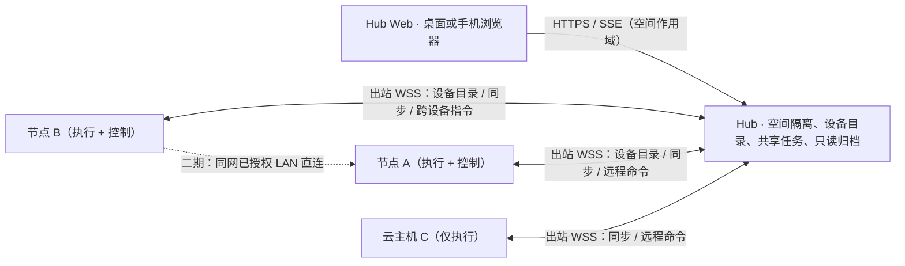

# Lever 多设备、多空间与自托管 Hub

设计方案 · 2026-11-21

在电脑 B 把任务派给 A，在手机上回答 A 的审批，回到 A 查看文件和变更，最后在原任务验收。整段工作只有一条执行会话。**Host 管执行与会话，Hub 管空间、设备目录、共享任务与只读归档。** 切换设备或网络时，用户仍从 Agents 打开原 Chat 或 Topic，从 Tasks 找到交付结果。 [Lever 产品与会话设计](design.md)

方案面向自托管 Hub 与多台独立 Host：首期面向单用户默认个人空间，用无窗口 `lever` 和响应式 Hub Web 跑通多设备闭环；底层数据模型、协议与隔离边界从首期起即按**多空间（个人空间 + 多团队空间）**与**节点对等感知**设计，便于未来多个团队安全共用同一个 Hub 服务。本机任务和 Chat 默认留在创建它们的设备。

## 交付产物与阶段划分

**一期发布三类产物。** 管理员用 Hub 镜像和部署包启动服务，在每台节点运行对应平台的 `lever`。只查看任务、发消息或处理审批的人，直接用电脑或手机浏览器打开 Hub 地址；具备控制角色的节点也可经 Hub 感知同空间全部设备并跨设备下发指令。

| 阶段 | 用户拿到什么 | 装在哪里，怎样使用 |
| --- | --- | --- |
| 一期 | **Hub 镜像** `lever-hub:<version>` | 自托管服务器或内网主机。镜像内的 `lever-hub` 同时提供 Hub Web、HTTP/SSE API 和 Host WSS 入口，内置 `setup`、`reset-password`、`backup` 和停服后的 `restore`。 |
| 一期 | **部署包** `lever-hub-deploy-<version>.tar.gz` | 解压得到 `compose.yaml`、`.env.example` 和 `README.md`。支持内置 HTTPS（公网域名）或纯 HTTP 置于反向代理 / Tailscale / WireGuard 之后运行。 |
| 一期 | **支持远程配对的 Host**，沿用 `lever`（Windows 为 `lever.exe`） | 每台执行电脑或云主机。在本机 Web 或 CLI 完成配对、选择向空间开放的 Agent，并可查看同空间其他节点。工作目录和 Provider 登录态取自本机。 |
| 二期 | **Lever 桌面包**，`Lever.app` / `Lever.exe` | 执行设备和控制设备按需安装。桌面壳层融合多设备 Agents/Tasks 视图，启用远程执行后支持登录自启与空闲待命；同期加入 LAN 直连与本机任务笔记共享。 |
| 三期 | **Lever 手机 App**，iOS（`.ipa`）与 Android APK | 用 MyGo Mobile 分别打包并真机验收。扫码配对，同网可直连 Host，离开局域网后经 Hub 续接共享 Chat。 |

**构建入口。** 现有 `make build` 输出 `bin/lever`，`make package` 将桌面包输出到 `desktop/dist/<平台>-<架构>/`。一期新增 `make hub`，复用 `make web`，再从 `cmd/lever-hub` 构建 `bin/lever-hub`。镜像在仓库根目录构建并嵌入前端产物，部署包从 `deploy/hub/` 收集发布文件。 [现有构建目标](../Makefile) · [桌面打包配置](../desktop/mygo.json) · [Web 资源嵌入](../web/assets.go)

## 空间模型与数据所有权

**Space（空间）是 Hub 的顶层业务隔离域。** 每个 Hub 可承载多个空间，分为个人空间（`personal`）与团队空间（`team`）。

- **一期零心智负担**：`lever-hub setup` 创建管理员账号并自动初始化唯一的默认个人空间；只有单个空间时，Hub Web 直接进入该空间，不展示多空间切换器，也不做团队成员管理界面。
- **面向多团队的自然演进**：未来开放多用户后，用户通过 `space_memberships(space_id, user_id, role)` 拥有 1 个个人空间和 N 个团队空间。所有共享任务、设备目录视图、Agent 开放授权、归档查询、SSE 订阅和远程命令从一期起就携带并校验 `spaceId`，确保不同团队共用一个 Hub 时完全隔离、无需破坏性迁移。



| 对象 | 谁决定它的状态 | 隔离域与其他端持有什么 |
| --- | --- | --- |
| Space、成员关系、账号与登录会话 | Hub。 | 顶层租户与权限边界；一期固定单管理员 + 单默认个人空间。 |
| Device 身份、凭据、角色、自定义名称、维护状态 | Hub 管理目录、名称、状态与撤权；Host 持久化自身 `deviceId` 与 Ed25519 私钥。 | 一台物理 Host 用单一连接接入 Hub，可挂载到一个或多个 Space。 |
| Agent、Scope、目录组与空间开放清单 | 所属 Host。接收首条消息时解析工作目录，后续各轮沿用该 Session 的 Scope。 | Host 本机决定将哪些 Agent 开放给哪个 `spaceId`；Hub 仅在该 Space 展示开放摘要与可用性。 |
| Chat、主 Session、Topic、Run、审批请求 | 创建 Chat 的 Host。每个 Session 独立准入、排队和恢复。 | 仅显式绑定 `sharedScope = {hubId, spaceId}` 的 Chat 进入对应 Space 归档；默认为空表示「仅设备」。 |
| 共享任务、派发历史、当前派发指针、验收结果 | Hub。每项任务归属单一 `spaceId`，保留历次派发目标与结果。 | Host 只保存与本次派发对应的引用和 `commandId` 回执，不镜像维护任务验收状态。 |
| 草稿、列表位置、已读游标 | 当前客户端。阅读位置细到 `(deviceId, sessionId)`。 | 桌面、浏览器和手机各自保留工作位置。 |

**统一标识。** 选择执行目标用 `(spaceId, deviceId, agentId, workingCopyId?)`，打开共享会话用 `(spaceId, deviceId, chatId)` 再定位其中的 Session、Run 或 Request，任务链接用 `(hubId, spaceId, taskId)`。

现有 `Overview` 返回的设备 ID 固定为 `local`。一期在 Host `settings` 表持久化真实 UUID `deviceId` 与 Ed25519 密钥对（已确认前端现有代码尚无对 `"local"` 的硬编码依赖）；原有 Chat、Session 和原生会话 ID 全部沿用。目录组解析继续由目标 Host 完成。 [本机 Overview、发送与 Session 创建](../internal/app/app.go) · [目录组解析](../internal/app/working_copies.go)

## 多设备管理、节点感知与配对体系

当用户同时拥有多台执行机与控制端（公司电脑、家里电脑、Linux 开发机、云主机、手机）时，设备之间的**发现、配对、权限收敛与生命周期治理**是核心能力。

### 1. 一次配对，全空间感知（消除 N×N 配对）

- **星型信任锚**：每台新设备只需向 Hub 配对一次，无需设备之间两两配对。配对进入某 Space 后，Hub 立即通过 WSS 将该 Space 的最新**设备目录（Device Directory）**增量推送给同空间内所有在线控制节点，实现新设备上线即刻全端可见。
- **跨设备下发路径**：任何具备控制角色的在线节点（如电脑 B 上的 `lever`）都能感知同空间内其他所有已配对设备、在线状态及开放 Agent，并可直接经 Hub 向任意目标设备（如电脑 A）下发任务、新建/续聊共享 Chat、回答审批或停止执行。一期在协议、`internal/remote` 和 CLI 层完整打通，Hub Web 提供统一控制台；二期将该能力直接融入桌面工作台侧栏与看板，并在同局域网时利用 Hub 已登记的公钥自动升级为 LAN 直连，依然不需要设备间手动二次配对。

### 2. 节点角色分离与最小权限

避免“所有加入 Hub 的机器都互有最高权限”带来的横向移动风险，配对时显式声明并授予设备角色：

| 角色组合 | 典型设备 | 具备的能力与权限边界 |
| --- | --- | --- |
| `executor + controller` | 个人电脑 A / B（桌面或本机 `lever`） | 既作为 Host 接收派发、运行本机开放的 Agent，也作为控制节点感知同空间其他设备并向它们下发指令。 |
| `executor`（仅执行） | 无头云主机、团队公用构建机 | 只对外暴露所选 Agent 并执行派发，**不能**枚举或反向控制同空间其他成员的个人电脑。 |
| `controller`（仅控制） | 手机 App、纯控制端电脑 | 感知空间设备、派发任务、续聊与审批，不提供本机执行能力。 |
| 浏览器会话 | Hub Web | 通过登录用户的同源会话行使控制权限，不登记为持久设备，但在「账号会话」独立可见可撤销。 |

**身份归属与团队演进**：远程控制命令在 `remoteproto` 中始终携带发起人 `actorUserId`、目标 `spaceId` 与来源 `originDeviceId`。未来进入多团队空间时，个人设备可同时挂载到「个人空间」和「团队空间 A」，按 Space 分别勾选开放的 Agent；跨设备发指令严格按操作用户的 Space 成员身份鉴权，不会因设备共享而越权。

### 3. 三种配对入口与安全握手

所有设备共用同一套**短时效（10 分钟）、一次性、绑定目标 `spaceId` 与允许角色上限**的配对票据（Hub 仅存储票据哈希）：

1. **配对链接 / 短码（桌面与本机 Web）**：在任意已登录的 Hub Web 或控制节点的「设置 → 设备 → 添加设备」选择节点类型（工作机 / 仅执行主机 / 仅控制端）并生成一次性配对票据，同时展示配对链接、短码与二维码。新机器在本机设置页粘贴即可完成配对。
2. **无头 CLI 配对（SSH / 云主机 / 容器）**：
   - 运行 `lever remote pair --hub https://hub.example.com --role executor`（通过交互提示或 `--code-stdin` 传入一次性票据，避免配对码落入 shell 历史），或直接传入配对链接。
   - 支持两种模式：`lever` 已运行时经 `localipc` 实时生效；尚未启动时直接写入数据目录，启动即连 Hub。`localipc` 的远程管理路由显式拒绝携带 `LEVER_EXECUTION_TOKEN` 的请求，防止受控 Agent 误调用。
   - 配对成功后，**默认不开放任何 Agent**；由用户在 Host 本机显式执行 `lever remote agents expose <agentId>`（或在本机设置页勾选）才对外可见。
3. **扫码配对（三期手机 App）**：扫描同一配对二维码，换取 `controller` 凭据并存入系统安全存储。

**配对握手**：新设备提交 `pairingCode + deviceId + publicKey + hostname + platform + requestedRoles`。Hub 校验票据有效、未过期、未复用且角色未越界，在事务中消耗票据、登记设备与公钥并签发独立可撤销的设备凭据，返回 `hubId`、`spaceId` 与 Hub 身份指纹。配对发起端即时看到新设备加入通知，可直接改名或核对指纹；设备后续改 IP、切网络或改主机名均无需重配。

### 4. 多设备日常管理与治理

Hub Web 与控制节点均提供统一的设备治理能力（CLI 对应 `lever remote status` / `lever remote devices` / `lever remote agents` / `lever remote unpair`）：

- **健康与负载总览**：展示每台设备的自定义名称（由 Hub 持有，离线也可修改）、平台、Lever 版本、角色、在线/离线状态、最近心跳、同步进度（`ackedVersion / currentVersion`）、当前运行中 Run 数与待处理审批数。
- **维护 / 暂停接单（Drain）**：可在任意端将某台执行机切换为「暂停接收新派发」。已有会话、续聊和审批正常完成，派发选择器中将该设备标为「暂停接单」，避免向即将关机或升级的机器误派新任务。
- **Agent 取消开放（Host 本地主权）**：哪些 Agent 开放给哪个 Space 永远由 Host 本地决定，Hub 不能远程强开。Host 取消某个 Agent 对某 Space 的开放后：立刻禁止向该 Agent 新建共享 Chat、新派发任务和委派；已同步的共享 Chat 在 Hub 保持归档可读，正在运行的 Run 可继续完成或停止，但不再接受新的远程用户输入。
- **主动解绑与远程一键撤销**：
  - Host 主动执行 `lever remote unpair`（或在设置页断开）会通知 Hub 下线并清除本地远程凭据，保留本地数据。
  - 设备丢失、云主机销毁或不再信任时，在 Hub 设备页一键**撤销**：Hub 立刻断开其 WSS、吊销凭据、广播给同空间其他控制节点（二期同步失效 LAN 授权）、从派发目标隐藏。已归档的共享历史在 Hub 保持只读可查；该设备上未决的共享任务自动提示「原设备已撤销」，允许用户通过离线逃生路径验收或改派。

## 共享范围、访问路径与隐私白名单

在 Chat 上新增可选字段 `sharedScope`（含 `hubId` 与 `spaceId`）。为空表示「仅设备」，是旧数据和本机新 Chat 的默认值；非空表示「与该 Hub 的该 Space 共享」。Host 创建 Chat 时写定范围，主 Session、Topic 和后续 Run 继承它。本机续聊共享 Chat，新消息仍进入原 Space 的归档。想分享旧的仅设备对话时，用户选取内容新建共享 Chat。跨设备归档直接使用 Lever 的 Chat，不混用读取 Provider 原生会话的 `SharedConversation`。 [原生会话入口](../internal/app/shared_conversations.go)

| 用户要操作什么 | 可以从哪里操作 | 连接中断后 |
| --- | --- | --- |
| 仅设备 Chat | 本机，或二期经该 Host 明确授权的原生客户端 LAN 直连。标题、正文、活动和命令均不进入 Hub。 | 离开 LAN 时保留已加载内容和草稿，等同一 Host 重新可达。 |
| 空间共享 Chat | 本机、已授权的 LAN，或经对应 Space 的 Hub。回复、审批和停止都送给同一 Host。 | LAN 断开时可经 Hub 续接；Hub 暂不可达时，有效 LAN 授权仍可用；双路断开显示最近同步历史与时间。 |
| 空间共享任务 | 同空间内各控制端均向 Hub 创建、编辑、派发、验收与改派；打开关联 Chat 后按上一行访问。 | Hub 离线时保留上次任务视图；本机或 LAN 中已完成的会话操作在重连后补入任务进度。 |

**委派隔离。** 委派仍在同一 Host 执行。共享父 Chat 发起委派时，目标 Agent 既要满足父 Agent 的委派规则，也要已向**同一个 `spaceId`** 开放。实现上需同步修改 [本机委派流程](../internal/app/delegation.go)：在 `addDelegationTools` 向共享父 Run 暴露可用目标时过滤未向同空间开放的 Agent，并在 `delegate` 创建子 Chat 时显式继承父 Chat 的 `sharedScope`。

**归档字段白名单与体积上限。** 首次共享时提示消息与审批详情可能包含路径或源码。同步采用显式白名单投影，不直接把 Host 原始 JSON 整行同步给 Hub：

| 同步对象 | 进入 Hub 归档的字段 | 明确留在 Host（不同步） |
| --- | --- | --- |
| `SharedAgent` | `agentId`、`spaceIds`、名称、头像、可用状态、默认运行时/模型摘要、开放的目录组摘要（`id`、`name`、`state`） | `Scope` 绝对路径、`Instructions`、`Skills`、Provider 凭据与本地 CLI 路径 |
| `SharedChat` | `chatId`、`agentId`、`spaceId`、标题、来源、`sharedTaskRef`、时间戳 | 本地 `noteId`、`channel` 凭据 |
| `SharedSession` | `sessionId`、`chatId`、`kind`、标题、`workingCopyId/Name`、`queuePaused`、`activity`（含原样保留的 Host `unreadSequence`） | `Scope.Roots` 绝对路径、`nativeId`、本地运行时缓存 |
| `SharedRun` | `runId`、`sessionId`、`sequence`、`status`、`superseded`、`input`、`items`（单条输出超限时截断并标 `truncated`）、`turnDiff/changes` 仅文件名与增删行数统计、错误与时间戳 | `run_turn_diffs` 原始 patch、`gitDir`/绝对路径、`nativeTurnId`、`channelPrompt`、附件二进制文件 |
| `SharedRequest` | `requestId`、`runId`、`chatId`、`sessionId`、`kind`、`title`、`detail`、`questions`、`options`、`allowOnce`、`status`、`answer`、`answeredByUserId` | — |

## 一项任务可以派发多次（含离线逃生）

**Hub 是共享任务与验收结果的唯一状态机，一次派发用首条指令的 `commandId` 标识。** Host 只需维护 `remote_commands` 幂等与终止墓碑表，不镜像保存任务验收状态，避免 Host 离线或宕机把 Hub 自己的任务永久锁死。

1. **确定共享内容。** 一期从 Hub Web（或控制节点 API/CLI）在当前 Space 直接新建共享任务（含标题、正文、可选项目标签）。二期支持从本机任务笔记预览并共享创建（校验笔记版本、处理图片提示、按创建 ID 幂等并将 `(hubId, spaceId, taskId)` 链接写回本机）。从共享 Chat 创建任务保留原 Chat/Topic 来源链接；从仅设备 Chat 创建仅带选中内容。
2. **选定执行目标。** 在任务详情选择同空间内的 `(deviceId, agentId, workingCopyId?)`，发起端保存本次派发的 `commandId`。Hub 对同 ID 重试返回原记录，对新请求在单个事务里校验任务版本、目标设备属于该 Space 且未处于暂停接单/撤销状态，登记当前派发和待投递快照后再向在线 Host 投递。双端并发派发只能有一次成功。目标事先离线时可先保存任务稍后派发；投递途中断线保留原目标并显示「待设备确认」。
3. **接续与验收。** 收到 Host 受理回执后，「打开 Chat」直达主会话；当前派发的主 Session 决定任务进度，各 Topic 独立回应。共享派发不向 Agent 暴露自动完结本地任务的 `complete_current_task` 工具，主 Run 完成后统一进入「待验收」，由人工在 Hub 验收。 [本机自动完结工具](../internal/app/task_completion.go)
   - **原 Host 在线**：Hub 先向 Host 发起轻量只读核验 `verify_session_idle(sessionId, expectedLatestRunId)`，确认该 Run 仍是主 Session 最新已完成结果、队列为空且无活动/未确认执行，核验通过后由 Hub 在事务中写入 `acceptedRunId` 并标记任务「已完成」。若 Host 已有新一轮执行，返回冲突并刷新界面供用户重新确认。
   - **原 Host 离线或已撤销（离线逃生）**：若该派发在 Hub 归档中已有 `completed` 终态 Run，允许用户二次确认后按「最后同步的结果」完成验收（标记验收基于归档快照），不强制等设备上线。
4. **改派或重试执行。**
   - **原 Host 在线**：若旧派发仍在执行，需先停止或等其结束，排队消息已清空，`unknown` 需先核实；若首条指令尚未送达，Hub 向 Host 发送 `cancel_dispatch(commandId)`，Host 在 `remote_commands` 落一条 `cancelled` 墓碑（迟到的同 ID 派发指令只返回该终止回执而不执行）。确认旧派发结束后，Hub 以新 `commandId` 派发给新目标，可携带用户选定的旧结论。
   - **原 Host 离线或已撤销（离线逃生）**：
     - 若旧派发已同步终态（`completed` / `failed` / `interrupted`），可直接改派到新目标，无需等待原设备恢复；
     - 若旧派发处于「运行中」或「待设备确认」，默认阻止自动改派以防双跑，并提示风险；同时提供需显式二次确认的**「忽略原设备并强制改派」**入口。Hub 切换 `currentDispatchId` 后，旧派发标为 `superseded`，原 Host 后续恢复上线时，迟到的回执和同步数据只补入那条历史派发记录，绝不覆盖当前派发。

旧 Chat 仍可作为普通共享对话继续，历史派发的结果固定在结束时的 Run。Hub 按任务版本串行处理验收与改派，重启后可按原 `commandId` 向 Host 查询核实未决派发。

本机 `DispatchTask` 依赖本地笔记和 SQLite `chat_task` 唯一索引（约束一个本机任务只关联一条 Chat）。共享派发改用独立 `sharedTaskRef`（`hubId`, `spaceId`, `taskId`, `dispatchId`），在 Host 复用 `sendLocked` 的受理事务、队列和运行时入口，不触碰本地 `chat_task` 约束。同时放开 [app.go](../internal/app/app.go) 中新建 Chat 首次创建 `main` Session 时传入 `workingCopyId` 的校验，使其与任务派发、新建 Topic 保持一致。 [本机任务派发](../internal/app/tasks.go) · [任务与执行模型](../internal/model/tasks.go) · [唯一索引](../internal/store/store.go)

## 远程命令、WSS 通道与历史同步

### 1. 一期 `remoteproto` 命令集与边界

普通共享 Chat 的操作经 Hub（以及二期 LAN）都进入同一套 Host 授权与业务处理，每条命令携带 `spaceId`、`actorUserId` 与幂等键。

**一期明确支持的远程命令**：

| 命令 | 语义与 Host 确认方式 |
| --- | --- |
| `dispatch_task` / `send` | 校验 `spaceId`、设备角色与 Agent 开放权限，将 `actorUserId`、`spaceId`、目标与规范化输入绑定到 `commandId`，与 `Chat`/`Session`/`Run` 在同一 SQLite 事务中写入 `remote_commands` 并提交，提交后启动运行时。覆盖新建共享 Chat、主会话续聊、新 Topic、Topic 回复及 `queue`/`steer`；`selection` 留空时自动沿用 Host 上 Agent/Session 的默认运行时与模型。相同 ID 同输入返回原引用，同 ID 改目标或内容返回冲突。 |
| `answer` | 绑定具体 `requestId` 与答案，或本轮全部允许（`allow_run`，对应现有 `/runs/{id}/approvals`）。首个有效答案持久化后交给运行时；同答案重试幂等返回，不同答案返回冲突并展示已采纳答案与审批人；过期卡片刷新为终态。 |
| `stop` | 绑定具体 `runId`，触发运行时中断与进程树清理；界面以 Host 随后同步的 Run 终态为准。 |
| `resolve_unknown` / `resume_queue` | 分别对应 Host 异常重启后的 `unknown` 人工核实与已暂停会话队列恢复。 |
| `query_command` | 按 `commandId` 查询已落盘回执（`accepted` / `cancelled` / `not_found`），用于断线重试与 Hub 重启核对。 |
| `verify_session_idle` | 只读核验 `sessionId` 的最新已完成 Run 是否等于 `expectedLatestRunId` 且无活动/排队执行，用于在线验收。 |
| `cancel_dispatch` | 仅接受 Hub 发起；若 `commandId` 尚未受理则在 `remote_commands` 写入 `cancelled` 墓碑，已受理则返回已有执行引用供 Hub 决定停止或等待。 |

**显式留待二期+的能力**（不在一期扩张协议复杂度）：远程附件上传、`@file` 引用补全、远程 ModelPicker 与完整模型目录同步、Comparison 多模型对比、Pause/Resume、编辑已发消息、Hub 版自定义保存视图（`task_views`）。客户端界面依据握手协商的协议能力动态隐藏或禁用未支持入口。

### 2. WSS 连接治理

- **单连接多路复用**：每台 Host 与 Hub 维持一条出站 WSS（HTTPS 443 或内网配置端口），复用承载三类消息：Hub → Host RPC 请求/响应（带 `rpcId` 与超时）、Host → Hub 增量/快照同步与 ACK、以及 Hub → 控制节点的 Space 设备目录与事件推送。
- **连接代际防抖**：每次握手分配单调递增的 `connectionEpoch`。Host 断线重连“顶掉”僵尸连接时，Hub 先替换活跃连接再关闭旧连接，旧连接的退出清理只在 `connectionEpoch` 匹配时才将设备置为离线，避免重连闪断误标离线。
- **心跳与重连**：固定心跳周期（如 30s ping / 90s 超时）与带抖动的指数退避重连。
- **帧长与分片**：限制单帧大小（如 2 MiB，兼容常见反代默认值）；全量快照同步拆分为 `snapshot_start` / `snapshot_chunk` / `snapshot_commit` 分片传输。

### 3. 共享历史同步、节流与双向恢复

现有本地 SSE 仅保留最近 2000 条对象引用通知，长时离线或备份恢复会超出该窗口。为此，每个 Host 为绑定的 Hub 维护递增的**共享版本（`sharedVersion`）**及单调的 **`syncEpoch`**。 [事件保留与事务提交](../internal/store/store.go) · [现有会话活动摘要](../internal/store/activity.go)

1. **统一落盘，不漏写路径。** 在 `internal/store` 收口共享对象写入（或配合 SQLite 触发器校验 `chats.shared_scope` 与 `hub_exposed_agents`），确保任何改变共享数据的事务——包括新建、流式保存、编辑替换（`SupersedeRuns`）、自动标题/重命名、重启恢复（`Recover`）、委派子 Chat、Agent 开放变更和目录组删改——都在同一事务内推进 `sharedVersion` 并按 `(objectType, objectId)` 覆盖写入 `shared_sync_log`（含删除/取消开放墓碑）。
2. **流式节流，防止写放大。** 本地运行期每 200ms 持久化一次 `Run`；同步器对处于 `running` 状态的同一 `Run` 按 **500ms–1s 节流合并**后再推送，减少长回复对网络与 Hub SQLite 的写放大；一旦发生状态跃迁、产生审批 `Request`、用户发送新消息或进入终态，立即无延迟刷出。
3. **批次提交与清理。** Host 从一致只读快照（执行完立刻释放事务，避免阻塞本地单连接池）取出上次确认点到当前版本的白名单投影再传输。Hub 校验批次起点等于当前确认点，收齐后将归档更新、删除与新确认点在一个事务提交。Host 仅清理已确认版本。
4. **双向回滚与快照重建。** 满足以下任一条件即自动触发分片全量快照校正：
   - 首次连接（`hubAcked == 0`）；
   - **Hub 从旧备份恢复**（`hubAcked < hostMinRetained`）；
   - **Host 从旧备份恢复或重建库**（`hubAcked > hostCurrentVersion` 或 `syncEpoch` 变化）。
   Hub 仅按该 Host 的完整清单校正该 Host 名下的共享归档，清掉源端已删除或取消开放的条目，不影响其他 Host 的归档及 Hub 自身的任务与验收记录。
5. **已读游标与客户端换路。** Host 的 `Conversation.UnreadSequence` 来自 `events` 表的 `AUTOINCREMENT` 序号（每台 Host 严格单调）。Hub 归档时**原样保留 Host 的 `unreadSequence`**，不替换为 Hub 自身的事件序号；客户端按 `(deviceId, sessionId)` 记录已读位置。二三期在 LAN 与 Hub 之间切换时，已读状态无缝对齐；若客户端已从 LAN 看到更高的 `sharedVersion`，切到滞后的 Hub 时保留本地新内容并提示同步中，待 Hub 追平后继续更新。

## 源码目录与前端架构

沿用一个 Go module 和一个 Web 工程。下图只列与交付有关的位置，`+` 表示拟新增，阶段标在首次需要该目录的位置。

```text
lever/
├── cmd/
│   ├── lever/                   无窗口 Host 与本机 CLI 入口（新增 lever remote 子命令）
│   ├── lever-desktop/           桌面窗口及同一可执行文件的后台 Host 模式
│   └── lever-hub/               + 一期，Hub 服务入口与 setup/reset-password/backup/restore
├── internal/
│   ├── host/                    装配本机后端、远控客户端、窗口连接与空闲退出
│   ├── cli/                     本机 CLI 命令（新增 remote pair/status/devices/agents/unpair）
│   ├── localipc/                当前系统用户的 socket 或命名管道
│   ├── httpapi/                 本机 HTTP、SSE 和私有 IPC 路由（新增本机远程设置接口）
│   ├── app/                     Chat、任务、审批、委派与执行业务入口
│   ├── store/                   Host SQLite、remote_commands、shared_sync_log 与同步触发
│   ├── provider/                在 Host 上启动和控制运行时
│   ├── remoteproto/             + 一期，Host/Hub 协议帧、Space/设备目录、命令、白名单投影与兼容测试
│   ├── remote/                  + 一期，Host 侧配对、WSS、授权校验、同步器与目录缓存，二期加 LAN
│   └── hub/                     + 一期，Hub HTTP/SSE、认证、Space、设备管理、共享任务、归档与 SQLite
├── web/
│   ├── index.html               本机工作台入口
│   ├── hub.html                 + 一期，Hub Web 入口（响应式桌面 + 手机）
│   ├── assets.go                将 web/dist 嵌入 Go 程序
│   └── src/
│       ├── main.tsx             本机配对并启动工作台（一期最小改动）
│       ├── hub.tsx              + 一期，Hub 登录并启动共享工作台
│       ├── api/                 本机 client.ts，新增 hub.ts 与生成的 hub.gen.ts
│       ├── components/          复用 shadcn UI、SecondarySidebar、common 等纯组件
│       ├── features/            本机功能；抽离 RequestCard/RunContent 等纯展示核心供复用
│       └── hub/                 + 一期，薄壳响应式 Hub 工作台（Agents / Tasks / Chat / Devices）
├── deploy/hub/                  + 一期
│   ├── Dockerfile               构建 Hub 镜像
│   ├── compose.yaml             固定镜像版本、服务入口及持久卷
│   ├── .env.example             部署者需要填写的配置（支持内置 HTTPS 与反代双模式）
│   └── README.md                初始化、反代/内网配置、升级与恢复说明
└── mobile/                      + 三期，MyGo Mobile 入口和两端共用的 Go 客户端
    ├── ios/                     按需接入 iOS 系统能力的 Swift 代码
    └── android/                 按需接入 Android 系统能力的 Kotlin 代码
```

- **Host 与 Hub 各自装配。** `internal/hub` 拥有独立的 `hub.db` 与 HTTP/SSE/WSS 路由，对 Host 的依赖只到 `internal/remoteproto`。`internal/host` 在启动本机后端时按配对状态自动拉起 `internal/remote`，因此 `lever` 与 `lever-desktop` 共用同一套远程连接底座。
- **前端一期采用「薄壳 `web/src/hub/` + 复用纯展示组件」**。仓库现有 [App.tsx](../web/src/App.tsx)（2400+ 行）、[Composer.tsx](../web/src/features/chat/Composer.tsx)（1400+ 行）、[AgentSidebar.tsx](../web/src/features/agents/AgentSidebar.tsx)（1000+ 行）和 [TaskBoard.tsx](../web/src/features/tasks/TaskBoard.tsx)（900+ 行）中有 73 个文件直接耦合单例 [client.ts](../web/src/api/client.ts) 与本机专属模型。为避免一期破坏现有桌面端稳定性并兼顾手机端交互体验：
  - **本机入口（`index.html`）一期最小改动**：仅在「设置」新增「远程与设备」页（配对、勾选开放 Agent、查看同空间其他节点在线状态），在已配对的 [NewChat.tsx](../web/src/features/chat/NewChat.tsx) 增加可选的「共享到空间」开关，并在共享 Chat 顶栏展示 `Hub 共享` 徽标与关联任务跳转链接。
  - **Hub 入口（`hub.html`）新建轻量 `web/src/hub/`**：直接复用 shadcn 组件、[SecondarySidebar](../web/src/components/workbench/SecondarySidebar.tsx)、`AgentAvatar`、`RunStatus`、`TaskStatusIcon`、`MessageResponse`，并将 [RequestCard](../web/src/features/chat/RequestCard.tsx) 与 `RunContent` 的提交回调抽离为 props 供两端共用。二期在多设备接口稳定后，再按实际复用面将多设备 Agents/Tasks 融入桌面壳层。
- **类型生成与测试。** Hub HTTP 请求/响应 DTO 纳入现有 `make generate` 输出到 `web/src/api/hub.gen.ts`；协议编解码与兼容测试放在 `internal/remoteproto/`，多设备并发派发/同步/备份恢复/空间隔离集成测试放在 `internal/hub/`，浏览器与移动端视口流程沿用 `web/tests/`。 [现有类型生成配置](../internal/model/tygo.yaml) · [Vite 配置](../web/vite.config.ts)

### 手机 App 选型（三期）

三期 iOS 和 Android 控制端采用 **MyGo Mobile**。一期按移动优先构建的 `web/src/hub/` 随 App 打包，在 iOS WKWebView 和 Android 系统 WebView 中运行；通过 MyGo 绑定调用两端共用的 Go 客户端，将控制端凭据存入系统安全存储，LAN 直连时验证 Hub 登记的 Host 公钥。Swift 和 Kotlin 按需接入扫码与局域网发现。届时将 MyGo 从当前 `v0.7.4` 升级至 `v0.10.0+`。 [MyGo 发布说明](https://github.com/egoist/mygo/releases/tag/v0.10.0) · [Lever 依赖](../go.mod)

### 桌面复用同一个 Host（二期）

现有桌面窗口通过私有 IPC `/desktop/attach` 连接 `--serve-desktop` 后台，窗口关闭且无活跃任务时退出。二期让已配对的无窗口/常驻 Host 也注册 `/desktop/attach` 并支持用户级登录自启服务，同一个数据目录始终只由一个进程持有；窗口打开时接回现有 Host 与共享 Chat，关闭窗口时保持远程在线待命。 [后台连接](../internal/host/desktop_client.go) · [后台生命周期](../internal/host/desktop.go) · [本机 IPC 路由](../internal/httpapi/local_cli.go)

## 用户界面与工作流

```text
一级导航      二级侧栏                     Chat
Lever         Agents           折叠  ＋    修复导出时的文件名冲突
Agents        搜索设备 / Agent             代码 Agent · 电脑 A · 空间共享
Tasks         全部 / 未读                  [打开关联任务]
设置          电脑 A · 在线
                代码 Agent                 等你确认写入导出目录
                  修复导出…  待处理        [查看详情并回答]
              电脑 B · 在线
                文档 Agent                 输入消息…
```

- **Agents** 是首次打开 Hub Web 的落点，之后恢复上次使用的 Agents 或 Tasks。侧栏按设备分组列出当前 Space 已开放的 Agent、设备在线状态与活跃 Chat/Topic，沿用「全部 / 未读」和设备/Agent 搜索。从侧栏或任务详情打开同一审批卡；已读消息不消除待回答状态。 [Agent 侧栏](../web/src/features/agents/AgentSidebar.tsx) · [审批卡](../web/src/features/chat/RequestCard.tsx)
- **Tasks** 提供当前 Space 的共享任务看板与列表，支持按状态与 `deviceId` 筛选（`filters.remote` 保留给外部任务源，不复用混义）。详情置顶当前派发与操作（验收 / 改派 / 打开 Chat），下方保留完整派发历史。派发面板展示同空间在线设备、已开放 Agent 和目录组（切换设备或 Agent 清空旧目录组并保留指令草稿，暂停接单或离线设备明确标识）。 [任务看板](../web/src/features/tasks/TaskBoard.tsx) · [派发表单](../web/src/features/tasks/TaskDispatchPanel.tsx)
- **任务状态** 沿用现有 `taskStatus` 语义：手动任务从「待办」→「进行中」→「待验收」→「已完成」；等待回答、失败或 `unknown` 显示「需处理」；手动关闭显示「已关闭」。网络回执未确认另标「待设备确认」，原设备离线或已撤销则提示「进行中 · 电脑 A 离线 / 已撤销」并保留已知进度与逃生入口。 [状态推导](../web/src/features/tasks/taskDocument.ts) · [中文状态名称](../web/src/i18n/zh-CN.ts)
- **设置 → 设备** 集中管理当前 Space 的配对（生成一次性配对链接/短码/二维码）、设备改名、角色查看、同步进度、暂停接单开关、一键撤销以及账号登录会话管理。无设备时引导添加第一台设备；已连接却无可用 Agent 时提示前往该 Host 勾选开放。

窄屏（手机浏览器 / 三期 App）采用底部 `Agents / Tasks / 设置` 入口，打开详情占满页面并返回恢复筛选与滚动位置；沿用灰阶主题与清晰状态图标，触控区至少 44 px。查询缓存、输入草稿（含待确认 `commandId`）与已读记录按 `(spaceId, deviceId, ...)` 区分，避免多台设备同名 Agent 冲突。 [Lever 界面规范](../AGENTS.md) · [现有已读游标](../web/src/features/agents/useConversationReadState.ts)

```text
Agents                           ＋
搜索设备 / Agent        全部 / 未读

电脑 A · 在线
  代码 Agent
    修复导出时的文件名冲突  待处理 ›
电脑 B · 在线
  文档 Agent
    检查批量导出的说明        未读 ›

   Agents       Tasks       设置
```

共享深链接（如 `/s/<spaceId>/tasks/<taskId>`、`/s/<spaceId>/devices/<deviceId>/chats/<chatId>`）可直接定位任务、Chat、Topic 或审批卡；回到前台或从链接进入时读取最新状态。

## 安全认证、部署与运维

Hub 暴露了向本机 Agent 下发指令的控制面，认证与部署安全从一期即为硬性要求。

### 1. 认证与授权

- **管理员初始化与登录**：首次运行 `lever-hub setup` 生成一次性初始化链接（或交互创建管理员账号与默认个人空间）。首期采用 **Argon2id 密码哈希** + 同源 `HttpOnly / Secure / SameSite=Lax` 随机高熵会话 Cookie，登录接口带 IP/账号速率限制；在「设置 → 安全/会话」可查看并撤销活跃浏览器会话；忘记密码通过服务器命令行 `lever-hub reset-password` 重置并吊销旧会话。
- **Host 与控制端凭据**：配对签发独立可撤销的设备令牌并绑定 Ed25519 公钥（Hub 仅存令牌哈希与公钥）。每次 API / WSS 请求均校验 `user / device` 身份、`spaceId` 归属及 `executor / controller` 角色边界。
- **LAN 直连（二期）**：Host 在独立端口开放远程接口并通过 mDNS 公告；客户端验证配对登记的 Host 公钥，Host 校验控制端持钥证明与 Hub 签发的短期 `spaceId` 授权，逐次核对目标与共享范围。完整的 Files、Diff、Terminal 和运行时设置始终保留在本机 loopback 接口。 [本机 HTTP 边界](../internal/httpapi/server.go)

### 2. 数据目录与双一等部署模式

Hub 与 Host 可部署在同一台机器，各自持有独立数据目录与文件锁：

| 持有者 | 运行时目录 | 持久化内容 |
| --- | --- | --- |
| Hub | Compose 命名卷 `hub-data` 挂载到 `/var/lib/lever-hub/` | `hub.db`（WAL 模式：用户、空间、设备、配对、共享任务与归档）、`hub.lock`（防并发写/恢复锁）、`identity/`（Hub 身份密钥与 `hubId`），自管 HTTPS 时 `tls/` 保存证书与续期材料。 |
| 每个 Host | 沿用 `--data-dir`、`LEVER_DATA_DIR` 或系统用户配置目录下的 `Lever/` | 原有 `lever.db` 新增设备身份与密钥、远程配对与空间开放表、`remote_commands`、`shared_sync_log`。 [Host 默认路径](../internal/host/host.go) · [数据库与目录锁](../internal/store/store.go) |

**两种一等部署模式**（同等支持，不强绑公网 443）：

1. **反向代理 / 内网隧道模式（推荐用于 Tailscale / WireGuard / 已有 Caddy·Nginx）**：`lever-hub --listen 127.0.0.1:8090` 提供纯 HTTP，由反代或隧道处理 HTTPS 终端并转发 WebSocket 与 SSE；同样直接用于本地开发与 Playwright E2E。
2. **公网独立 HTTPS 模式**：在 `.env` 配置 `LEVER_HUB_DOMAIN`，开放 TCP 443，由 `lever-hub --tls-domain $LEVER_HUB_DOMAIN` 通过 TLS-ALPN-01 自动申请并续期证书。 [Docker Compose](https://docs.docker.com/reference/cli/docker/compose/up/) · [证书验证条件](https://letsencrypt.org/docs/challenge-types/#tls-alpn-01)

### 3. 备份、升级与恢复

- **热备**：`lever-hub backup -o backup.tar.gz` 在线执行 SQLite `VACUUM INTO` 生成一致快照，连同 `identity/` 一起打包到服务器之外，不直接拷贝活跃 WAL 文件。
- **升级**：切换固定镜像版本运行 `docker compose pull && docker compose up -d`，Hub 自动执行数据库迁移，已配对设备沿用原凭据重连。
- **停服恢复**：先停止 Hub 容器，执行 `lever-hub restore backup.tar.gz`（获取 `hub.lock` 校验无运行进程后再覆盖 `hub.db` 与 `identity/`）。重启前核对恢复点之后的设备撤权清单；上线后通过双向版本校验从各 Host 自动补齐共享归档，并按原 `commandId` 核实未决派发。

## 交付顺序、一期里程碑与验收

### 1. 一期：Hub Web 与无窗口 Host

为降低联调风险，一期按三个内部里程碑顺序收口：

| 里程碑 | 交付内容 | 核心验证手段 |
| --- | --- | --- |
| **M1a：协议与内核** | `internal/remoteproto` + `internal/hub`（Space、认证、设备配对/撤权、设备目录、共享任务、归档、SSE/WSS）+ `internal/remote` + Host `store` 同步与幂等 + `lever remote` CLI | `go test -race` 覆盖并发派发、回执丢失、审批冲突、在线/离线验收与改派、Hub 与 Host 双向回滚备份、跨 Space 隔离与仅执行节点越权阻断 |
| **M1b：界面与端到端** | `web/hub.html` + `web/src/hub/` 响应式工作台 + 纯组件抽离复用 + 本机「设置 → 远程与设备」与共享徽标 | Playwright E2E（桌面 + 手机视口）跑通完整跨设备任务流与审批流 |
| **M1c：运维与发布** | `cmd/lever-hub`（`setup`/`reset-password`/`backup`/`restore`/TLS-ALPN-01 & 反代双模式）+ `deploy/hub/` + `make hub` | 空卷 Docker Compose 启动、热备停服恢复与真实跨机冒烟 |

**一期验收清单**：

- 从空卷启动 Hub 并初始化管理员与默认个人空间；用 `lever` 在 A（`executor+controller`）和云主机 C（`executor`）完成配对并分别开放指定 Agent。核对 A 与 Hub Web 即时感知全部设备，且 C 无法读取设备目录或向 A 下发命令。
- 从 B 的浏览器在 Hub Web 创建共享任务并派给 A，在手机 Web 回答 A 的审批（含单次与本轮允许），回到 A 的本机界面看到同一条带 `Hub 共享` 徽标的 Chat 并检查文件与变更，最后在原任务验收。
- 双端同时派发、A 的受理回执丢失、Hub 重启后，Hub 只有一条当前派发，A 只有一个首轮 Run。双端提交不同审批答案时，原卡片显示同一个已采纳答案。
- 在线状态下 A 已接收新一轮时，旧结果验收返回冲突；先验收再续聊，历史派发仍指向已验收 Run。离线逃生验证：A 已同步 `completed` 后离线仍可二次确认验收；A 处于运行中/待确认或被一键撤销时，支持二次确认强制改派，A 后续重连的迟到回执只记入历史派发，不覆盖当前派发。
- 取消开放 A 上某 Agent 后，禁止新派发与新建共享 Chat，既有共享历史保持归档可读；委派目标未向同一 `spaceId` 开放时被 Host 拒绝。
- 分别模拟 **Hub 还原到较早备份**与 **Host 还原到较早备份**：分片全量快照能正确校正该 Host 归档（含更新与删除），其他 Host 归档不受影响，任务按 Hub 备份点恢复。
- 单元测试构造两个不同 `spaceId`，核对共享任务、设备目录、归档查询、SSE 推送与远程命令均无法跨空间读取或执行。

### 2. 二期：桌面一体化、后台常驻与 LAN 直连

- 安装桌面包并启用远程执行：A 重新登录后无窗口常驻，B 在桌面端直接看到同空间其他设备并向 A 派发任务；随后打开 A 的桌面窗口自动接回同一 Host 与 Chat。
- 从本机任务笔记预览并共享创建任务；B 经 LAN 直连发出首条消息后断网，切到 Hub 找回同一 Chat 和 Run；同 ID 携带不同输入返回冲突。
- 离开 LAN 时核对仅设备 Chat 未进入 Hub；Hub 不可达时在有效授权期内经 LAN 回答共享审批，授权到期或撤权广播后 Host 拒绝新请求，重连后补齐进度。

### 3. 三期：MyGo Mobile 手机 App

- 在 iPhone 和 Android 真机扫码配对；Wi-Fi 直连回答共享 Topic 审批并在收到回执前切至蜂窝网，经 Hub 重开确认仍是同一 `requestId` 且 Host 只采纳一次；拒绝局域网权限时共享 Chat 经 Hub 正常工作，仅设备 Chat 保留已加载内容与草稿。
- 长对话滚动与中文输入法编辑草稿切后台，电脑端回答审批后手机回前台恢复原 Topic、草稿及已采纳答案。
- 原 Host 异常退出后手机可阅读历史并定位待核实设备；确认旧执行停止后方可在线改派，已暂停会话队列由用户显式恢复。

MyGo 首发时在 iPhone 16 真机上做过验证，Android 的结果来自模拟器。若 Lever 在某个平台上的输入或滚动体验经真机调优仍不达标，再单独评估对应页面的原生实现。 [上游验证记录](https://github.com/egoist/mygo/pull/940)
