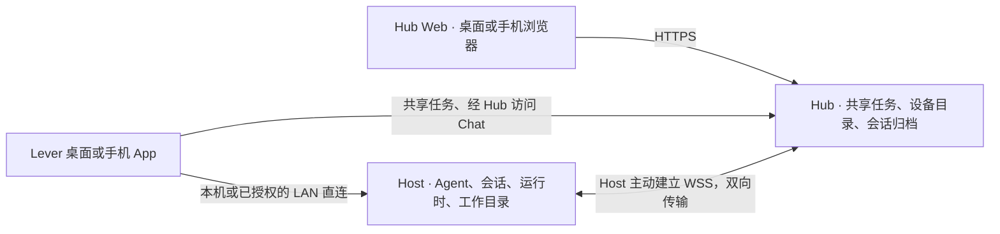

# Lever 多设备与自托管 Hub

概要设计草案 · 2026-11-20

在电脑 B 把任务派给 A，在手机上回答 A 的审批，回到 A 查看文件和变更，最后在原任务验收。整段工作只有一条执行会话。**Host 管这条会话怎么运行，Hub 管这项共享任务交给了谁。** 切换设备或网络时，用户仍从 Agents 打开原 Chat 或 Topic，从 Tasks 找到交付结果。 [Lever 产品与会话设计](design.md)

方案面向一位用户、一个自托管 Hub 和多台独立 Host。本机任务和 Chat 默认留在创建它们的设备。首期用无窗口 `lever` 和响应式 Hub Web 跑通这段流程。下文的远程协议、部署命令和界面均为拟议设计。

## 交付产物

**一期发布三类产物。** 管理员用 Hub 镜像和部署包启动服务，在每台要执行任务的机器上运行对应平台的 `lever`。只查看任务、发消息或处理审批的人，直接用电脑或手机浏览器打开 Hub 地址。

| 阶段 | 用户拿到什么 | 装在哪里，怎样使用 |
| --- | --- | --- |
| 一期 | **Hub 镜像** `lever-hub:<version>` | 自托管服务器。镜像内的 `lever-hub` 同时提供 Web、HTTP API 和 Host 连接入口。同一程序提供 `setup`、`backup` 和停服后的 `restore`。 |
| 一期 | **部署包** `lever-hub-deploy-<version>.tar.gz` | 解压得到 `compose.yaml`、`.env.example` 和 `README.md`。将 `.env.example` 复制为 `.env`，填写域名后运行 `docker compose up -d`。Compose 引用该版本的镜像，说明涵盖初始化、升级和恢复。 |
| 一期 | **支持远程配对的 Host**，沿用 `lever`，Windows 为 `lever.exe` | 每台执行电脑或可选的云主机。启动程序，在本机 Web 或 CLI 配对、选择开放的 Agent。工作目录和 Provider 登录态取自该机器。 |
| 二期 | **Lever 桌面包**，macOS 为 `Lever.app`，Windows 为 `Lever.exe` | 执行设备和控制设备按需安装。桌面包自带 Host 运行能力，设置中启用远程执行后可登录自启、空闲待命。同期更新 Hub 的 LAN 授权和 Host 的直连接口。 |
| 三期 | **Lever 手机 App**，iOS 签名包（`.ipa`）和 Android APK | 用 MyGo Mobile 分别打包，在两端真机验收。安装后扫码配对，同网可直连 Host，离开局域网后可经 Hub 续接共享 Chat。 |

**构建入口。** 现有 `make build` 输出 `bin/lever`，`make package` 将桌面包输出到 `desktop/dist/<平台>-<架构>/`。一期拟增 `make hub`，复用 `make web`，再从 `cmd/lever-hub` 构建 `bin/lever-hub`。镜像从仓库根目录构建，在 Linux 构建阶段使用同一目标，运行镜像携带已嵌入 Web 资源的程序。部署包直接从 `deploy/hub/` 收集上述三个文件。 [现有构建目标](../Makefile) · [桌面打包配置](../desktop/mygo.json) · [Web 资源嵌入](../web/assets.go)

## 源码目录与依赖

沿用一个 Go module 和一个 Web 工程。下图只列与交付有关的位置，`+` 表示拟新增，阶段标在首次需要该目录的位置。

```text
lever/
├── cmd/
│   ├── lever/                   无窗口 Host 与本机 CLI 入口
│   ├── lever-desktop/           桌面窗口及同一可执行文件的后台 Host 模式
│   └── lever-hub/               + 一期，Hub 服务入口与运维子命令
├── internal/
│   ├── host/                    装配本机后端，管理窗口连接、空闲退出和远程常驻
│   ├── cli/                     本机 CLI 命令，包括拟新增的配对操作
│   ├── localipc/                当前系统用户的 socket 或命名管道
│   ├── httpapi/                 本机 HTTP、SSE 和私有 IPC 的请求处理
│   ├── app/                     Chat、任务、审批和执行的业务入口
│   ├── store/                   Host SQLite、派发回执和待同步记录
│   ├── provider/                在 Host 上启动和控制运行时
│   ├── remoteproto/             + 一期，Host 与 Hub 的命令、回执、同步批次和版本
│   ├── remote/                  + 一期，Host 侧配对、WSS、远程命令与同步，二期加 LAN
│   └── hub/                     + 一期，Hub HTTP、设备连接、共享任务、归档和自己的 SQLite
├── web/
│   ├── index.html               本机工作台入口
│   ├── hub.html                 + 一期，Hub Web 入口
│   ├── assets.go                将 web/dist 嵌入 Go 程序
│   └── src/
│       ├── main.tsx             本机配对并启动工作台
│       ├── hub.tsx              + 一期，Hub 登录并启动共享工作台
│       ├── api/                 本机 client.ts 和拟新增的 Hub 客户端 hub.ts
│       └── features/            复用 agents、tasks、chat，设备管理放在 settings
├── deploy/hub/                  + 一期
│   ├── Dockerfile               构建 Hub 镜像
│   ├── compose.yaml             固定镜像版本、服务入口及持久卷
│   ├── .env.example             部署者需要填写的配置
│   └── README.md                随部署包发布的操作说明
└── mobile/                      + 三期，MyGo Mobile 入口和两端共用的 Go 客户端
    ├── ios/                     按需接入 iOS 系统能力的 Swift 代码
    └── android/                 按需接入 Android 系统能力的 Kotlin 代码
```

- **Host 与 Hub 各自装配。** Hub 通过 WSS 投递 `remoteproto` 定义的指令。Host 的 `remote` 校验授权并调用 `app`，在受理派发的同一个本机事务里写入会话、回执和待同步标记。Hub 用自己的库保存任务和归档，对 Host 的依赖只到消息契约。本机运行时和 loopback 路由由 `internal/host` 装配。
- **Web 构建一次，按入口启动。** 一期的两个 HTML 入口由同一 Vite 工程输出到 `web/dist/`。Host 的首页继续使用 `index.html`，Hub 的首页和共享深链接使用 `hub.html`。本机入口走现有配对，Hub 入口走同源账号登录。二者复用侧栏、看板、Composer 和审批卡，分别接本机或 Hub 的查询与操作。 [当前前端入口](../web/src/main.tsx) · [Vite 配置](../web/vite.config.ts)
- **桌面复用同一个 Host。** 现有窗口先通过私有 IPC 连接后台，按需用同一程序的 `--serve-desktop` 模式启动 Host。目前 `/desktop/attach` 只在桌面后台模式注册。二期让已配对的无窗口 Host 也接受窗口连接，同一个数据目录始终由一个进程持有。 [后台连接](../internal/host/desktop_client.go) · [后台生命周期](../internal/host/desktop.go) · [本机 IPC 路由](../internal/httpapi/local_cli.go)

Hub 的 HTTP 请求与响应类型跟处理函数放在 `internal/hub/`，浏览器使用的类型拟纳入现有 `make generate`，生成到 `web/src/api/hub.gen.ts`。Host 与 Hub 之间的协议兼容测试放在 `internal/remoteproto/`，两端配合的派发和归档恢复用 `internal/hub/` 的集成测试验收，浏览器流程沿用 `web/tests/`。 [现有类型生成配置](../internal/model/tygo.yaml)

### 手机 App 选型

三期 iOS 和 Android 控制端采用 **MyGo Mobile**。一期 Hub Web 的响应式 React 界面随 App 打包，在 iOS 的 WKWebView 和 Android 的系统 WebView 中运行。两端复用 Agents、Tasks、Chat 和审批卡。一条审批在电脑上被回答后，手机上的同一张卡片会显示 Host 已采纳的答案。

浏览器用 Hub 的同源登录会话发送请求、订阅事件。App 则通过 MyGo 绑定调用两端共用的 Go 客户端。它将控制端凭据保存在系统安全存储中，直连时验证配对时登记的 Host 公钥。共享 Chat 在 LAN 和 Hub 之间换路后，仍按原请求 ID 核对回执。仅设备 Chat 只走获准的 LAN 直连，共享任务操作始终交给 Hub。 [现有 Web 客户端](../web/src/api/client.ts)

Swift 和 Kotlin 按需接入扫码和局域网发现等系统能力。MyGo 的相机插件提供预览和拍照，扫码配对还需接入二维码识别。移动支持始于 MyGo `v0.10.0`。Lever 当前使用 `v0.7.4`，三期接入时一并升级 Go 依赖、CLI 和前端运行库。 [MyGo 发布说明](https://github.com/egoist/mygo/releases/tag/v0.10.0) · [原生模块与插件](https://github.com/egoist/mygo/blob/v0.10.0/docs/mobile/plugins.md) · [相机插件](https://github.com/egoist/mygo/blob/v0.10.0/plugins/camera/camera.go) · [Lever 依赖](../go.mod)

## 谁保存数据，谁接受修改



| 对象 | 谁决定它的状态 | 其他端持有什么 |
| --- | --- | --- |
| Agent、Scope、目录组 | 所属 Host。接收首条消息时解析工作目录，后续各轮沿用该 Session 的 Scope。 | Hub 展示用户开放的 Agent 和可选目录组的 ID、名称与可用性。 |
| Chat、主 Session、Topic、Run、审批请求 | 创建 Chat 的 Host。每个 Session 独立准入、排队和恢复。 | 客户端操作原对象。Hub 保存显式共享的会话副本，供设备离线时阅读。 |
| 共享任务、派发历史、验收结果 | Hub。每项任务指向当前派发，保留历次派发的目标和结果。 | Host 只保存与本次 Chat 对应的派发引用。来源设备保存本机任务和共享任务链接。 |
| 草稿、列表位置、已读游标 | 当前客户端。阅读位置细到 Session，审批结果由 Host 确认。 | 桌面、浏览器和手机可以各自保留工作位置。 |

**设备按 Host 实例识别。** 在 Lever 数据目录里生成并持久化 `deviceId`，配对时绑定 Host 公钥。改名或换 IP 后仍能打开原会话。同一服务器上的两个独立数据目录可以各自配对。桌面可同时是执行端和控制端，两种身份分别授权。

选择执行目标用 `(deviceId, agentId, workingCopyId?)`，打开会话用 `(deviceId, chatId)`，再定位其中的 Session、Run 或审批请求。任务链接用 `(hubId, taskId)`。Hub 的域名是连接地址，稳定身份随数据卷和备份保存。

现有 `Overview` 返回的设备 ID 固定为 `local`。已有 Chat、Session 和运行时原生会话 ID 都可沿用，只在跨设备引用的外层补上所属 Host。当前目录组选择已有归属、归档状态和就绪校验，远程派发也由目标 Host 做这次校验。 [本机 Overview、发送与 Session 创建](../internal/app/app.go) · [目录组解析](../internal/app/working_copies.go)

## 共享范围与访问路径

在 Chat 上新增一个可选的 `sharedWithHubId`。为空表示「仅设备」，也是旧数据和本机新 Chat 的默认值。有值表示「与这个 Hub 共享」。Host 创建 Chat 时写定范围，主 Session、Topic 和后续 Run 继承它。本机续聊共享 Chat，新消息仍进入原 Hub 的归档。想分享旧的仅设备对话时，用户选取内容开始一条新的共享 Chat。现有 `SharedConversation` 读取 Provider 的原生会话，跨设备归档直接使用 Lever 的 Chat。 [原生会话入口](../internal/app/shared_conversations.go)

| 用户要操作什么 | 可以从哪里操作 | 连接中断后 |
| --- | --- | --- |
| 仅设备 Chat | 本机，或经该 Host 授权的原生客户端在 LAN 直连。会话标题、正文、活动和命令都留在这条路径。 | 离开 LAN 时保留已加载内容和草稿，等同一 Host 重新可达。 |
| Hub 共享 Chat | 本机、已授权的 LAN，或经绑定的 Hub。回复、审批和停止都送给同一 Host。 | LAN 断开时可经 Hub 续接。Hub 暂不可达时，有效的直连授权仍可用。两条路都断开时显示最近同步的历史和时间。 |
| 共享任务 | 各端都向 Hub 创建、编辑、派发和验收。打开关联 Chat 后按上一行访问。 | Hub 离线时保留上次任务视图。本机或 LAN 中已完成的会话操作在重连后补入任务进度。 |

经 Hub 新建 Chat 使用「Hub 共享」。本机或 LAN 新建时可显式选择范围。发送前显示 Agent、执行设备、目录组与范围。归档保留 Chat 和 Session 的层级、时间线顺序、用户消息、助手回复、工具活动摘要、运行状态及审批所需字段。首次共享时提示消息和审批详情可能包含路径或源码。原始文件、完整 diff、附件内容、Profile 配置和 Provider 凭据保存在 Host。

委派仍在同一 Host 执行。共享父 Chat 的委派目标既要满足父 Agent 的委派规则，也要已向该 Hub 开放。Host 在创建子 Chat 前检查这两个条件，子 Chat 继承父 Chat 的共享范围。 [本机委派流程](../internal/app/delegation.go)

## 一项任务可以派发多次

**一次派发直接用首条消息的 `commandId` 标识。** Hub 保存每次派发的目标和指令快照，Host 受理后返回 Chat、主 Session 和首个 Run。补充要求沿用该 Chat，改派则创建一条新记录。

1. **确定共享内容。** 一期从 Hub Web 直接新建任务。二期支持从本机任务笔记派发，来源设备先校验笔记版本，再预览标题、指令和项目。有图片或附件时，用户可补充文字或明确选择仅派发文字。来源设备保存用户确认的快照及创建 ID，用同一 ID 重试可取回同一项共享任务，再将链接记回本机。从共享 Chat 创建任务时保留原 Chat 或 Topic 的来源链接，从仅设备 Chat 创建则只带选中的内容。来源链接用于追溯，派发才会启动执行。
2. **选定执行目标。** 在任务详情选择 Agent 和目录组，发起端保存这次派发的 ID。Hub 对重试返回原记录，对新请求则在同一个事务里校验任务版本、登记当前派发和待投递内容，再投递给在线 Host。两端同时派发只能有一次成功。目标事先已离线时可以保存任务稍后派发。投递途中断线则保留原目标，显示「正在确认是否送达」。
3. **接续与验收。** 收到 Host 回执后，「打开 Chat」直达主会话。当前派发的主 Session 决定任务进度，各 Topic 独立回应。用户验收时，Hub 先记下当前派发和用户看过的 Run。原 Host 在同一个受理事务里核对该 Run 仍是主 Session 最新的已完成结果，并确认队列已空、没有活动或未确认的执行，随后记下最终结果。Hub 据此标记完成。若 A 先收到新要求，手机会看到新一轮，验收需要重新确认。
4. **改派或重试执行。** 改派也先请原 Host 结束这次派发。正在执行的工作要先停下或完成，排队输入要处理完，`unknown` 要在原设备核实。若首条指令尚未受理，原 Host 可以先为该派发 ID 落一条终止记录，迟到的首条指令只返回这条回执。Hub 取得最终回执后才以新 ID 派发，可带上用户选定的结论。旧 Chat 仍可作为普通对话继续，历史派发的结果固定在结束时的 Run。

Hub 按任务版本串行处理验收与改派，先记录意图再联系 Host。两项操作共用一次派发的最终回执，Hub 重启也可按原 ID 取回它。**原 Host 离线且尚无最终回执时，可读历史，验收和改派等它恢复。** 这样 A 已经开跑而回执丢失时，在 B 上重试仍会找回 A 的 Chat。

本机 `DispatchTask` 要读取本机笔记、检查版本并处理笔记图片。SQLite 的 `chat_task` 唯一索引还约束一个本机任务只关联一条 Chat。共享派发使用独立的 `(hubId, taskId, commandId)` 引用，在 Host 复用 `sendLocked` 的受理事务、队列和运行时入口。这样电脑 A 只需收到任务指令即可执行，B 的笔记及其本地派发约束仍由 B 管理。 [本机任务派发](../internal/app/tasks.go) · [任务与执行模型](../internal/model/tasks.go) · [唯一索引](../internal/store/store.go)

## 远程命令与回执

普通 Chat 的发送、回答、停止和回执查询，经 LAN 或 Hub 都进入同一套 Host 授权和业务处理。客户端保存待确认的输入，Hub 在线转交。只有 Hub 能发起或结束带共享任务引用的派发，Host 校验其 Hub 身份。本机与直连客户端要改派或验收时，也向 Hub 提交任务操作。

| 操作 | Host 如何确认 |
| --- | --- |
| 首条消息、续聊、任务指令 | Host 校验授权，将原始发起身份、目标、共享范围和规范化输入绑定到 `commandId`，与本次创建或修改的 Chat、Session、Run 在同一事务中受理。相同请求返回原引用，同 ID 改目标或内容返回冲突。提交后才启动运行时。 |
| 回答审批或问题 | 绑定具体 `requestId` 和答案。首个有效答案持久化后交给运行时。同答案重试返回已有结果，两端答案不同则显示已采纳的答案。已过期的卡片刷新为终态。 |
| 停止 | 绑定具体 `runId`，回执表示已处理停止请求。界面依据 Host 随后报告的 Run 终态展示结果。 |
| 结束派发 | 按该次首条指令的 ID 记录最终结果。重复查询或投递返回同一结果，旧派发的迟到回执只能补入自己的历史记录。 |

例如手机在 Wi-Fi 发出首条消息，A 已创建 Chat，回执却在切到蜂窝网时丢失。手机经 Hub 携带原 ID、原发起身份和原输入查询或重试，A 返回已有 Chat 和 Run。相同文字由用户主动发送第二次会获得新 ID。投递期限只限制首次受理，超时后仍可查询已有记录。回执确认的是 Host 已受理，运行时的外部操作以实际结果为准。Host 异常退出时沿用现有恢复语义，活动执行标为 `unknown`、待回答的请求过期、所属队列暂停。 [发送、回答与停止](../internal/app/app.go) · [重启恢复](../internal/store/store.go)

## 共享历史怎样补齐

现有 SSE 只保留最近的对象变更通知，Run 和 Request 的内容按引用读取。长时间离线、Hub 还原备份，都可能超出这段历史。为此，每个 Host 为绑定的 Hub 维护一个递增的**共享版本**。同一个版本用于归档确认和比较从 LAN、Hub 读到的快照。 [事件保留与事务提交](../internal/store/store.go) · [现有会话活动摘要](../internal/store/activity.go)

1. **Host 落盘。** 共享数据变更时，在同一个 SQLite 事务中推进版本，按对象键记录最新版本及删除标记。流式更新同一 Run 只占一条待同步记录。编辑替换旧消息、重启恢复和删除会话都要记录受影响的对象。开放的 Agent 和目录组也走这条路径，目录字段只含用户开放的摘要。
2. **Hub 确认。** Host 从一致的读快照取出上次确认点到本次版本的全部变更，只保留共享字段，结束本机事务后再传输。Hub 核对批次起点等于当前确认点，收齐后将更新、删除和新确认点一起提交。已应用的批次只返回确认，有缺口则从当前确认点补传。Host 只清理已确认版本，传输途中产生的更新留给下一批。Agents 摘要和派发进度从已提交的数据读取。
3. **从旧备份恢复。** 首次连接，或 Hub 的确认点早于 Host 已清理的记录时，Host 按一致快照列出属于该 Hub 的全部共享对象。Hub 用完整清单校正该 Host 的归档，清掉源端已删除的条目，再收增量。这次重建只覆盖该 Host 的共享数据。Hub 自己持有的任务和验收记录恢复到备份点。
4. **客户端换路。** 读取同一 Chat 的快照及该来源的订阅游标，再接收该来源的后续事件。订阅游标只在原来源有效。若手机已从 A 看到较新的共享版本，切到落后的 Hub 时保留已显示的内容并提示同步中，待 Hub 追平后继续更新。

## 配对与连接

Hub 给每个 Host 和原生控制端分别签发可撤销的凭据。浏览器使用 Hub 同源登录会话。Host 主动连出到 Hub 的 443 端口并在断线后重连。握手协商协议版本和支持的操作，界面按目标能力提供入口。自托管者能读取归档的共享消息。

开启 LAN 后，Host 在独立端口提供远程接口，通过 mDNS 公告候选地址。客户端在 TLS 连接上用配对时登记的公钥验证 Host。Host 验证控制端持钥证明和 Hub 签发的短期授权，逐次核对目标、操作及本机保存的 Chat 共享范围。访问仅设备 Chat 需要 Host 明确开放的 LAN 权限。Hub 验证登录用户对任务、归档和命令的权限。完整的 Files、Diff、Terminal 和运行时设置由本机 loopback 接口提供。 [本机 HTTP 边界](../internal/httpapi/server.go)

原生客户端同网优先直连。连接中断或系统未开放局域网访问时，共享 Chat 切到 Hub。直连恢复且双方身份验证通过后，再切回原会话。Host 拒绝操作授权时，客户端直接显示拒绝结果。Hub 离线期间可在已有授权有效期内直连，撤权在线下发，离线 Host 最迟在授权到期时停止接受该凭据。解除 Host 配对后停止控制和同步，Hub 账号仍可阅读已归档历史。浏览器使用同源 Hub，局域网发现由原生客户端完成。 [Chrome 本地网络访问](https://developer.chrome.com/docs/modern-web-guidance/guides/security/local-network-access) · [Apple 本地网络权限](https://developer.apple.com/documentation/technotes/tn3179-understanding-local-network-privacy)

## 用户从 Agents 和 Tasks 开始

```text
一级导航      二级侧栏                     Chat
Lever         Agents           折叠  ＋    修复导出时的文件名冲突
Agents        搜索 Agent                   代码 Agent · 电脑 A · Hub 共享
Tasks         全部 / 未读                  [打开关联任务]
设置          电脑 A
                代码 Agent                 等你确认写入导出目录
                  修复导出…  待处理        [查看详情并回答]
              电脑 B
                文档 Agent                 输入消息…
```

- **Agents** 是首次打开 Hub 的落点，之后恢复上次使用的 Agents 或 Tasks。侧栏按设备列出已开放的 Agent，沿用「全部 / 未读」和活跃 Chat、Topic。一条审批从侧栏或任务详情打开同一张卡片。读过消息后仍待回答的请求继续显示。 [Agent 侧栏](../web/src/features/agents/AgentSidebar.tsx) · [审批卡](../web/src/features/chat/RequestCard.tsx)
- **Tasks** 复用看板、保存的视图和任务详情。卡片显示任务状态、Agent 和设备。设备筛选单独按 `deviceId` 匹配，现有 `filters.remote` 表示外部任务源的状态。详情置顶当前派发，历史记录可回到当时的 Chat。派发面板沿用 Agent 与目录组选择器，切换 Agent 后清空旧目录组并保留指令草稿。 [任务看板](../web/src/features/tasks/TaskBoard.tsx) · [派发表单](../web/src/features/tasks/TaskDispatchPanel.tsx)
- **任务状态** 复用现有 `taskStatus`。手动任务从「待办」到「进行中」，执行完成后进入「待验收」，验收后「已完成」。等待回答、失败或未知时显示「需处理」。「待确认」用于任务提议，「排队中」用于 Agent 的任务队列，手动关闭的任务显示「已关闭」。网络回执另标「待设备确认」，设备断线则显示「进行中 · 电脑 A 离线」，保留已知进度。 [状态推导](../web/src/features/tasks/taskDocument.ts) · [中文状态名称](../web/src/i18n/zh-CN.ts)
- **设置 → 设备** 负责配对、改名、查看最近连接和同步时间，以及撤销 Host 或控制端。首次没有设备时指向「添加设备」。已连接却没有可用 Agent 时指向该 Host 的开放设置或 Provider 状态。

桌面默认看本机 Agent，Tasks 可切换「本机 / Hub 共享」。宽屏沿用可折叠的二级侧栏。手机 Web 打开详情后占满页面，返回时恢复筛选与位置。原生 App 以 Agents、Tasks 为底部入口。窄屏保留设备名和下一步操作，沿用灰阶主题、状态图标和文字，触控区至少 44 px。 [共享侧栏](../web/src/components/workbench/SecondarySidebar.tsx) · [Lever 界面规范](../AGENTS.md)

查询缓存、草稿和已读记录用所属 Host 区分。新 Chat 的草稿挂在所选 Agent，已有会话按 Chat 或 Session 定位。升级时把旧键视作当前本机的数据，打开另一台设备上的同名 Agent 也能保留各自的草稿。 [新 Chat 输入框](../web/src/features/chat/NewChat.tsx) · [现有已读游标](../web/src/features/agents/useConversationReadState.ts)

```text
Agents                           ＋
搜索 Agent              全部 / 未读

电脑 A
  代码 Agent
    修复导出时的文件名冲突  待处理 ›
电脑 B
  文档 Agent
    检查批量导出的说明        未读 ›

      Agents            Tasks
```

共享链接可以直接定位任务、Chat、Topic 或审批卡。手机回到前台、打开链接或后续从系统通知进入时，读取对象的当前状态，已在另一端回答的卡片显示处理结果。

## 部署与数据目录

Hub 与 Host 可以部署在同一台服务器上，各自持有独立的数据目录。

| 持有者 | 运行时目录 | 持久化内容 |
| --- | --- | --- |
| Hub | 拟将 Compose 命名卷 `hub-data` 挂载到 `/var/lib/lever-hub/` | `hub.db` 保存账号、配对、共享任务与归档。`identity/` 保存 Hub 身份密钥，自管 HTTPS 时 `tls/` 保存证书与续期材料。升级复用该卷。 |
| 每个 Host | 沿用 `--data-dir`、`LEVER_DATA_DIR` 或系统用户配置目录下的 `Lever/` | 原有 `lever.db` 增加设备身份关联、派发回执和待同步记录。用户文件和工作副本仍按 Agent 的 Scope 定位。 [Host 默认路径](../internal/host/host.go) · [数据库与目录锁](../internal/store/store.go) |

1. **启动 Hub。** 将域名指向服务器，在部署包的 `.env` 中设置 `LEVER_HUB_DOMAIN`，开放 TCP 443。运行 `docker compose up -d`，用包内指定的镜像版本和持久卷启动 Hub。独立部署时由 Hub 通过 TLS-ALPN-01 获取和续期证书。有现成 HTTPS 反向代理时，由代理处理证书、转发 WebSocket 和 SSE，Hub 的 HTTP 端口只向代理开放。 [Docker Compose](https://docs.docker.com/reference/cli/docker/compose/up/) · [证书验证条件](https://letsencrypt.org/docs/challenge-types/#tls-alpn-01)
2. **配对第一台设备。** 在服务器执行拟议命令 `docker compose exec hub lever-hub setup`，用一次性初始化链接创建管理员。登录「设置 → 设备」生成区分 Host 与控制端的限时一次性配对码。A 在本机设置中粘贴配对链接并选择开放的 Agent，无窗口 Host 也可通过本机 CLI 提交相同选择。云端执行只需配对一个有独立数据目录、工作目录和 Provider 登录态的 Host。手机浏览器登录同一个 HTTPS 地址，原生 App 扫码配对。
3. **让 Host 独立于窗口。** 现有桌面在独立进程中运行 Host。窗口通过按数据目录定位的本机 socket 或命名管道取得配对信息。窗口关闭后，Host 继续执行活跃任务，任务结束后退出。启用远程执行后，Host 作为用户级服务随登录启动，以便在窗口关闭时接收派发。 [无窗口入口](../cmd/lever/main.go) · [桌面生命周期](../cmd/lever-desktop/main.go) · [本机 IPC](../internal/httpapi/local_cli.go)
4. **更新与恢复。** 升级前将 SQLite 一致快照与 Hub 身份密钥备份到服务器之外。切换固定镜像版本并运行 `docker compose pull && docker compose up -d`，Hub 执行迁移，设备沿用配对重连。回滚到旧备份时，先核对恢复点之后的授权变更，再开放远程控制。按原 ID 向 Host 核实未决派发。只找回 Chat 而缺少任务记录时，将它作为历史供查阅。设备页显示连接与归档进度，`docker compose logs hub` 可查看启动、证书和迁移错误。

## 交付顺序与验收

### 1. Hub Web 与无窗口 Host

- 用发布镜像和部署包从空卷初始化 Hub，在 A 运行发布的 `lever` 并配对。从 B 的浏览器派给 A，在手机 Web 回答审批，再回任务验收。
- 双端同时派发、A 的受理回执丢失、Hub 重启后，Hub 只有一条当前派发，A 只有一个首轮 Run。双端提交不同审批答案时，原卡片显示同一个已采纳答案。
- A 已接收新一轮时，旧结果的验收应返回冲突。先验收再续聊时，历史派发仍指向已验收的 Run。回执丢失时尝试改派，若终止记录先落盘，迟到的首条指令只能取回该回执。若指令先受理，需找回原 Run 并核实终态，才能向新目标派发。
- 还原到较早的 Hub 备份。确认过的更新与删除能从 A 的共享快照补齐，其他 Host 的归档完整，任务按备份点恢复。

### 2. 桌面与 LAN

- 在目标平台安装桌面包并启用远程执行。A 重新登录系统后保持空闲、窗口关闭，从 B 派发仍能启动新的 Run。再打开 A 的窗口能接回同一 Host 和 Chat。
- 从本机笔记预览并共享选中内容。B 直连发出首条消息后断网，经 Hub 找回同一 Chat 和 Run。相同 ID 携带不同输入时返回冲突。
- 离开 LAN 时，核对仅设备 Chat 的标题、正文和命令均未进入 Hub。Hub 不可达时，在有效授权期内通过 LAN 回答共享 Chat 的审批，到期后 Host 拒绝新的远程操作。恢复连接后，任务补齐进度。

### 3. MyGo Mobile 手机 App

- 分别在 iPhone 和 Android 真机扫码配对。通过 Wi-Fi 直连回答共享 Topic 的审批，在收到回执前切到蜂窝网。经 Hub 重开原 Topic，确认仍是同一个 `requestId`，Host 只采纳一次。拒绝局域网权限时，共享 Chat 仍可经 Hub 访问，仅设备 Chat 保留已加载内容和草稿。
- 在长对话中滚动并用中文输入法编辑草稿。将 App 切到后台，从电脑回答审批。回到前台时应恢复原 Topic 和草稿，审批卡显示已采纳的答案。
- 原 Host 异常退出后，手机能阅读历史并定位待核实的设备。确认旧执行已停止后方可改派，已暂停的会话队列由用户显式恢复。

MyGo 首发时在 iPhone 16 真机上做过验证，Android 的结果来自模拟器。若 Lever 在某个平台上的输入或滚动体验经真机调优仍不达标，再单独评估对应页面的原生实现。 [上游验证记录](https://github.com/egoist/mygo/pull/940)
