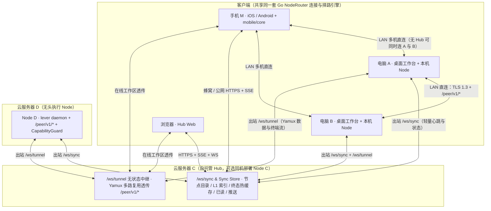

# Lever Agent-based 多设备协同架构设计

设计方案 · 2026-11-26（v2）

> **设计基线**：以 **Agent 为协同逻辑基准**，采用 **Node + 可选单 Hub** 拓扑；**单用户默认互信**（预留多用户扩展位）；参考**飞书式多端同步**体验（默认一致、按需游标分页、已读实时对齐）；**Owner Node 为唯一权威，Hub 只做消息/状态热缓存与无状态隧道中继**；桌面端不改变主工作形态，远程 Agent 与本机 Agent 在同一列表中近似统一使用。[Lever 产品与会话设计](design.md)

---

## 1. 典型场景与核心架构不变量

### 1.1 目标场景

设用户拥有：电脑 A（Mac）、电脑 B（Mac/Windows）、云服务器 C（公网地址）、云服务器 D（无公网/内网云机）、手机 M（iOS/Android）。

1. **公网 Hub 协同（A / B / D / M 连接 C）**：C 部署 Hub（可选同机运行 Node C），A/B/C/D/M 均可与任意节点上开放的 Agent 沟通、审批、协作与跨机委派；同在局域网的设备自动优先走局域网直连，出门后无缝切回 C 中转。
2. **纯局域网多机直连（无 Hub，A / B / M 互通）**：不部署 Hub 时，手机 M 可同时直连 A 与 B 上的 Agent；A 与 B 之间也可直接局域网互连与跨机委派。
3. **按设备开放权限解锁扩展能力**：依据各设备本地开放的权限档位，其他设备可直接在该设备上浏览/编辑允许目录文件、查看完整 Git Diff、创建/编辑 Agent 或打开远程终端。

### 1.2 七条不可破坏的架构不变量

1. **Owner Node 唯一权威**：每个 Agent 固定归属创建它的 Node；运行时进程、Provider 凭据、工作目录、完整历史与 SQLite 始终留在 Owner Node，Hub 与其他设备不持有执行权。
2. **统一资源寻址**：所有对象均以 `(nodeId, resourceId)` 寻址（本机 Node 同样使用持久 UUID `nodeId`），彻底消除隐式单机假设。
3. **一套模型，不维护双套 Transcript Schema**：远程接口直接复用 Lever 现有 `model` 契约子集（`Agent / Chat / Session / Run / Request / ChatPage / SessionRunPage`），废弃把对象二次阉割转换成异构 `remoteproto.Record` 再还原的冗余链路。
4. **开放 Agent 即默认同步（飞书式一致），不做双源拼页**：开放 Agent 下的对话默认多端可见（支持个别 Agent/Chat 显式标 `localOnly`）；Owner Node **在线**时直接分页读取其原生历史与实时流，**离线**时读取客户端本地缓存 + Hub 热缓存。
5. **双隔离出站 WSS + 统一 `/peer/v1/*` 业务面**：Hub ↔ Node 拆分为轻量 `/ws/sync`（心跳/目录/同步/事件）与 `/ws/tunnel`（`yamux` 复用流透传 `/peer/v1/*`），避免大文件/终端阻塞心跳；LAN TLS 1.3 直连与 Hub 隧道共用同一套 `/peer/v1/*` `http.Handler`。
6. **单用户默认互信，3 档权限 + 本地硬守卫**：个人多设备（含 Hub Web 浏览器）默认免 Inbox 确认直接互信；目标 Node 本地以 3 档清晰预设（`chat` / `workspace` / `admin`）控制能力边界，并内置不可绕过的敏感路径读写黑名单。
7. **坚决不做 Hub-to-Hub Mesh**：Hub 定位为薄通信与轻量同步中心（通过自动化包依赖测试锁死 `internal/hub` 不得依赖 `internal/app`、`internal/provider`、`internal/workspace`）。多网络需求通过在客户端维护「多目标槽（可选 Hub + N 个 LAN Peer）」解决，Hub 之间永远不互联同步。

---

## 2. 总体架构：Node + 可选单 Hub

系统拆分为清晰的正交层次：

* **控制与同步面（`/ws/sync` + Hub Sync Store）**：负责节点在线状态、L1 目录与会话摘要、跨端单调已读游标、终态热缓存（供离线浏览）以及手机锁屏推送（APNs/FCM）。负载极轻，绝不承载大对象。
* **实时交互与工作区面（`/peer/v1/*` over LAN TLS 1.3 / Hub `/ws/tunnel`）**：承载在线分页历史、实时流式 SSE、发消息/审批、附件、文件目录读写、Git Diff、远程建 Agent、PTY 终端。Hub 侧纯无状态流透传，不落盘。



### 2.1 Node 描述模型（分离「软件协议特性」与「用户授权权限」）

每个设备由持久 UUID `nodeId` 与 Ed25519 密钥对唯一标识，对外宣告 `NodeDescriptor`：

```go
type AccessLevel string

const (
	AccessNone      AccessLevel = "none"      // 纯控制端（如手机 M），不提供服务能力
	AccessChat      AccessLevel = "chat"      // 仅对话、话题、审批、跨机委派与只读变更摘要
	AccessWorkspace AccessLevel = "workspace" // 含 chat + 允许目录文件浏览/读写 + 完整 Diff + 附件
	AccessAdmin     AccessLevel = "admin"     // 含 workspace + 远程创建/编辑/归档 Agent + 远程 PTY 终端
)

type NodeDescriptor struct {
	NodeID                string           `json:"nodeId"`
	PublicKey             []byte           `json:"publicKey"`
	Name                  string           `json:"name"`
	Platform              string           `json:"platform"`              // darwin / windows / linux / ios / android
	LeverVersion          string           `json:"leverVersion"`          // 仅展示与升级提示，不作为协议判断依据
	ProtocolVersion       int              `json:"protocolVersion"`       // 当前协议版本
	MinCompatibleProtocol int              `json:"minCompatibleProtocol"` // 最低兼容版本
	Features              []string         `json:"features"`              // 软件支持的特性集：peer_v1, fs_v1, agent_manage_v1, terminal_v1 ...
	Online                bool             `json:"online"`
	Draining              bool             `json:"draining"`              // 维护态：暂停接收新任务/新对话
	CanControl            bool             `json:"canControl"`            // 是否允许主动控制/委派其他 Node
	AccessLevel           AccessLevel      `json:"accessLevel"`           // 本机用户授权档位
	ReadOnlyFS            bool             `json:"readOnlyFs,omitempty"`  // workspace 档下的可选「文件只读」限制
	BrowseRoots           []BrowseRootInfo `json:"browseRoots,omitempty"` // 允许浏览/建 Agent 的根目录标签
}
```

* **区分 `Features` 与 `AccessLevel` 的价值**：客户端能够明确分辨一个能力不可用究竟是「**目标设备未开放该权限**」（提示去对方设置开启），还是「**目标设备的 Lever 版本较旧**」（提示升级），避免静默失败或误导文案。

---

## 3. 信任模型、3 档权限预设与安全守卫

### 3.1 单用户默认互信（与多用户扩展位）

* **默认互信，消除 Inbox 摩擦**：
  * 配对加入同一 Hub 个人域的所有设备（A / B / C / D / M）以及登录同一 Hub 的浏览器会话，默认同属一个 `owner`，**直接按目标 Node 的 `AccessLevel` 执行，不再把个人操作拦截在本地待确认 Inbox**。
  * 无 Hub 局域网中通过扫码/短码完成配对的 Peer 同样默认互信。
  * 提供一个**可选安全开关**「新设备接入需确认」（默认关闭），需要更高防线的用户可在 Host 或 Hub 开启。
* **多用户扩展预留**：协议头与 Hub 存储保留 `spaceId`、`actorUserId`、`actorNodeId`；鉴权固定为两段式 `Authenticate(actor) → Authorize(actor, targetNode, requiredAccess, resource)`。当前单用户仅校验同 `owner` + 目标 Node 权限档位；未来接入团队空间时只需在 `Authorize` 叠加成员角色 ACL，无需重写协议。

### 3.2 3 档权限预设与本地硬边界

采用 3 档诚实、符合实际安全边界的权限预设（全部由目标 Node 本地设置和强制校验，Hub 无法越权提升）：

| 权限档位 | 包含能力 | 推荐场景 |
| --- | --- | --- |
| **`chat`** | 与开放 Agent 对话/话题/审批（含 `allow_run`、恢复队列、停止、重试、切模型）、跨机 Agent 委派、查看文件变更摘要 | 敏感办公机、仅需手机/异地收发消息的机器 |
| **`workspace`**（桌面默认） | 包含 `chat` + 浏览/搜索/读取/编辑允许目录文件（可单勾「仅只读」开关）+ 完整 Git Diff + 附件上传/下载 | 个人主力电脑 A / B |
| **`admin`**（云主机推荐） | 包含 `workspace` + 查询远端 Providers/Models/Skills + 远程创建/编辑/归档 Agent + 远程 PTY 终端 | 专属开发云主机 D、远程个人工作站 |

配套两个直观的本机范围约束：
1. **开放 Agent 策略**：默认「全部未归档 Agent（含新增）」，可切为白名单，或对单个 Agent 标为「仅本机」。
2. **可访问目录边界**：
   * 已有 Agent 的文件与 Diff：严格限定在该 Agent 自身 `Scope.Roots` 内；
   * 远程创建 Agent 选目录 / 独立目录浏览：限定在目标机本机配置的 `allowedBrowseRoots`（默认空或用户显式添加如 `~/Code`、`/srv/projects`；未配置时仅允许选用已有 Project）。

### 3.3 内置硬性读写安全守卫（防误操作与防提权）

即便目标 Node 开放了 `workspace` 或 `admin`，`/peer/v1/*` 的文件系统处理层仍内置不可绕过的硬守卫：

* **读黑名单**：始终拒绝通过远程文件接口读取 `~/.ssh`、`~/.gnupg`、主流云 CLI 凭据目录（`~/.aws`、`~/.kube` 等）、私钥文件（`*.key`、`*.pem`、`*.p12`、`*.p8`）、以及 Lever 自身数据目录与密钥文件。
* **写黑名单**：始终拒绝通过远程文件接口覆写 shell/系统自启动文件（`.bashrc`、`.zshrc`、`.profile`、`.gitconfig`、`.config/systemd`、`LaunchAgents` 等）。
* **路径与写入安全**：所有路径操作必须先做 `realPath` 符号链接解析校验防目录逃逸；写入采用同目录隐藏临时文件 + 原子 rename；`LEVER_EXECUTION_TOKEN`（受控 AI 运行时）严禁调用本机任何修改 `AccessLevel`、`allowedBrowseRoots`、`remote_peers` 或签发配对码的管理接口。

---

## 4. 配对体系、多机直连与云主机运维

### 4.1 客户端多目标槽（解除手机与桌面单连接限制）

每台设备（桌面 Go 后端 `internal/store` 与手机 `mobile/core`）统一维护独立的两类目标配置：

* **Hub 绑定槽（`remote_hubs`）**：0~N 个（个人通常为 1 个公网 Hub C）；
* **直连 Peer 表（`remote_peers`）**：0~N 个无 Hub 局域网直连节点（记录 `nodeId`、`publicKey`、`name`、`platform`、`lastAddr`）。

关键规则：
* 手机 M 可在不部署任何 Hub 的情况下，同时扫码配对电脑 A 和电脑 B，在同一工作台与两台电脑上的 Agent 互通；
* 电脑 A 与电脑 B 之间也可直接局域网对等配对；
* 同一台物理机既在 Hub C 列表里又配对过直连 Peer 时，按 `nodeId` 合并显示为一台设备，自动择路；
* **断开/退出 Hub 账号绝不清除用户独立配对的直连 LAN Peer**；异常断连保留缓存只读，仅在显式解绑时清空该节点凭据、缓存与草稿。

### 4.2 局域网发现与配对方式

1. **mDNS 发现**：`internal/bonjour` 补齐 `Browse(ctx)`，发现同网段所有广播 `_lever._tcp` 的节点（TXT 仅含公开元信息：`id`、`name`、`platform`、`v`）。发现只展示列表，绝不自动信任。
2. **二维码 / 6 位短码确认**：任意可被连接的 Node 生成 10 分钟一次性配对码与链接 `leverdevice://pair?lan=<ip:port>&node=<id>&pub=<ed25519>&code=<code>`，支持手机扫码、桌面粘贴或局域网发现列表点击后输 6 位短码互信。
3. **支持手填 `IP:Port` 兜底**：兼容禁用组播/mDNS 的公司内网或 Tailscale/WireGuard 专网；输入地址并完成首次配对时，依然以 Ed25519 公钥指纹绑定身份。

### 4.3 云主机 C 与无头服务器 D 的部署与运维契约

* **云主机 C（Hub + 可选本机 Node）**：
  * 代码与进程架构保持 `lever-hub`（薄同步/中继服务）与 `lever`（执行 Node）边界解耦，便于独立升级与依赖守卫；
  * 在 [deploy/hub/](../deploy/hub/) 提供开箱即用的单机一体化 Compose 与安装脚本，支持一个开关同时拉起 `lever-hub` + 绑定 `127.0.0.1:8090` 的本机 `lever` Node，免去两套手工配置。
* **无头云主机 D（纯执行 Node）**：
  * **对齐 CLI 参数**：`lever remote pair` 完整支持 `--link`、`--code`、`--code-stdin`、`--hub`、`--access chat|workspace|admin`、`--expose-all`、`--no-control`（禁止反向控个人机）；
  * **分离监听与宣告地址**：`lever serve --listen <bind> --advertise <addr> --json` 明确区分绑定地址与对外宣告地址（禁止宣告 `0.0.0.0`），启动输出单行版本化就绪 JSON 供脚本/容器集成；
  * **诊断与常驻**：提供 `lever remote status --json`（输出每个目标节点的路由类型 LAN/Hub、RTT、协议版本与当前权限档位）以及 Linux `systemd --user` / system unit 模板（带防无限重启速率限制）。

---

## 5. 飞书式多端消息同步与按需历史加载

### 5.1 核心思路：在线直读原生分页 + Hub 轻量热缓存

彻底摒弃「Hub 维护全量镜像 + 跨源拼页 + 异构 Record 转换」的重型方案，采用极简且体验一致的分层：

| 数据层 | 内容 | Owner Node 在线时 | Owner Node 离线时 |
| --- | --- | --- | --- |
| **L1：目录与会话索引** | `NodeDescriptor`、开放 `Agent` 摘要、`ConversationSummary`（标题、预览、`messageAt`、`activeStatus`、`pendingCount`、`lastSeq`、`readSeq`） | 经 Hub `/ws/sync` 或 LAN `/peer/v1/events` 实时增量更新，客户端本地缓存秒开 | 读 Hub 持久化的最新索引 + 客户端本地缓存 |
| **L2：会话消息与审批** | 原生 `ChatPage(before, limit=40)`、`SessionRunPage(before, limit=40)`、`Request` 与审批结果 | **直接经 `NodeRouter` 向 Owner Node 按需游标分页拉取**（完整原文、零截断、含老历史）+ 实时 SSE 流式更新 | 读 **Hub 终态热缓存**（每活跃会话保留最近 40 轮完整终态与审批）∪ 客户端本地缓存；翻出缓存窗口提示「设备离线，上线后可加载更早历史」 |
| **L3：工作区与大对象** | 目录树、文件内容、Git Diff Patch、附件原图/文件、Provider/Model 目录、PTY 终端 | **在线按需经 `NodeRouter` 透传 `/peer/v1/*`**（图片/附件允许客户端本地缓存） | 明确展示「目标设备离线」，不落盘 Hub |

### 5.2 老对话处理与流式同步机制

1. **老对话零阻塞可见**：
   * 电脑 A 开放某个 Agent 接入多设备时，该 Agent **之前已有的全部本地历史 Chat 默认立即可见**（除非被单独标为 `localOnly`）；
   * 首次接入时**绝不把几个月前的全量历史一次性灌入 Hub**——只将「Agent 列表 + 最近活跃会话 L1 摘要 + 活跃会话最近热窗口」异步写入 Hub；当用户在 B 或 M 上翻阅更早历史时，只要 A 在线，分页查询直接经隧道命中 A 的 SQLite `ChatPage`，瞬时加载。
2. **毫秒级流式输出 + 低写放大**：
   * 在线发消息通过 `NodeRouter` 直接送达 Owner Node 的 `POST /peer/v1/messages`（带 `commandId` 幂等键），立即返回已受理 Run；
   * 生成中的文本与工具活动由 Owner Node 经实时事件流（LAN SSE 或 Hub 内存广播）低延迟推给正在观看该会话的客户端，**流式中间态不写 Hub SQLite**；
   * 仅在 **Run 创建、审批 Request 产生/回答、Run 进入终态、标题变更** 时，向 Hub `/ws/sync` 提交轻量检查点持久化，并按需触发手机 APNs/FCM 锁屏推送。
3. **跨端已读游标严格单调**：
   * 按 `(nodeId, sessionId) → readSequence` 在 Hub 与各端严格单调推进；任意一端读完，其余在线端实时消除红点。
4. **明确的离线与投递歧义语义**：
   * **断联 ≠ 进程退出**：与目标机失联时，进行中的 Run 状态标记为「连接中断/待确认（`unverifiable`）」，不误判为已完成或已中止；
   * **写操作歧义不盲重放**：发消息或提交审批在收到回执前断线，绝不静默重发第二条，而是用同一 `commandId` 查询回执确认结果；
   * **离线禁止普通聊天盲发**：目标机离线时保留草稿，明确提示离线状态，不把普通聊天默默积压到数小时后静默执行。

---

## 6. 统一 Peer 协议、路由稳定性与混合版本兼容

### 6.1 单一 `/peer/v1/*` 业务面

每台提供服务的 Node（`AccessLevel != none`）注册一套标准的 HTTP/SSE/WS Handler，并由统一的 `CapabilityGuard` 中间件按 `AccessLevel` 与 `Read/Write Guard` 鉴权：

* **`chat` 档开放**：
  * `GET /peer/v1/overview`（本机开放的 Agent 与会话索引）
  * `GET /peer/v1/events?after=<seq>`（本机开放范围的实时 SSE，**LAN 直连也享有原生流式推送**）
  * `GET /peer/v1/chats/{id}?before=<seq>&limit=40`、`GET /peer/v1/chats/{id}/topics/page`、`GET /peer/v1/sessions/{id}/runs`
  * `POST /peer/v1/messages`、`POST /peer/v1/runs/{id}/stop|retry|resume|pause|approvals|resolve`、`POST /peer/v1/sessions/{id}/queue/resume`、`POST /peer/v1/requests/{id}/answer`、`POST /peer/v1/read`
* **`workspace` 档追加开放**：
  * `GET /peer/v1/agents/{id}/files|files/search|file`（只读模式下仅放行 GET）
  * `POST|PUT /peer/v1/agents/{id}/files|file|files/operation`（非只读模式放行）
  * `GET /peer/v1/agents/{id}/git-roots|git-summary|diff|changes|commits|branches`
  * `POST|GET /peer/v1/chats/{id}/attachments`、`GET /peer/v1/attachments/{id}`
* **`admin` 档追加开放**：
  * `GET /peer/v1/providers`、`GET /peer/v1/providers/{id}/models`、`GET /peer/v1/skills`、`GET /peer/v1/fs/browse`（受 `allowedBrowseRoots` 约束）
  * `POST /peer/v1/agents`、`PUT /peer/v1/agents/{id}`
  * `GET /peer/v1/agents/{id}/terminal`（WebSocket PTY）

**双传输承载复用 100% 业务代码**：
* **LAN 直连**：TLS 1.3 TCP Listener 直接挂 `http.Server{Handler: peerHandler}`；
* **Hub 公网中继**：Node 出站连 Hub `/ws/tunnel`，在二进制 WSS 上封装 `yamux.Session` 作为 `net.Listener`，交给**同一个** `http.Server{Handler: peerHandler}`；Hub 侧反向代理直接通过目标 Node 的 `yamux.Session.Open()` 转发 HTTP / SSE / WebSocket，流级背压互不阻塞。

### 6.2 共享 Go `NodeRouter` 与连接稳定性纪律

将连接管理、择路与本地缓存收敛进单个共享 Go 包（`internal/multinode`），由**桌面本机后端、CLI、手机 `mobile/core`** 共用，严格遵守四条实战工程规则：

1. **每节点单一重试所有者（One Supervisor per Node）**：每个远端 Node 有唯一一个 `Supervisor` 持有连接状态机和带抖动的指数退避，UI 与业务请求只消费状态，不各自触发重连。
2. **故障秒切 + 优路滞后回切（Hysteresis）**：
   * 正在使用的 LAN 连接失败 → 立刻切换至 Hub 隧道/缓存；
   * 在 Hub 上工作时检测到同网 LAN 恢复 → 必须满足滞后条件（连续 2 次健康探测成功 + 距上次切换至少 30 秒 + 失败冷却期外），先完成新路径身份校验再平滑切换，杜绝 Wi-Fi 边缘反复震荡。
3. **前台唤醒 / 切网先 Probe 不盲断 + 短闪断宽限**：
   * OS 上报网络变更或 App 回到前台时，先对现有活跃连接发轻量 Probe，探活成功则保持不动；
   * 节点短闪断给予 10~15 秒宽限期再对外标记离线，避免短暂波动导致界面大面积闪红；HTTP 刷新失败不踢断健康 WebSocket。
4. **路由安全底线**：
   * mDNS 与 Hub 下发的 LAN 地址仅作不可信提示，**未验证 TLS 证书 Ed25519 公钥与 `nodeId` 匹配前绝不发送凭据**；
   * 远端路由失败**严禁回退 `loopback`**；HTTPS 配对的节点**严禁降级明文 HTTP**。

### 6.3 混合版本兼容契约（从 Day 1 生效）

多设备天然长期处于混合版本状态，所有跨节点通信强制遵守三条线缆纪律：

1. **Rule 1（加字段安全，语义严区分）**：JSON 解码忽略未知字段；新增字段必须可选，读取端必须严格区分 **字段缺失 `absent`（对方旧版本未支持/未知）** 与 **显式 `false / null`（对方明确否定/为空）**。
2. **Rule 2（新能力/新帧必须协商）**：任何新增路由、事件类型或控制帧必须对应 `NodeDescriptor.Features` 中的稳定特性名；未确认对端宣告该特性前绝不发送。
3. **Rule 3（不静默破坏旧语义）**：不修改已有字段的单位、含义或删减已有输出；仅在无法兼容的破坏性变更时提升 `ProtocolVersion` 与 `MinCompatibleProtocol`，并向用户给出清晰的升级引导提示。

---

## 7. 多端工作形态融合

### 7.1 桌面端（电脑 A / B）：统一 Agents 列表 + 复用全部工作区面板

* **后端聚合网关**：本机 `lever` 后端对外扩展：
  * `GET /api/overview`：返回本机 + 所有已连远端节点的 `nodes`、`agents`、`conversations`（每条显式携带 `nodeId`）；
  * `GET /api/events`：合并推送本机与已连远端节点的实时事件（携带 `nodeId`）；
  * `/api/nodes/{nodeId}/...`：统一路由前缀（`nodeId == 本机` 直接走本地 `App`，远端走 `NodeRouter`）。
* **前端极小侵入改造**：
  * [web/src/api/client.ts](../web/src/api/client.ts) 增加 `nodeApi(nodeId, path)`，React Query 缓存键带上 `nodeId`；
  * [AgentSidebar.tsx](../web/src/features/agents/AgentSidebar.tsx) 平铺展示本机与远程 Agent（单机未配对时界面零变化；多设备接入后，远程 Agent 旁展示简洁中性灰设备标签如 `云主机 D` + 在线点，顶部搜索旁提供轻量设备筛选）；
  * 选中远程 Agent 后，直接打开现有工作台的 `Chat`（完整 Streamdown Markdown、Topic 侧栏、附件、切远端模型）、`文件`（Monaco）、`变更`（Pierre Diff）、`终端`（xterm）、`配置`（Profile）Tab，按 `node.accessLevel`、`node.features` 与 `node.online` 动态显隐或进入只读/离线提示态；
  * 点击 `＋ 新建 Agent` 时，若存在在线且开放 `admin` 的远端设备，弹窗顶部出现「运行设备」下拉选择，选定后实时从该设备拉取 Provider/Model/允许目录并直接创建；
  * 淘汰「设置 → 远程与设备 → 打开共享空间」的独立弹窗与双套割裂前端；设置页回归纯粹的「配对管理 + 本机权限档位/目录白名单 + 连接诊断」。

### 7.2 Hub Web（纯浏览器）与手机 M

* **Hub Web**：`lever-hub` 暴露与桌面一致的 `/api/overview`、`/api/events` 与 `/api/nodes/{nodeId}/...`，使纯浏览器工作台逐步收敛复用同一套主前端（隐藏本机专属设置项），彻底消除精简版纯文本聊天的割裂体验。
* **手机 M（iOS 原生 / Android）**：升级 [mobile/core](../mobile/core/) 接入共享 `internal/multinode`（支持同时直连 A/B + 可选 Hub C、游标分页按需加载、LAN/Hub 双路实时事件与 APNs/FCM 锁屏推送）；UI 保持移动端飞书 IM 形态，展示所有设备的 Agent 列表与设备小标，按权限支持查看文件/Diff 与远程建 Agent。

### 7.3 跨设备 Agent 委派（Delegation）

* 委派发现与调用统一切换到 `NodeRouter`：无 Hub 局域网中 A、B 的 Agent 也能直接互相发现与委派；
* 状态跟踪由远端事件流驱动（淘汰 350ms/5s 轮询），支持读取完整输出（无 128 KiB 截断），并支持受控多跳协作（`maxDepth = 3` + 调用链循环检测）。

---

## 8. 分阶段实施路线

### Phase 1：传输底座、权限简化与混合版本地基
* 实现 `NodeDescriptor`（`features[]` + 3 档 `AccessLevel` + `allowedBrowseRoots`）、单用户默认互信（移除个人设备强制 Inbox、修复浏览器无法自动执行与 `allow_run` 漏项）与内置读写安全守卫。
* 在 `internal/remote` 落地统一 `/peer/v1/*`（首批覆盖会话、消息、审批、实时 SSE）与 `CapabilityGuard`；在 `internal/hub` 拆分 `/ws/sync` 与 `/ws/tunnel`（`yamux` 反向代理），并加上 `internal/hub` 包依赖边界守卫测试。
* 修复无头 CLI（`--link/--code/--access/--expose-all`、`--advertise/--json`、`status --json`）并补充云主机 C 同机一键部署配置与 Linux `systemd` 模板。
* **验收**：A、B、D、M 接入 C 后零手工逐机信任即可互通，浏览器与手机操作实时生效，大流量透传不阻塞心跳。

### Phase 2：飞书式同步模型 + 无 Hub 多机局域网互通
* 同步粒度切换为「开放 Agent 默认同步（支持 `localOnly` 例外）」，Hub 存储重构为按 `(space_id, node_id, session_id, sequence)` 索引的 L1 索引 + 终态热缓存 + 单调已读游标；废弃异构 `remoteproto.Record` 阉割转换层。
* 落地共享 `internal/multinode`（多目标槽、单节点 `Supervisor`、LAN↔Hub 滞后切路、`bonjour.Browse`、手填 `IP:Port` 兜底、短闪断宽限）；解除手机 M 单配对槽限制并打通 A ↔ B 免 Hub 局域网直连与跨机委派。
* **验收**：无 Hub 时 M 同时直连并与 A、B 上 Agent 流畅流式对话；有 Hub 时在线直读完整分页历史、离线无缝回看 Hub 热缓存，多端未读红点即时同步。

### Phase 3：桌面端统一工作台融合与 Hub Web 收敛
* 本机 `lever` 后端实现聚合 `/api/overview`、`/api/events` 与 `/api/nodes/{nodeId}/...` 网关；前端 `client.ts` 支持 `nodeId` 路由。
* `AgentSidebar` 平铺展示远程 Agent（带设备标识、在线状态与设备筛选），复用主工作台完整 `Chat` 与 `Profile`；移除「设置里弹窗打开精简版 HubApp」，并让 Hub Web 后端对齐同一聚合 API。
* **验收**：在电脑 A 桌面端使用电脑 B / 云主机 D 的 Agent，除设备标签外交互与本机 Agent 一致。

### Phase 4：权限开放的扩展工作区能力（文件、Diff、远程建 Agent、终端）
* 在已打通的 `/peer/v1/*` 隧道 + `CapabilityGuard` + 读写守卫之上，逐项启用并接入桌面/Web/手机界面：
  1. **`workspace` 档**：远程 Files（Monaco，支持只读/读写）、Git Diff（Pierre）、附件收发；
  2. **`admin` 档**：跨设备 `＋ 新建 Agent`（选运行设备 → 拉取目标机 Provider/Model/允许目录 → 创建并立即可聊）与远程 PTY 终端（xterm）。
* **验收**：在云主机 D 开启 `admin` 后，从电脑 A 或手机 M 可直接在 D 上新建 Agent、浏览修改 D 的代码并实时对话与调试；未开权限或版本过旧时各端均有清晰提示且无法越权访问敏感文件。
